# AI 原生并行 Web 内核 — 基本设计书

> **一句话定义**：以 Rust 实现、面向 AI Agent 与机器测试客户端的并行原生 Web 执行内核；**不是** Chrome Headless 的 UI 关闭模式，也**不是**把现有 Chromium 放进 Rust 外壳。Native Engine 的执行模型、状态、资源、隔离与 Agent 访问语义由本项目掌握；Web 标准组件允许经审查复用。
>
> **状态**：本文为依据 v1.1.0 要件定义形成的**方案设计**，不是已实施、已完成测试或已通过安全认证。上游需求仍为待签署草案；技术选择标记为原则已定、暂定或待 POC。所有验收数值沿用要件，不在本基本设计擅自降级。

## 0. 文档控制与审查基线

| 项目 | 内容 |
|---|---|
| 基本设计 ID | `AIPWE-BD-001` |
| 版本 / 日期 | `1.1.0` / 2026-11-10 |
| 上游基线 | `AIPWE-RD-001` / 1.1.0 / SHA-256 见文首元数据 |
| 基本设计方法 | 对应 IPA 的基本设计粒度：架构、模块、方式、逻辑数据、外部接口、安全、部署、质量与追踪 |
| 决策权威 | 要件定义 > 本基本设计 > 详细设计 > 代码/测试；偏离需 ADR/变更单 |
| 交付边界 | 本 MD 为设计正文；配套 XLSX 为 157 条上游记录的设计映射、独立红队审查结论、接口、决策、测试与门槛矩阵 |
| 有效性 | **待批准的基本设计**；不代表 IPA 官方模板、认证或独立安全评估 |

### 0.1 输入审查记录

- 结构核验：上游 `BR=7`、`FR=74`、`NFR=24`、`IF=9`、`UC=10`、`AC=5`、`RISK=15`、`DEC=13`，合计 **157 条**；本文对每一条建立至少一个设计控制映射。
- 上游文档元数据版本为 `1.1.0`，但第 0 节“版本/日期”表仍写 `1.0.0`。本设计以元数据、修订记录和 v1.1 XLSX 为正式版本识别，不擅自回改原件；该笔误列为上游勘误待处理。
- 上游 `DEC-01..13` 原本标为“须在基本设计前冻结”，但仍有未锁定项。本设计给出**推荐基线和冻结条件**，不把候选组件、性能数据或 Playwright 版本写成已经确认。本次对抗审查额外识别的设计阻断问题已在第 18—21 章登记；未完成 POC/红测之前仅批准进入受控原型阶段。
- `NFR-003` 等性能数值为要件目标；没有真实测试证据前均标记“未验证”。

### 0.2 设计不可变原则

1. **Parallel Native**：调度/资源/生命周期设计于内核层；不等价于每任务启动一份浏览器。
2. **Agent Native**：结构化语义、任务、版本化快照、操作和证据是主接口；没有面向人的标签页、地址栏、书签或浏览器 UI。
3. **Web Semantics**：遵循 Web Agent/Event Loop/Task/Microtask 的标准模型；Realm 不是唯一事件循环所有权单位。同源安全与布局依赖不能为获得吞吐而违反。
4. **Safe Isolation**：逻辑 Context ≠ OS 沙箱；不同租户的活动执行进程不可共享，跨 Site 执行需要实际进程与网络数据边界；不可信 JS 必须具备真实 OS 保护边界。
5. **Explicit Compatibility**：Native/Rust、Chromium Oracle、Playwright fixture、BiDi 的支持等级独立报告；不可静默回退。
6. **No Blind Replay**：外部写动作不具备通用 exactly-once；未知效果状态必须显式暴露。
7. **Verification Before Performance**：先确保正确性/隔离/覆盖度可比，再评价并行吞吐。

## 1. 系统上下文与业务流程

### 1.1 系统上下文

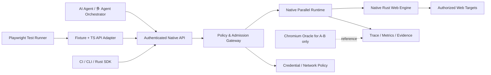

`WEB` 是外部不可信世界；Agent/CI 是机器调用方；Chromium Oracle 不承载 Native 的兼容性声明。开发者仍可运行 CLI/查看审计，但无普通消费者浏览器 UI。

### 1.2 核心端到端任务

1. 客户端以身份凭据及声明目的提交 Task / DAG；Policy Gate 验证 tenant、origin、动作、预算和高风险审批。
2. Scheduler 检查 DAG、资源配额、租约与公平性，再按 admission/queue/reject 派发 Execution Context。
3. Context Manager 创建或获得**经过清洗**的租户专用 Context，分配 Site/Realm 保护域。
4. Web Runtime 以受支持 Web 语义执行导航、HTML/DOM、JS 微任务、CSS/Layout；按语义/视觉需求启用计算。
5. Agent 只读查询取得带 generation/epoch/version 的不可变 Snapshot；写 Action 经权限/版本/公平仲裁并入 Realm 事件队列。
6. 结果形成 `task_state` 与独立 `effects_state`，含 error、trace、capabilities 和受策略限制的证据。
7. Worker/Context 最终清理，审计保留最少必要元信息；敏感网页和截图不默认持久化。

### 1.3 时间及执行边界

- Task 不等于 Page；一个 Task 可组合多个节点、上下文或授权页面；页面脚本自身的执行顺序不由 DAG 任意拆分。**Task 标注 read_only 仅表示调用方意图，不证明导航/脚本不会向服务端写入；网络副作用必须独立识别和阻断/授权。**
- Agent 多读可并行，DOM/JS 有序写不得绕过 Web Agent/Event Loop 的任务、微任务及同步脚本语义；多个 Realm 可能共享一个 Event Loop，Worker 可拥有不同的 Event Loop。
- Context 数据隔离不是服务器测试账号隔离；Playwright 测试还须分配独立测试账号、数据库命名空间/Fixture。
- Semantic snapshot 是在运行时安全点取得的逻辑只读投影，不是“冻结现实网站”，也不保证跨站全局原子快照。

## 2. 总体技术架构与执行域

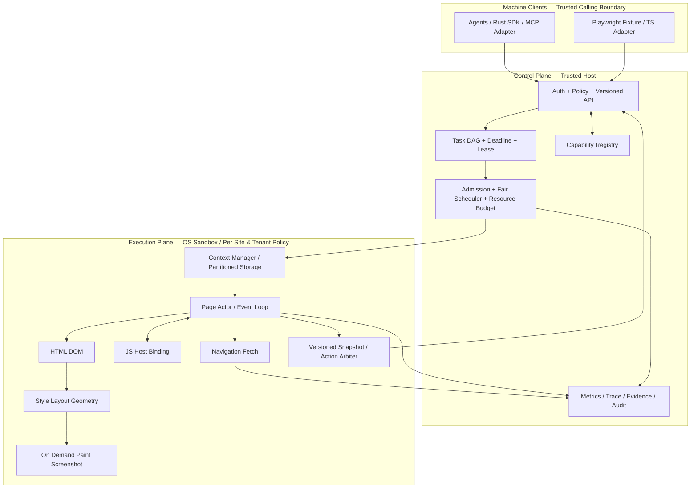

**四种分离**：① 控制面/执行面信任隔离；② Native engine/Chromium 对照隔离；③ 语义/布局/绘制依赖分离；④ 客户端 bridge/内核能力分离。Native 引擎含自主 Host、DOM 所有权、页面 Actor、操作仲裁和任务/资源机制；组件可经 crate 接口复用，不以“重写全部标准库”为自研条件。

### 2.1 实体、执行线程与进程的关系

| 单位 | 作用 | 并行策略 | 隔离与保证 |
|---|---|---|---|
| TaskNode | DAG 调度单位 | 独立可就绪节点可并发 | 继承 Task 权限、预算和效果等级 |
| Context | Cookies/Storage/凭证/权限私有集合 | 多 Context 并发 | 不天然对应 OS 进程；禁止跨租户数据残留 |
| Page | 同一文档及导航状态 | 不同 Page 可并行 | 导航强制代际更新，动作前置条件失效 |
| Web Agent / event loop | JS/DOM 时序保证 | **按规范所需 Agent/Event Loop 拥有任务队列**；Realm 映射至其 Agent | 不允许随意跨 Agent 并发修改 live DOM；可同步互访的 Window 必须遵守同一时序 |
| Read-only Snapshot | 可共享只读语义投影 | 同代际内多 Agent 并行读取 | TTL + generation/version，不能被写入 |
| OS sandbox process | 承载不可信网页脚本 | 按 Site/风险拆分 | 安全边界不可因高密度优化合并成无隔离 |
| Network/Font/cache pool | 可复用基础设施 | 安全分区后共享 | 禁止跨租户身份敏感缓存泄漏 |

### 2.2 推荐技术候选（**不是冻结选型**）

| 能力 | 候选方式 | 采用前必须证明 |
|---|---|---|
| 异步执行/资源管理 | Rust async runtime / Actor pattern | 取消传播、deadline、公平性、压力下可观测 |
| HTML 解析 | 成熟 Rust HTML5 parser adapter（如 html5ever） | DOM 节点语义、规范回归、许可证及维护性 |
| JavaScript | Rust 可嵌入引擎候选（如 Boa） | ES/Promise/Host binding correctness、Realm 隔离、性能 |
| CSS/Layout | 可替换 Style/Layout adapter（Stylo 等候选） | selector/style/geometry 正确性、线程语义、许可 |
| 绘制 | 可替换 CPU/GPU render adapter | 一致 screenshot、GPU 丢失/内存限制、无画面优化 |
| 对外协议 | R0-R2 暂定 HTTP/JSON + SSE，Rust SDK 使用同一语义 | 资源背压、事件 Gap、远程失败、版本兼容 |
| 数据持久化 | 任务/审计独立 metadata store，artifact 可配置对象存储 | 最小权限、TTL、加密与删除可验证 |

不应在基本设计阶段认定某个 crates 自动提供成熟浏览器能力。`FR-022/023` 的宿主 Web API 和事件循环依然是自研集成难点。

## 3. 模块分解与 Rust Crate 责任

> **依赖方向改为从外向内**：`api/bridge → application(runtime/scheduler/policy) → ports(types/traits) ← engine adapters`；`types/ports` 不得反向依赖实现 crate。前版箭头容易误导实现为 DOM 依赖上层接口。不得由 DOM 内核反向依赖 Playwright TS 适配层；所有跨保护域调用使用可审计的 IPC。以下 crate 名为推荐逻辑边界，具体 workspace 拆分可在详细设计优化，但 ID 与职责必须保持可追踪。

| Crate | 主要职责 | 依赖输入 | 对外消费者 | 代表契约 | 阶段 |
| --- | --- | --- | --- | --- | --- |
| aiweb-types | 类型/标识/契约 | 所有 crate | 无外部依赖服务 | TaskId/ContextId/Generation/EffectState | R0 |
| aiweb-task-graph | DAG 与作业所有权 | types | scheduler | TaskGraph, node leases | R0 |
| aiweb-scheduler | 配额/公平/背压 | task-graph, resource | runtime supervisor | AdmissionDecision, DispatchLease | R0 |
| aiweb-api | 鉴权后任务/API | types, policy | SDK/CLI/Agent | Versioned request/response | R0 |
| aiweb-resource | 资源预算与计量 | types | scheduler, observability | UsageReport, BudgetDecision | R0 |
| aiweb-context | Context 安全生命周期 | types, resource | page, storage | ContextHandle, ContextGeneration | R1 |
| aiweb-page | Web Agent/Event Loop 协调 + Page Actor | context, dom, js-host | snapshots/actions | AgentLoopId, PageGeneration, DocumentEpoch | R1 |
| aiweb-dom | HTML、DOM 与节点 identity | html parser adapter | page, semantics | DomTree, NodeKey | R1 |
| aiweb-js-host | JS host binding 与事件 | JS adapter | page, network | RealmRuntime, EventBridge | R1 |
| aiweb-net | 导航、HTTP(S)、Fetch | network policy | page, storage | NavigationResult, ResourceResponse | R1 |
| aiweb-sandbox | 权限/OS 执行域 | policy, supervisor | untrusted execution | SandboxProfile, PolicyResult | R1 |
| aiweb-policy | API 身份绑定和初始权限策略 R0；Web 网络策略 R1 | types | api, network, sandbox | AuthenticatedPrincipal, AuthorizationDecision | R0-R1 |
| aiweb-storage | 分区 Cookies/Storage/Cache | context, policy | network, js-host | PartitionKey, StorageHandle | R1 |
| aiweb-snapshot | 不可变语义投影与 Diff | page, semantics | api, actions | SnapshotToken, DiffCursor | R2 |
| aiweb-action | 写入仲裁与副作用账本 | page, policy | api | ActionReceipt, EffectRecord | R2 |
| aiweb-semantics | DOM/ARIA 语义树 | dom, layout adapter | agent api | SemanticTree, LocatorRef | R2 |
| aiweb-layout | Style/Layout/Geometry 接口 | DOM, CSS adapter | page, render | LayoutSnapshot, Geometry | R2 |
| aiweb-render | 按需 paint/raster/screenshot | layout, GPU/CPU adapter | api, artifacts | RenderReceipt, Screenshot | R2 |
| aiweb-bridge-ts | Playwright fixture/API 子集 | api protocol | Playwright Test | supported API subset | R2 |
| aiweb-observe | R0 最小 metrics/trace；R2 事件、证据和数据保护增强 | types, resources | admin, CI | EventEnvelope, TraceId | R0-R2 |
| aiweb-capability | backend/version capability registry | types | API / Bridge | CapabilityManifest | R1-R2 |
| aiweb-distributed | Worker 注册与租约 | scheduler, policy | remote orchestrator | WorkerLease, CapacityReport | R3 |
| aiweb-agent-loop | Web Agent/事件循环/任务源协调，不等同 Realm | page, js-host | page, snapshot, action | AgentLoopId, TaskSource, MicrotaskCheckpoint | R1 |
| aiweb-state-vector | 页面复合状态版本与依赖追踪 | page, DOM, style, navigation | snapshots, actions | VersionVector, StateDependencySet | R2 |
| aiweb-locator | 动态解析、actionability、等待和副作用边界 | semantics, layout, action | agent API, TS bridge | LocatorPlan, ActionabilityReceipt | R2 |
| aiweb-effects | 网络/DOM 动作级效果账本与对账 | network, action, policy | task, audit, API | EffectRecord, ReconcileStatus | R1-R2 |
| aiweb-egress | 防 SSRF、身份网络外发、响应分类与审计 | network, policy, sandbox | fetch, document loader | NetworkDecision, DestinationProof | R1 |


### 3.1 模块接口的硬约束

- `aiweb-page` 为 Page 状态所有者；`aiweb-agent-loop` 负责规范层 Agent/Event Loop 顺序和多 Realm 的时序关系。`aiweb-action` 不能向外泄露可变 DOM 指针。
- `aiweb-scheduler` 能分派 Task/Context，但不能绕过 `aiweb-policy`；每次网络访问仍由 `aiweb-net` 执行最小授权。
- `aiweb-snapshot` 只存逻辑投影和版本，不持有跨线程长期活动 DOM 引用；TTL 过期返回结构化失效。
- `aiweb-js-host` 在受限进程内部执行。同步死循环不得依赖单纯的 Tokio timeout 解决；使用沙箱进程级 CPU/内存/时间硬限额以及 watchdog kill，并记录不确定外部效果。
- `aiweb-render` 是按需路径；调用 screenshot 时必须保证布局/paint 是正确、同一 document epoch 的结果。
- `aiweb-observe` 不允许直接汇出凭证、Cookie 和非脱敏文本；按 policy 对 evidence 分类。
- `aiweb-bridge-ts` 保持自有协议的翻译层属性；它的 TS 类型可能与 Playwright 相似，但不可冒充原版 `Browser` 类型全功能兼容。

## 4. 原生并行方式设计（核心差异化）

### 4.1 Task Graph 与 Admission

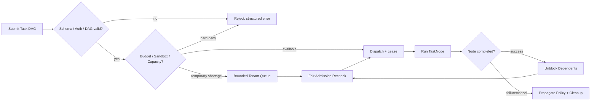

输入为 `TaskSpec`（ID、parent、priority、deadline、resource budget、origin/action policy、effect_class），输出 `AdmissionDecision = admitted | queued | rejected` + 具体 reason。Task DAG 验证包括自环、重复边、跨租户引用、依赖节点不存在、循环及 deadline 冲突。DAG 节点按就绪条件才可运行，不抢跑依赖中尚有副作用的节点。

### 4.2 调度策略（R0 可实现、R3 强化）

1. **两级入场**：全局硬上限（宿主进程树预算）+ 每租户/Agent/Task/Context 子预算；不可满足者拒绝或有界排队。
2. **公平权重**：建议采用分租户加权公平队列/Deficit Round Robin；长任务需要时间片或等待上界监控，但不能任意中断网页脚本破坏时序。
3. **工作负载分类**：semantic、interactive、visual、mixed；分类只调整队列和资源估算，不改变 Web 行为。
4. **弹性分配**：优先复用冷却后的安全资源；Context 私有状态不能跨租户残留；JS Realm 故障不引发全局自动重试。
5. **反馈与诊断**：记录 queue_age_ms、rejection_reason、estimated/actual cost、tenant fairness 和 P99 wait；支持调优而非硬编码“最大 100 并发”。
6. **资源分摊**：可单独归因的私有成本直接计 Task/Context；shared fixed pool 按可解释的时间或请求占比分摊，报表同时展示 unallocated overhead，避免让共享资源从账单上消失。

**容量设计约束**：`Σreserved_memory + reserved_runtime_overhead ≤ memory_admission_cap` 是**入场估算条件**，不是物理内存永不超限的证明；RSS 峰值、shared/file-backed 账本和 cgroup memory.current 等采用独立监测口径，避免因共享页重复求和产生误判。CPU 时间配额与 CPU 瞬时占用分别限额；cgroup OOM、超时与 kill 都纳入故障状态。实际资源突发由 OS 硬限制 + watchdog 防护，不能用预留预算冒充真实成本。R3 的公平时限须在负载与硬件冻结后确定，不在此处虚构绝对毫秒。

### 4.3 同 Page 多 Agent 多读/单写

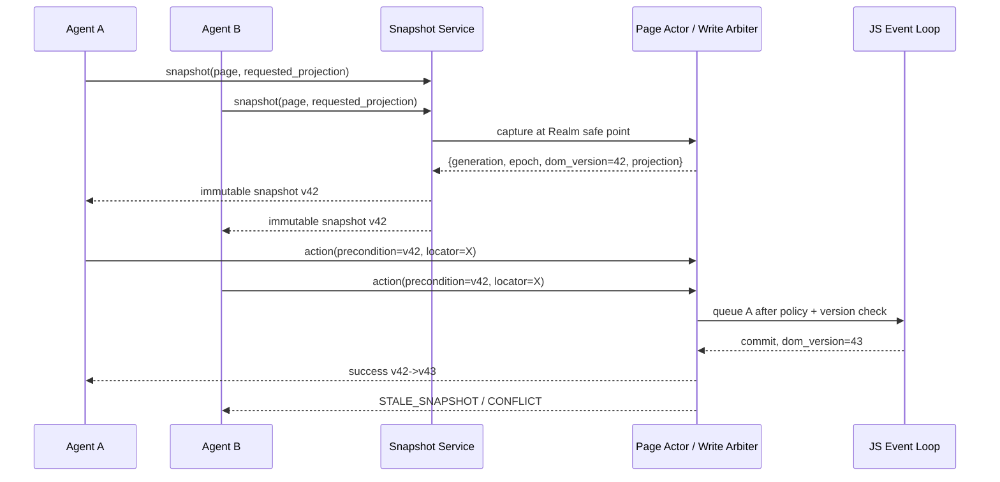

**最低身份四元组**：`context_generation`（租用/重建）、`page_generation`（Page 实例）、`document_epoch`（跨文档替换）、`dom_version`（DOM 修订）。**此四元组不能单独担保点击正确性**：额外需要 `navigation_revision`、`focus_scroll_revision`、`style_layout_revision`、`target_state_digest`、`policy_revision` 等按动作依赖选取的条件。新导航/重建都使旧 Locator/Action 前置条件无效；相同 DOM 版本下也需检查元素身份与影响范围，避免错点新节点。

**Web 时序规则**：JS 微任务 checkpoint、DOMContentLoaded、MutationObserver、事件派发等以受支持标准子集为准；安全点只在不破坏该语义的位置采集快照。对无法提供一致投影的页面阶段，返回 `SNAPSHOT_UNAVAILABLE` 或等待，不得从不同版本拼装“看似一致”的快照。写队列遵守所属 Web Agent/Event Loop 的非重入规范顺序、租约超时、排队公平；高风险动作需授权 token 且再次检查执行前状态。**不承诺**数据库式跨站事务、实时 DOM 完全无锁读或外部 exactly-once。

### 4.4 DAG 取消、失败与重试

- Task cancel 传播到所有未终结子 TaskNode 和 Page/Context lease；对已发出的网络副作用只停止后续自动尝试，保留 `effects_state=uncertain`。
- 仅**网络和业务侧均被证明无外部副作用**的本地纯读可有限重试；导航/页面读取并非天然安全（页面加载可发出 POST、Beacon、WebSocket 等）。非幂等及效果未知操作默认 **zero automatic retry**，已发出但未确认的效果必须靠账本对账。
- 页面崩溃 → 标记 failure + 保存最少证据 → 回收所属 sandbox → 可复用的其它 Context 继续。
- 跨主机 Worker 失联不得根据“未收到 ACK”判定写操作未发生；需要对账/上层确认才能恢复业务动作。

## 5. Web 执行、布局与语义投影方式

| 阶段 | 执行路径 | 允许的优化 | 不允许省略的行为 |
|---|---|---|---|
| R1 语义基础 | Network → HTML parser → DOM → JS Host/Event → 基础 DOM 查询 | 受控页面无需创建 GPU surface | 正确 TLS、DOM、脚本与事件顺序；R2 才承诺完整 ARIA 语义投影 |
| R2 样式几何 | DOM → Style → Layout → geometry | 对不涉及视觉的查询不主动 paint | `getBoundingClientRect`/可见性 API 所需真实 layout |
| R2 绘制 | Layout → paint/raster → screenshot | 无截图请求可减少 raster/compositing | 视口、字体、deviceScale、资源加载、颜色/像素正确 |
| R3 密度优化 | 安全分区只读共享/按需渲染 | 复用确定性字体/只读 parse 结果 | Context/Origin/Site 身份与隐私隔离 |
| R4 扩展 | Frame/Worker/更多 CSS/Web API | 分模块优化和渐进能力开关 | 支持与不支持项均真实公开 |

### 5.1 Native 与浏览器兼容性的关系

- `engine_id=aiweb-native` 必须表示实际 Rust 执行闭环，不允许内部默认转给 Chromium 后端。
- `engine_id=chromium-oracle` 只能在 benchmark/reference/明确请求的过渡路径出现，响应中保留 `backend` 字段。
- 对 Web API 采用 `capability_id + support_level + spec_ref + tested_manifest`；JS 运行时没有实现的 Web API 不应使用静态假结果蒙混。
- WPT 的`candidate/pass/fail/skip/unsupported` 与独立 holdout 基准必须分别披露，覆盖率不可用“已支持子集 100%”替代。

### 5.2 Page 生命周期

`created → navigating → committed → dom_content_loaded → load_observed → active → closing → closed` 是对外可观测逻辑阶段；现代 SPA 可以在 active 阶段继续网络和 DOM 变化。事件报告不宣称 `networkidle` 意味着语义稳定，也不假设 `load` 后页面静止。Document 替换引起 `document_epoch` 改变；同文档 SPA History API 更新 **navigation_revision** 而不强制递增 `document_epoch`；同一文档但策略、目标、样式或可交互状态改变，仍须重新验证受影响动作，不得沿用旧快照的安全结论。

## 6. 逻辑数据模型与状态管理

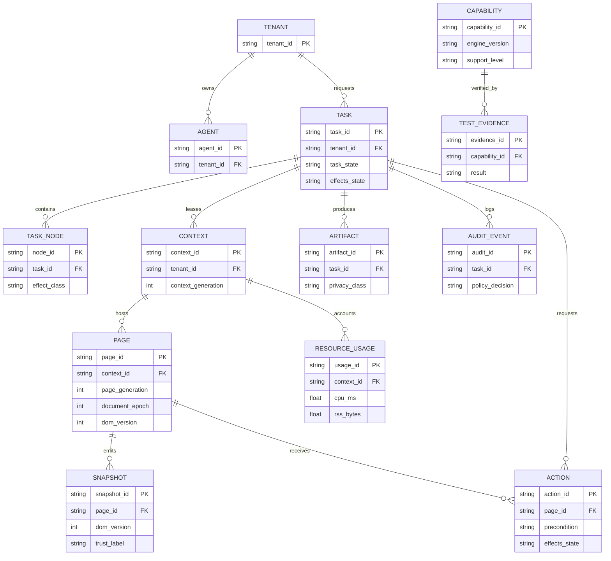

这张 ER 是**逻辑关系**，不是承诺采用关系型数据库、也不是将活动 DOM 全部持久化。存储分三级：**热态**（Page/DOM/Realm/队列）在受限进程内；**元信息**（Task 结果、租约、配额、Trace 索引、Capability）可以持久化；**敏感证据**（截图、网页文本/文件）默认禁存，按授权/TTL 单独落库。

### 6.1 状态与代际

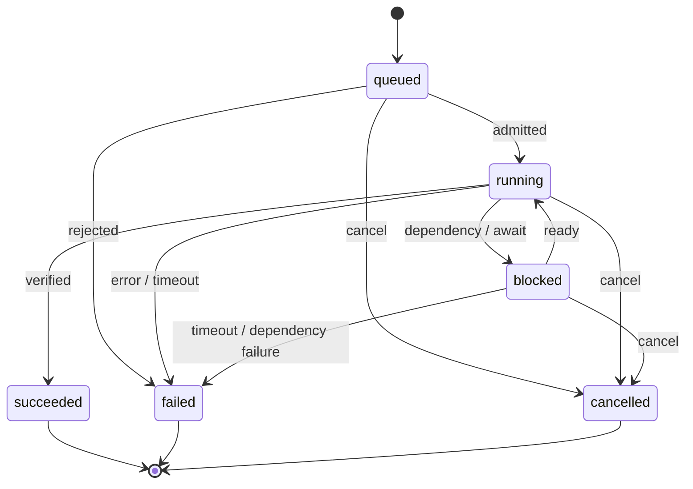

`effects_state = none | confirmed | uncertain` 是**兼容上游的聚合展示字段**，**不能代替逐动作 EffectRecord 账本**：若任何行动效果未知则聚合为 uncertain；其余已有确认效果则 confirmed；均无外部效果记录为 none。例如 `Task=failed` 且 `effects_state=uncertain` 是合法组合。`ActionReceipt` 要包含 `effect_class`、审批/授权 ID、提交点（若可判定）、是否安全重试 `retry_safe`。如果服务端在 POST 已送出后连接断开，不能因为没有回执就重试。动作必须有稳定 `action_id/idempotency_key`、状态查询和恢复查询接口；如果账本也无法确认，保持 uncertain。

### 6.2 保存、主键与保留

| 类型 | 主键/版本 | 保留/索引建议 | 访问规则 |
|---|---|---|---|
| Task/Node | task_id/node_id + lifecycle revision | 保留状态元数据、依赖和结果，不默认证据正文 | owner tenant + assigned Agent |
| Context/Page | id + generation/epoch | 热态；租约撤销后回收、注销对象 ID | 租户/上下文级隔离 |
| Snapshot | snapshot_id + `{context_gen,page_gen,document_epoch,dom_version}` | 有界缓存/TTL，默认不写盘 | 对已授权的只读 Agent |
| Action | action_id + idempotency_key + effect class | 操作审计、审批引用和 effect_state | 严格动作/域名权限 |
| Capability | engine/backend/version + feature ID | 每 release 签名 manifest | 允许公开基本支持信息 |
| Evidence | artifact_id + classification + TTL | 默认禁存敏感正文，引用签名短期化 | 审计式访问和脱敏 |

实际 TTL 秒数、密钥轮换周期、日志保存天数仍待隐私与运维策略冻结；不得在本阶段硬编码并假称满足监管要求。

## 7. 外部接口基本设计

### 7.1 推荐协议结构

R0-R2 暂定：**HTTP/JSON v1 Control API + Server-Sent Events（事件）+ Rust SDK 同语义封装**。大结果/截图通过授权 artifact 引用获取，不在高频查询中传任意二进制。SSE 单方向足够传事件；双向调试场景再评估 WebSocket/gRPC，不提前增加多套不一致协议。

- 鉴权：`tenant_id`、`agent_id`、角色、scope 必须由服务端验证后的凭据/连接上下文派生；客户端 JSON 中的 identity 只能是审计提示且需与已鉴权主体一致，不得成为授权依据。本地 Rust SDK 不得绕开。
- 幂等：任务/动作接收端必须以 `(authenticated_tenant, request_kind, idempotency_key)` 建立持久化去重与请求摘要校验；相同键不同 payload 返回 `IDEMPOTENCY_KEY_REUSE`。接受一次不等于 Web 副作用 exactly-once。
- 版本：`api_version=aiweb/v1`、`engine_version`、`protocol_version`；不兼容变更必须协商。
- 错误：统一 `{code, message, stage, trace_id, retry_safe, effects_state, details}`；禁用未实现功能时返回 `UNSUPPORTED_FEATURE`。
- 事件：`{stream_id, seq, timestamp, task_id, context_id, page_id, event, version, trace_id}`；按租户/流授权、每流有序，跨流不承诺全序。游标应绑定 stream、schema version、tenant 和保留窗口；Gap 触发全量重同步。SSE 支持 Last-Event-ID（或等价显式 cursor），不得跨租户重放。

### 7.2 端点清单（推荐草案）

| Method | 路径 | 所需权限 | 阶段 | 请求 | 响应/错误 | 设计 ID | 行为 |
| --- | --- | --- | --- | --- | --- | --- | --- |
| POST | /v1/tasks | submit | R0 | TaskSpec | 202 TaskReceipt / 4xx | BD-IF-01 | 建任务、验证 DAG 与预算；不等待网页结束 |
| GET | /v1/tasks/{task_id} | read | R0 | task_id | 200 TaskResult / 404 | BD-IF-01 | 状态与 effects_state 并列 |
| POST | /v1/tasks/{task_id}:cancel | cancel | R0 | CancelRequest | 202 CancelReceipt | BD-IF-01 | 传播取消；外部副作用未知仍 uncertain |
| POST | /v1/contexts | create | R1 | ContextCreate | 201 ContextLease | BD-IF-01 | 权限、origin、存储分区、配额显式绑定 |
| DELETE | /v1/contexts/{context_id} | destroy | R1 | context_id + generation | 202 DestroyReceipt | BD-IF-01 | 撤销租约、清理私有数据；异步证据可查 |
| POST | /v1/contexts/{context_id}/pages | navigate | R1-R2 | PageCreate/NavSpec | 201 PageHandle | BD-IF-01 | 返回 page_generation/document_epoch |
| POST | /v1/pages/{page_id}/snapshots | inspect | R2 | SnapshotQuery | 200 SnapshotEnvelope | BD-IF-01 | 按安全点获取不可变投影；返回 version/coverage |
| POST | /v1/pages/{page_id}/actions | mutate | R2 | ActionCommand + Precondition + idempotency_key | 202 ActionReceipt / 409 | BD-IF-01 | 排队到 Web Agent；写操作入效果账本，不保证最终完成 |
| GET | /v1/events?cursor= | subscribe | R2 | EventCursor | 200 stream / GAP | BD-IF-02 | 每流单调 seq，断线恢复与 backlog 上界 |
| GET | /v1/capabilities | capabilities | R1-R2 | client_version/feature | 200 CapabilityManifest | BD-IF-09 | 显式 backend、支持等级、理由、protocol version |
| GET | /v1/traces/{trace_id} | evidence.read | R2 | trace_id | 200 Meta/ArtifactRefs | BD-IF-06 | 访问前审计与保留策略校验 |
| POST | /v1/test-runs | test-run | R2 | TestRunPlan + data_namespace | 202 TestRunReceipt | BD-IF-06 | 分配独立服务端测试资源；输出分片关联 |
| GET | /metrics | metrics.read | R0-R2 | Admin credentials | 200 OpenMetrics | BD-IF-08 | 仅管理网或受权访问，无敏感标签 |
| POST | /v1/pages/{page_id}:navigate | navigate | R2 | NavigationSpec + page_generation | 202 NavigationReceipt | BD-IF-11 | 后续导航与建页区分；返回 navigation_id 和阶段游标 |
| GET | /v1/actions/{action_id} | action.read | R2 | action_id + tenant session | 200 ActionStatus | BD-IF-10 | 对账 action accepted/executing/confirmed/uncertain/failed；无跨租户读取 |
| GET | /v1/actions:by-idempotency-key | action.read | R2 | request_kind + idempotency_key | 200 ActionStatus 或 404 | BD-IF-10 | 断线/未知回执后先查询，不重发可能生效操作 |
| GET | /v1/events/snapshot | subscribe | R2 | stream_id + authorized cursor | 200 AuthorizedRecoverySnapshot | BD-IF-11 | EVENT_GAP 后使用全量授权状态重同步 |


### 7.3 Schema 草案（可供详细设计展开）

```yaml
api_version: aiweb/v1
request_id: req-001
identity:
  tenant_id: tenant-a  # 身份声明提示；必须与已鉴权 Principal 一致
  agent_id: agent-reader-01  # 不得用于直接决定授权
backend: aiweb-native  # 禁止缺省静默落到 Chromium
task:
  task_id: task-001
  effect_class: read_only
  priority: normal
  deadline_ms: 30000
  resource_budget:
    cpu_ms: 5000
    max_rss_bytes: 268435456
    network_bytes: 10485760
    artifacts_bytes: 0
  permissions:
    allowed_origins: ["https://example.org"]
    actions: ["navigate", "snapshot"]
  operation:
    kind: snapshot
    target:
      url: "https://example.org"
    projection: semantic
    consistency: snapshot_at_boundary
```

```yaml
api_version: aiweb/v1
request_id: req-001
engine_id: aiweb-native
backend: native-rust
engine_version: "0.1.0-dev"
protocol_version: "1"
task_id: task-001
task_state: succeeded
effects_state: none
context_id: ctx-001
context_generation: 1
page_id: page-001
page_generation: 1
document_epoch: 2
dom_version: 42
result:
  snapshot_id: snap-42
  projection: semantic
  consistency: snapshot_at_boundary
  trust_label: untrusted_web_content
  coverage: ["dom_text", "semantic_role"]
  data: {role: main, name: "Example"}
trace_id: trace-001
capabilities_used: ["dom.query.v1", "semantic.snapshot.v1"]
errors: []
```

**写入前置条件：** `ActionCommand` 绑定 `context_generation/page_generation/document_epoch`、动作依赖版本、动态 Locator 规则及可选 `element_identity`、`policy_revision`、`action_kind`、`effect_class`、`approval_ref`（高风险）和 `idempotency_key`。严格快照 CAS 与动态 Locator 重定位是**不同模式**：前者版本不符则失败；后者仅在同一 Document、动作前未触发副作用时可重新定位并执行 actionability 检查。不得通过猜测坐标自动继续，也不得在可能已提交效果后重试。

### 7.4 核心错误码与重试策略

| 错误码 | 对外含义 | 自动重试 |
|---|---|---|
| INVALID_REQUEST / PERMISSION_DENIED | 非法结构/无权限 | 否 |
| POLICY_VIOLATION / SANDBOX_FAILURE | 网络/动作/执行域防护 | 否（需审核） |
| UNSUPPORTED_FEATURE | 当前 backend 不支持 | 否（变更任务计划） |
| STALE_SNAPSHOT / CONFLICT | 代际、版本或写入冲突 | 重新只读快照后可重估；不能重放副作用 |
| RESOURCE_EXHAUSTED / TIMEOUT | 资源或时限达上限 | 仅确定性纯读取且 policy 允许 |
| EFFECT_UNCERTAIN | 外部副作用可能发生但无确认 | **绝不自动重试；先查询 ActionStatus，再业务对账** |
| NAVIGATION_FAILED / INTERNAL_ERROR | 导航或内核异常 | 按 effect_class、页面状态决定 |
| SNAPSHOT_UNAVAILABLE | 当前无法在合法安全点获取一致投影（新增设计错误码） | 等待/重新获取（只读） |
| EVENT_GAP | 订阅游标不能连续恢复（新增设计错误码） | 重新鉴权后取授权全量 Snapshot 并重同步 |
| IDEMPOTENCY_KEY_REUSE | 同一租户同一种请求以相同键提交不同摘要 | 否；人工检查调用方错误 |

新增的两个设计错误码不修改上游最小错误集合，属于向后兼容扩充；若需修改统一错误契约应在详细设计走 ADR。

## 8. Playwright 集成与并行测试设计

**兼容分三级，绝不混称**：

1. **L1 — Playwright Test fixture 适配（R2 Must）**：在测试工程中显式导入本项目 `test/expect` 适配，对接 Rust Native API，运行已声明子集；不假装替换 Playwright 内部 `page`。
2. **L2 — Playwright 风格 TS API 子集（R2 Must）**：保留 `goto/locator/click/fill/wait/assert` 等类语义；每个方法的等待、错误、selector 和 screenshot 覆盖都由独立 conformance 验证。
3. **L3 — 真正的原版 Playwright 浏览器驱动连接（R4+ 研究）**：不在本期承诺；`connectOverCDP()` 官方针对 Chromium-based，部分 CDP 模仿不能证明 Native drop-in。BiDi 是可独立探索的标准协议，不等价于 L3。

### 8.1 R2 支持矩阵草案

计划支持的 TS 子集：`navigate`、CSS/role 定位（限支持清单）、`click`、`fill`、`select`、明确等待、少量断言、基础 network events、按需截图。**Locator 定义为延迟解析策略，不是元素指针**：支持严格度、超时、自动等待、可见/稳定/接收事件/可编辑检查，且在首次可能产生副作用前才可重解析重试；与严格 Snapshot Action 模式单独验收。Frames/ServiceWorkers/复杂 route interception、浏览器扩展等未进入 R2 Must 时应报告 unsupported。**已规划**不等于已经实现；每项必须记录 Playwright npm/runner 版本、native release、测试数量和失败原因。

### 8.2 并行 Runner 流程

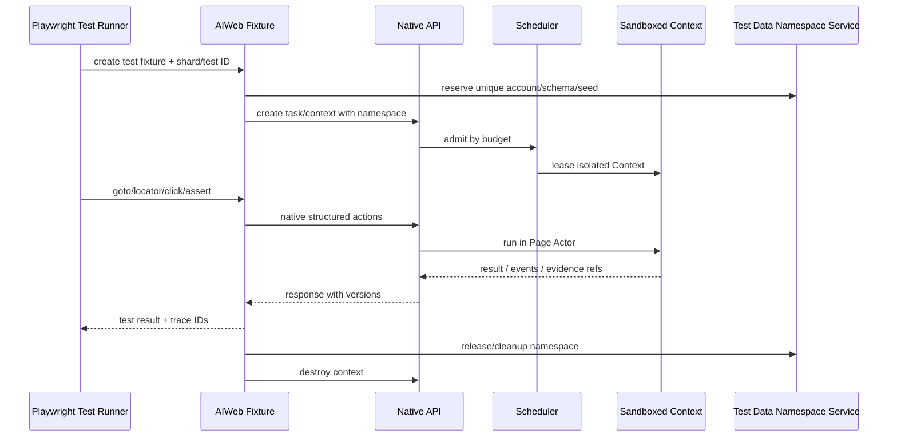

Playwright 的 BrowserContext 隔离只覆盖浏览器侧，不能防止两组测试同时修改相同服务器账户或数据库记录。**命名空间资源服务必须提供真实外部系统的数据隔离和清理确认**；仅生成 `namespace_id` 字符串不等于数据库/账号被隔离。故 `test_run_id / shard_id / test_id / namespace_id` 为测试运行契约中的必要关系键，清理失败必须显式失败并出具诊断。

### 8.3 Playwright Adapter 使用草案（不是已发布 API）

```ts
// @aiweb/playwright-fixture 是拟设计的内部包名，尚未发布。
import { test, expect } from '@aiweb/playwright-fixture';

test('basic form', async ({ aiwebPage, namespace }) => {
  await aiwebPage.goto(namespace.baseUrl);
  await aiwebPage.getByRole('textbox', { name: 'Account' }).fill(namespace.user);
  await aiwebPage.getByRole('button', { name: 'Submit' }).click();
  await expect(aiwebPage.getByText('Saved')).toBeVisible();
});
```

`aiwebPage` 特意使用不同名字而非直接声称实现 Playwright 官方 `Page` 全部接口，以免造成 drop-in 兼容误解。真实 API 类型、异步等待/断言的 semantics 在详细设计冻结后生成。

## 9. 安全、信任与隐私方式

### 9.1 信任域和执行保护

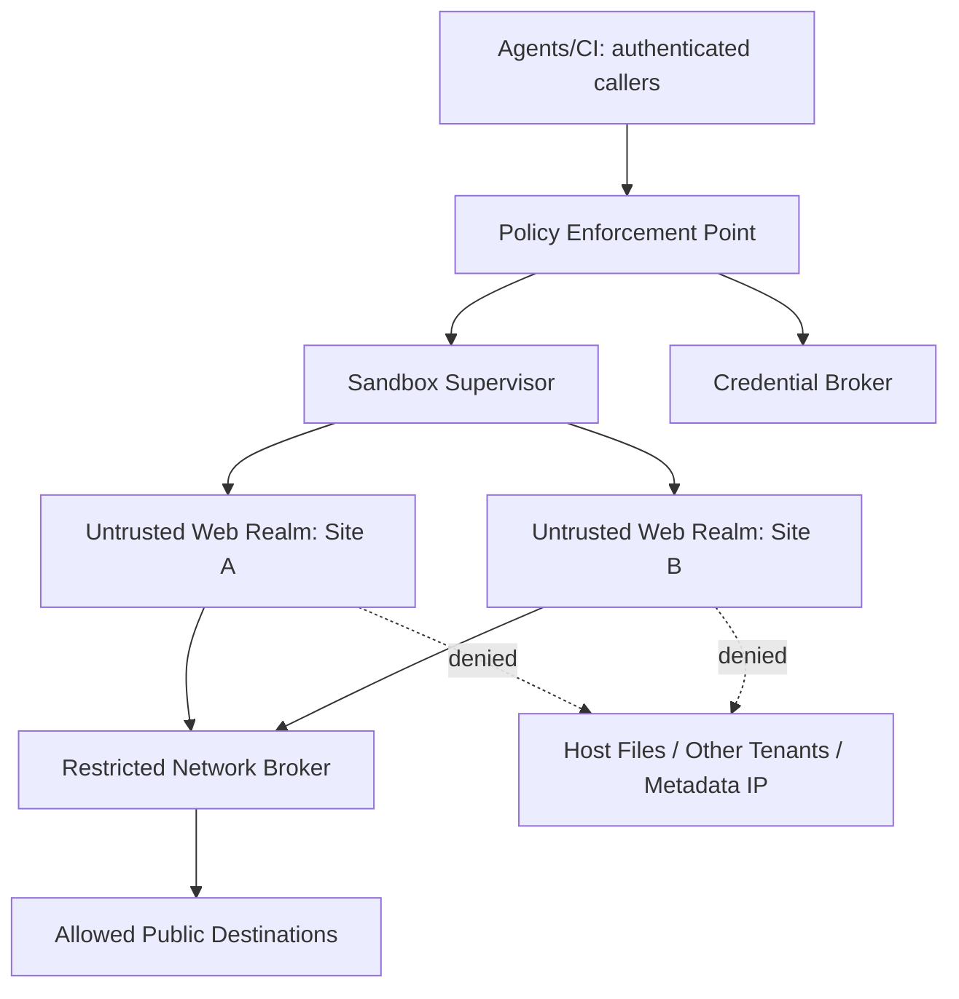

- 公网不可信页面执行仅在 Linux OS 进程沙箱通过出关后启用；未通过则 URL allowlist 仅受控 fixtures，不可依赖“Rust 不会内存越界”替代进程隔离。
- Site/Origin/Same-Origin、CORS、CSP 是 Web 安全语义；对于尚未实现的必要保护功能，应拒绝场景而非偷偷放松。网络 Broker 还必须对返回至 renderer 的跨源响应实施来源分区和可见性限制，不能只做请求地址 ACL。
- 网络在 DNS 解析、连接、每次 HTTP redirect、WebSocket 升级、代理转发、下载上传阶段重新核验目的地；私网、loopback、link-local、云元数据地址默认禁止。防 DNS rebinding/Alt-Svc/代理穿透必须对**实际连接地址**二次验证，权限不从页面 JS 的请求声明继承。
- 禁止跨租户共享活动脚本进程、凭证、存储、身份敏感缓存。Context pool **首先仅允许同租户、相同安全域的空白会话复用**；跨租户只可复用经过验证的无状态基础设施，不能把一个 Context “清空”当作可直接跨租户分配的充分证明。

### 9.2 Agent 不可信页面内容

`DOM_TEXT`、`ARIA_NAME`、`WEB_RESPONSE`、`TOOL_RESULT` 均为 `untrusted_web_content`；不得被解释为宿主系统指令、权限升级要求或策略变更。Agent 只能将其作为数据读取；任何 Action 再经过独立授权、域名、风险等级和审批检查。高风险动作的授权 token 必须绑定 tenant、agent、URL/origin、动作类型、目标摘要和到期，且不能由网页内 JS 直接铸造。

### 9.3 凭证/证据策略

凭证代理提供最小必要且短期有效的会话材料；原始密钥不得进入普通事件流和日志。审计保存 Agent、Task、origin、操作类型、授权决策和 trace，不默认证据文本。截图/DOM 导出是敏感 artifact，默认不持久化；当策略允许时需加密、访问审计、有限保留及安全删除。日志采样、压缩和标签系统不应把 URL query token/PII 变成高基数指标标签。

### 9.4 失败即关闭

遭遇沙箱配置失败、Origin 隔离缺失、Policy Gate 不可用、未知 capability 安全含义、凭证代理故障时，拒绝相关任务或降级到**明确显示且已授权的受控能力**，不能自动切换为更宽松或 Chromium backend 后报告成功。R1 发布前仍需独立安全专家审查/真实渗透测试。

## 10. 非功能质量设计与实验口径

### 10.1 上游验收门槛原样继承

| 指标 | 阶段 | 门槛 | 设计证据 |
|---|---|---|---|
| WPT 支持子集 | R1 | 冻结 HTML/DOM/JS/事件各≥1套件；支持子集通过率≥95%，披露候选分母与留出集 | manifest + WPT report |
| 可比任务成功率 | R2 | 语义/表单/视觉/混合各≥1类，完整任务成功率≥98%（skip/timeout计失败） | task oracle × ≥3轮 |
| 语义查询延迟 | R2 | 选定轻量任务 P95 ≤500ms（不含网络等待） | queue vs execution tracing |
| 稳定性 | R2 | 8/16/32 并发持续 60min，非预期 runtime 崩溃=0 | pressure/fault injection |
| 隔离与回收 | R1-R2 | 跨租户/Context/Origin 测试泄露 0；1000 次 Context 释放/复用无泄露 | SEC + GC/memory profile |
| Playwright Bridge | R2 | 每项“已支持”API 用例通过率≥98%，同时报告接口覆盖度 | fixture conformance |
| 有效吞吐 | R3 | 16/32 Context 至少一档达到 Chromium ≥1.20× | A-E 对等 A/B |
| 资源效率 | R3 | 优势档位 CPU·s/有效任务或峰值 RSS 至少一项改善≥15%，另一项恶化≤10% | 整个进程树归因 |
| 统计可信度 | R3 | 随机顺序 A/B ≥5轮，95% CI + 全部失败+样本数 | 原始 run manifests |
| Agent 成本 | R3 | 固定模型/tokenizer/Prompt/准确率，端到端 tokens 和工具往返 | 账单和 tokenizer 重算 |

### 10.2 对照实验任务集

A 静态表格/正文提取；B 受控 SPA DOM 交互；C 多页面登录/表单；D 布局/截图；E 同页多 Agent 竞争；F 跨 Origin / Prompt Injection / SSRF 安全；G POST 超时、崩溃与副作用未知。**A–E** 是性能主样本，F/G 作为必须通过的可靠性/安全门槛。Chromium 对照 E 类通过等价上层多 Agent 仲裁服务实现，不能因为原生内核具备 Agent API 就让对照少做功能。

固定硬件、OS、沙箱等效威胁模型、站点 fixtures、浏览器/Playwright 版本、网络、任务哈希、timeout/retry、代理模型和负载；仅更换 backend/并发档位（1/8/16/32/64）。**先实施逐场景结果非劣性配对门槛再报告性能；不得仅凭双方成功率都超过 98% 就宣称等价。** 布局/截图的容差与非确定性区域必须预注册，不能事后调整。**有效吞吐 = 语义正确且成功的任务数 / 从首个任务入队到最后终结的墙钟秒数**。CPU 时间算全进程树；RSS 包含子进程/代理；unsupported/skip/timeout 计失败。R3 预注册并随机化至少 5 轮（必要时增加样本直到预先选定的统计精度达标），采用任务配对/区组随机、报告效应量及 95% CI、分任务类别和整体表现；不得只展示最优一档掩盖其它档。

### 10.3 指标与公式

| Metric | 单位/标签 | 口径 |
|---|---|---|
| `aiweb_tasks_total` | task_state、backend、workload | 包含失败/跳过/取消，不记录敏感 URL |
| `aiweb_valid_throughput` | good_tasks/s | 成功且 oracle 正确 / 全部墙钟秒 |
| `aiweb_task_latency_ms` | p50/p95 | 提交到终态，含等待 |
| `aiweb_query_latency_ms` | p95 | 纯语义 query，本身不含网络等待；队列分列 |
| `aiweb_contexts_active` | count | Context/租户/资源等级（租户标签需受控） |
| `aiweb_process_tree_rss_bytes` | bytes | 全部子进程/网络代理/渲染进程合计 |
| `aiweb_cpu_seconds_per_good_task` | seconds | 进程树 CPU 秒 / 成功且正确任务数 |
| `aiweb_queue_wait_ms` | p99 | 排队年龄与有界拒绝另报 |
| `aiweb_effect_uncertain_total` | count | 发生未知外部副作用的动作数量 |
| `aiweb_artifact_redactions_total` | count | 策略脱敏次数，不保存敏感原文 |

资源账单既给 Task 实际成本，也给 overhead 以避免重复分摊或漏记；生产监控与实验环境分开保存。

## 11. 运行、部署和维护基本设计

### 11.1 Linux 主部署

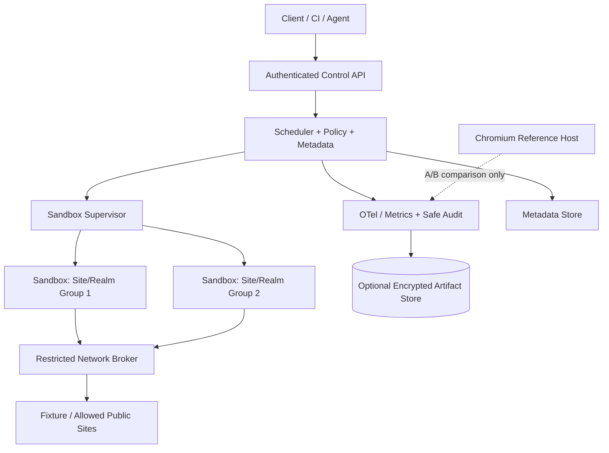

R1 Linux x86_64 非 root 运行；sandbox supervisor 负责低权限用户、文件系统、系统调用、网络命名空间/出口限制和进程树回收。需验证 Site Process Lock、Network Broker 的响应数据访问约束，避免隔离只在网络出站 ACL 上成立。具体 seccomp/user namespaces/容器组合需在目标发行版验证，不能仅因配置文件存在就声称隔离有效。Windows x86_64 只作为开发/功能验证目标；独立 Windows 沙箱安全门槛通过前禁止用于运行不可信网页。

### 11.2 分布式 R3 可选设计

调度控制面可接收 Worker 注册、心跳、容量指标和短期租约；Worker 以 `worker_id + generation + lease_epoch` 防止旧主重复执行，控制面只把**可安全重新派发**的纯读或上层已验证幂等作业迁移。多机器共享会话/Live DOM 不自动迁移；原生 Web 内核无跨机器透明迁移保证。与外部 Agent Orchestrator 保持 API 边界，不在内核引入对某一宿主项目的强依赖。

### 11.3 故障与运营手顺

- `OOM/resource_exhausted`：局部阻止新 admission；重收资源；未终结任务输出结构化失败；不得无限积压。
- `sandbox_violation`：停止受影响 capability/public URL 能力，事件保全和人工安全复核。
- `network_uncertain_effect`：上报 `effects_state=uncertain`，禁止自动重试，调用方提供业务对账记录。
- `snapshot_stale`：返回冲突，客户端重新查询最新快照；不隐式替换 locator。
- `capability_mismatch`：显式 UNSUPPORTED_FEATURE，报告 backend/版本；不默认调用 Chromium。
- 监控与审计：只保留必要元数据；开发 debug 不能绕开线上敏感数据规则。

## 12. 测试基本设计与上线判定

### 12.1 设计对应测试体系

- **UT**：Task DAG、状态机、预算、版本校验、DOM/JS 微任务单元。
- **IT**：API/Context/Page 生命周期、Agent 5读2写、跨导航旧引用、Playwright fixture、外部测试数据命名空间。
- **ST**：8/16/32 并发 60min、1000 次 Context 生命周期、OS crash fault injection、跨主机失联。
- **SEC**：Site/Origin、CORS/CSP、SSRF、沙箱、密钥残留、Prompt Injection、Agent 高风险审批。
- **PERF**：固定 A–E 工作负载，Chromium/Rust 随机化 A/B、16/32 重点档、CPU/RSS/Token 端到端统计。
- **DIFF/WPT**：固定 manifest、完整候选分母、独立 holdout、CSS Geometry 与 screenshot 差分。

### 12.2 计划测试清单（全部未执行）

| 测试 ID | 标题 | 阶段 | 相关设计 | 状态 | 计划证据 |
| --- | --- | --- | --- | --- | --- |
| UT-BD-001 | DAG 环检测/依赖传播 | R0 | BD-MOD-02 | 未执行 | Cycle/Cancelled propagation |
| IT-BD-002 | 任务与 effects_state 正交 | R0 | BD-DAT-02 | 未执行 | 超时 POST 与已取消 Task 并存 |
| PERF-BD-003 | 资源准入与背压 | R0 | BD-MOD-03 | 未执行 | 资源超额 queue/reject，进程树无 OOM |
| IT-BD-004 | 1,000 次 Context 生命周期 | R1 | BD-MOD-05 | 未执行 | 旧租户 Key 0 泄露 |
| DIFF-BD-005 | HTML/DOM/JS 事件顺序 | R1 | BD-MOD-10 BD-MOD-11 | 未执行 | 脚本-微任务-事件时序 oracle |
| SEC-BD-006 | OS 沙箱/跨站/SSRF | R1 | BD-SEC-02 BD-SEC-03 BD-SEC-04 | 未执行 | 高风险负例 0 成功 |
| IT-BD-007 | 同页 5 读 / 2 写冲突 | R2 | BD-MOD-07 BD-MOD-08 | 未执行 | 版本一致，无误提交 |
| IT-BD-008 | 导航与跨文档代际失效 | R2 | BD-DAT-03 | 未执行 | 旧 locator 全部 STALE_SNAPSHOT |
| DIFF-BD-009 | CSS/Geometry/截图一致 | R2 | BD-MOD-12 BD-MOD-13 | 未执行 | 可见性和截图差分指标 |
| SEC-BD-010 | Prompt Injection/审批 | R2 | BD-SEC-05 BD-SEC-06 | 未执行 | 恶意页面不得升级权限 |
| IT-BD-011 | Playwright fixture/API 子集 | R2 | BD-MOD-20 BD-IF-04 | 未执行 | 已支持测试 ≥98% |
| IT-BD-012 | Playwright 服务端数据隔离 | R2 | BD-MOD-23 | 未执行 | 同账号/shared DB 无串扰 |
| ST-BD-013 | 故障局部性/uncertain effect | R2 | BD-MOD-25 BD-MOD-16 | 未执行 | 页面崩溃不影响其他 Context |
| ST-BD-014 | 8/16/32 并发 60 min | R2 | BD-NFR-03 | 未执行 | 非预期 runtime 崩溃 0 |
| PERF-BD-015 | A-E 同任务吞吐 A/B | R3 | BD-NFR-02 BD-TST-02 | 未执行 | ≥1.20x 16/32 某档 + 资源门槛 |
| PERF-BD-016 | 公平与长短混合 | R3 | BD-MOD-03 | 未执行 | P99 wait+饥饿事件报告 |
| PERF-BD-017 | Agent Token 成本 A/B | R3 | BD-NFR-05 | 未执行 | 固定模型/tokenizer/准确性 |
| WPT-BD-018 | 固定 WPT + holdout 分母 | R1-R4 | BD-TST-01 | 未执行 | pass/fail/skip/unsupported 明细 |

### 12.3 发布门槛

`R0` 原理平台 → `R1` Rust Native Web 最小闭环并通过受限沙箱门槛 → `R2` Agent 与 Playwright 子集可用 → `R3` 在**等价正确性/安全性**前提下证明吞吐与资源优势 → `R4` 扩大真实 Web 能力。

所有发布点必须包含 Capability Manifest、计划测试结果、尚未实现清单、源代码/依赖指纹和安全评审记录。**不存在“AI 已自审”即视为安全上线的通道**。

| 版本 | Gate ID | 目标 | 必须交付/证据 | 禁止误宣称 |
| --- | --- | --- | --- | --- |
| R0 | AC-00 | 调度验证与 Chromium 对照 | FR-001..005 FR-040 FR-048；Trace/基线可复现 | 无自主内核完成声明 |
| R1 | AC-01 | Rust Web 最小执行闭环 | URL/TLS→HTML/DOM→JS Host→事件→语义结果；沙箱 Gate | 无安全门槛不得开放公网 |
| R2 | AC-02 | Agent + Bridge + Context | 代际快照/有序写/按需视觉/自定义 fixture；R2 NFR 全部满足 | 未支持 API 报错且数据隔离 |
| R3 | AC-03 | 等价安全下并行性能优势 | A-E 全任务、16/32 档至少一档 1.20x 并有资源改善；5轮 CI | 正确性安全不弱于对照 |
| R4 | AC-04 | 能力域扩展 | WPT/真实网站逐领域增长，保留盲测分母和兼容版本 | 禁止无凭据宣称任意站点兼容 |

## 13. 设计决策（对应 DEC-01—13）

> 以下为推荐决策，不代表要件方签署。没有真实 POC 的选型使用“暂定/待 POC”。对抗审查发现的设计阻断项列在第 18 章，对应 ADR-RED-001..006；它们在正式详细设计前必须形成决定。冻结前需生成 ADR、实验链接和风险影响评估。

| 上游 DEC | 基本设计建议 | 推荐基线 | 冻结证据 | 当前状态 |
| --- | --- | --- | --- | --- |
| DEC-01 | 受控 fixtures + 授权站点 | 先冻结 static、SPA、form、visual、multi-agent 五类本地 fixture；真实站点清单后补 | 候选 WPT/任务目录与版本哈希 | 未冻结 |
| DEC-02 | JS 引擎与 Host Binding | POC: Boa 作为 Rust JS 候选；与备选比较 Promise/DOM Host API | 事件顺序测试+许可证+微基准 | 待 POC |
| DEC-03 | HTML/CSS/Layout | HTML parser 复用成熟 Rust 库；CSS/Layout 用可替换 trait，Stylo 等须验证 | Layout/geometry 差分与许可审查 | 待 POC |
| DEC-04 | 平台与沙箱 | Linux x86_64 主环境；Windows 开发 CI，不开不可信网页 | OS 沙箱/Origin/SSRF 攻击报告 | 原则锁定，技术待验 |
| DEC-05 | API 传输 | R0-R2 采用 HTTP/JSON + SSE（待负载实测）；Rust SDK 同语义 | 接口延迟/背压/流恢复 | 暂定 |
| DEC-06 | Playwright 接入 | Fixture + TS Playwright 风格 API 子集；BiDi 长期兼容目标 | API 支持矩阵/版本锁定 | 原则锁定，版本待定 |
| DEC-07 | 硬件/基准集 | 固定单机 Linux、Chromium 与 Rust Native 各同安全条件 | 硬件规格+任务哈希+随机化顺序 | 未冻结 |
| DEC-08 | 快照/写入 | Agent 安全点快照；依赖感知状态向量；动态 Locator 与严格 CAS 两模式 | 冲突/导航/微任务/焦点/样式差分 | **待重审** |
| DEC-09 | 网络/凭证 | 出站 deny-by-default，内网拒绝，凭证代理，重定向逐跳检查 | SSRF 与凭证泄露演练 | 原则锁定 |
| DEC-10 | 公网开放 | R1 默认禁止任意公网 URL；仅 fixture/白名单授权站点 | Linux sandbox 安全 Gate | 原则锁定 |
| DEC-11 | Playwright 验收分层 | Runner fixture / TS API / native driver 三分层分别测 | 支持清单/原版脚本兼容比例 | 原则锁定，版本待定 |
| DEC-12 | 兼容性分母 | 冻结 WPT candidate、支持、skip、不支持及独立留出集 | WPT manifest hash 与报告 | 未冻结 |
| DEC-13 | 副作用与授权 | effects_state 独立；高风险动作需要外部授权和动作绑定 token | 攻击矩阵与超时 POST 故障实验 | 拟冻结，需评审 |

## 14. 风险与对策追踪

15 个上游风险的防护在设计目录中均有责任模块映射；不得用“Rust 内存安全”抵销 Web/OS 安全风险。

| 风险 ID | 风险描述 | 严重度 | 设计控制（节选） |
| --- | --- | --- | --- |
| RISK-01 | JS/DOM/CSS/Web API 兼容成本远高于预期 | 极高 | BD-ARC-02 |
| RISK-02 | 自研引擎误认为 CDP 接口即可直接 Playwright drop-in | 高 | BD-MOD-20 |
| RISK-03 | 共享优化造成跨 Context 信息泄露 | 极高 | BD-ARC-04/ BD-MOD-24 |
| RISK-04 | 内核并行破坏 Web 事件与脚本顺序 | 极高 | BD-MOD-06 |
| RISK-05 | 完全去绘制导致布局和可见性错误 | 高 | BD-ARC-03 |
| RISK-06 | AI 多 Agent 代码变更引发架构漂移 | 高 | BD-ARC-05 |
| RISK-07 | 假性性能优势来自弱沙箱、少功能或较低正确性 | 极高 | BD-ARC-02 |
| RISK-08 | 非幂等任务重试导致真实业务损失 | 极高 | BD-MOD-16 |
| RISK-09 | Windows 与 Linux 沙箱行为差异 | 高 | BD-ARC-04 |
| RISK-10 | 第三方 Rust 组件许可证或维护风险 | 中 | BD-ARC-05/ BD-SEC-08 |
| RISK-11 | WebDriver BiDi Working Draft 演进 | 中 | BD-IF-05 |
| RISK-12 | 平台兼容性目标扩张导致个人项目失控 | 极高 | BD-NFR-01 |
| RISK-13 | Playwright fixture 兼容被误称原生 Playwright 驱动兼容 | 极高 | BD-MOD-20 |
| RISK-14 | 页面代际失效导致 Agent 将旧快照操作应用于新文档 | 极高 | BD-MOD-08/ BD-DAT-03 |
| RISK-15 | 网页内容提示注入诱导 Agent 泄漏凭证/越权操作 | 极高 | BD-SEC-05/ BD-TST-04 |

## 15. 需求—设计双向追踪

完整追踪矩阵见 `.xlsx` 的「需求映射」和「设计项清单」。所有 **157 条上游记录**均至少映射一个 `BD-*` 控制项；每个控制项具有阶段、设计契约和计划验证方式，后续详细设计以 `DD-*` / `UT-*` / `IT-*` / `ST-*` / `SEC-*` / `PERF-*` 反向关联。

### 15.1 可维护 ID 规则

- 需求原 ID 不重排、不重用；设计 ID 如 `BD-MOD-08` 跨版本稳定，删除时保留废弃记录。
- 每次修改记录受影响的需求/设计/接口/数据结构/测试/安全/性能，生成 SHA-256 指纹。
- 修改本文件时应将 `fingerprint:` 一行从 UTF-8 原文中移除再计算 SHA-256，避免自引用；XLSX 总览同步记录 fingerprint 与源需求指纹。
- 当前测试状态统一为 **未执行**；设计自审或静态链接校验不等于实际 UT/IT/ST/SEC/PERF 通过。

### 15.2 全量追踪索引

| 上游 ID | 需求/主题摘要（来源节选） | 基本设计控制 ID |
| --- | --- | --- |
| BR-01 | AI 与自动化程序为唯一客户端类型，不交付人工浏览器 UI | BD-ARC-01 |
| BR-02 | 自主 Web 执行内核与原生并行运行时 | BD-ARC-02、BD-ARC-05 |
| BR-03 | 多 AI Agent 对同页安全协作 | BD-MOD-07 |
| BR-04 | 高密度多任务的资源效率 | BD-ARC-02 |
| BR-05 | Playwright 可利用并行能力 | BD-MOD-20 |
| BR-06 | 安全地运行不可信页面 | BD-ARC-04 |
| BR-07 | 结果可审计、可重放、可比较 | BD-MOD-18 |
| FR-001 | 接受结构化 Task（task_id、目标、上下文、优先级、deadline、配额、权限） | BD-MOD-01、BD-DAT-01、BD-IF-01 |
| FR-002 | Task 生命周期使用 queued/running/blocked/succeeded/failed/cancelled；另用 effects_state 表示 … | BD-MOD-01、BD-DAT-02 |
| FR-003 | 根据依赖图仅运行就绪节点，并检测循环依赖 | BD-MOD-02 |
| FR-004 | 基于 CPU、RSS、并发数、I/O 预算做入场控制与背压 | BD-MOD-03、BD-MOD-17 |
| FR-005 | 支持取消、deadline、超时资源回收并向上游返回明确状态 | BD-MOD-04 |
| FR-006 | 支持权重公平与优先级，避免短任务长期饥饿 | BD-MOD-03 |
| FR-007 | 对不同工作负载（语义/交互/视觉）使用不同调度策略 | BD-MOD-03 |
| FR-008 | 采用独立运行时/Context 管理，而非每次 Task 强制创建完整浏览器实例 | BD-ARC-02、BD-MOD-05 |
| FR-009 | 支持多主机 Worker 注册、健康检查、租约与失联回收 | BD-ARC-06、BD-MOD-21 |
| FR-010 | 对有外部副作用的动作禁止未经确认的自动重放；状态未知时标记 effects_state=uncertain 并启动人工/业务对账流程 | BD-MOD-16、BD-DAT-02 |
| FR-011 | Context 之间隔离 Cookie、Storage、Cache 身份、权限、JS 全局对象 | BD-MOD-05 |
| FR-012 | 提供 Context 创建/销毁/租用/释放，支持回收后无残留 | BD-MOD-05 |
| FR-013 | 同一页面代际内可向多个 Agent 提供版本化只读语义快照；导航、Realm 销毁和 Context 重建须更换代际 | BD-MOD-07、BD-DAT-03 |
| FR-014 | 动作提交需携带或绑定页面代际、前置版本、目标元素身份，发现导航/重建则拒绝旧动作 | BD-MOD-08、BD-DAT-03 |
| FR-015 | 同一 Realm 中 Agent 操作与网页脚本写入按 Web 事件循环/任务语义提交，不能用 CAS 绕过页面内的脚本副作用 | BD-MOD-06 |
| FR-016 | 并发写冲突必须拒绝、重验证或显式调停，禁止静默覆盖 | BD-MOD-08 |
| FR-017 | 对快照提供差分（新增、删除、属性与文本变化） | BD-MOD-07 |
| FR-018 | 隔离边界不等同于 Context，跨站执行遵循 Origin/Site 与进程沙箱策略 | BD-ARC-04、BD-SEC-02 |
| FR-019 | 独立任务复用可共享只读组件或安全分区缓存 | BD-ARC-05、BD-MOD-24 |
| FR-020 | 自研 Rust 内核提供 URL、HTTP(S)、重定向、TLS 校验与资源获取 | BD-MOD-09 |
| FR-021 | 解析受支持 HTML 为 DOM，具备元素查询、属性和文本操作 | BD-MOD-10 |
| FR-022 | 执行受支持 JavaScript，并实现与 DOM 的宿主绑定 | BD-MOD-11 |
| FR-023 | 实现受支持事件循环、定时器、Promise/微任务和 DOM 事件时序 | BD-MOD-11 |
| FR-024 | 对不支持的 Web API 返回显式 capability/error，不伪装成功 | BD-MOD-15 |
| FR-025 | 支持受控导航与页面生命周期事件、等待条件和超时 | BD-MOD-09 |
| FR-026 | 对支持范围内的页面，提供基础 CSS 样式、布局和几何定位 | BD-ARC-03、BD-MOD-12 |
| FR-027 | 支持按需截图，且画面须来自正确布局/绘制管线 | BD-ARC-03、BD-MOD-13 |
| FR-028 | 纯语义任务可跳过不必要的 paint/raster，但不得跳过所需布局和脚本副作用 | BD-ARC-03、BD-MOD-13 |
| FR-029 | 支持网络 Fetch/XHR、Cookie/Storage 等所选基线 API（具体覆盖由能力矩阵锁定） | BD-MOD-09 |
| FR-030 | 根据 WPT 与真实网站证据扩展 Frame、Worker、CSS、Web API 兼容性 | BD-MOD-15 |
| FR-031 | 公开互联网发布前，禁止无沙箱地直接运行不可信脚本 | BD-ARC-04、BD-SEC-02 |
| FR-032 | 提供结构化语义树（角色、名称、文本、可见状态、DOM 关联） | BD-MOD-14 |
| FR-033 | 提供稳定元素定位/重新定位语义，并提示元素失效 | BD-MOD-08、BD-MOD-14 |
| FR-034 | 提供 navigate/inspect/query/click/fill/select/wait/evaluate（受控） | BD-MOD-14、BD-IF-01 |
| FR-035 | 动作回报包含前后版本、结果、耗时、错误和证据引用 | BD-MOD-19、BD-IF-01 |
| FR-036 | 宿主对 Agent 身份、任务权限、允许域名及操作种类执行授权 | BD-MOD-22、BD-SEC-01 |
| FR-037 | 支持事件订阅（DOM/网络/页面生命周期）及流式差分 | BD-MOD-18、BD-IF-02 |
| FR-038 | 为 Agent 提供批量只读查询/压缩结构化输出，降低重复调用 | BD-MOD-14 |
| FR-039 | 任何状态快照声明一致性语义（版本、时间、数据覆盖范围） | BD-MOD-07、BD-DAT-03 |
| FR-040 | 建立原版 Playwright+Chromium 基准工作负载，锁定浏览器/框架版本 | BD-ARC-02、BD-TST-02 |
| FR-041 | 提供 Playwright Test fixture 适配器 + Playwright 风格 TS API 子集，列明 Locator/等待/断言/网络/截图支持矩… | BD-MOD-20、BD-IF-04 |
| FR-042 | Bridge 对未实现功能显式拒绝，不伪造 Playwright 成功 | BD-MOD-15、BD-MOD-20 |
| FR-043 | 通过自定义 fixture/TS 适配器支持测试操作子集：导航、定位、断言、表单、等待、基础网络观察；可运行的原版 Playwright 测试比例另行报告 | BD-MOD-20、BD-IF-04 |
| FR-044 | 支持并行 Worker/CI 分片任务接入并保持每测试 Context 独立 | BD-MOD-20、BD-IF-06 |
| FR-045 | 以自有版本化协议为核心，BiDi 作为标准兼容目标；原生 Playwright protocol 与 Chromium CDP 兼容分别立项，不以部分命令实现宣布 … | BD-MOD-20、BD-IF-05 |
| FR-046 | 报告 Playwright npm/runner 版本、fixture/adapter 版本和支持的 API 子集；不声称无需改动即可运行全部 Playwright 用例 | BD-MOD-20、BD-IF-04 |
| FR-047 | Trace 与测试结果可关联 task/context/page/action IDs | BD-MOD-18 |
| FR-048 | 指标含有效吞吐、完成率、P50/P95、RSS、CPU 秒、排队时长 | BD-MOD-17、BD-IF-08、BD-OPS-03 |
| FR-049 | 对失败输出结构化错误码和 trace_id，可采集最小证据 | BD-MOD-18、BD-OPS-03 |
| FR-050 | 任务/Context 配额含 CPU、内存、超时、网络与 artifact 限额 | BD-MOD-17 |
| FR-051 | 支持持久化任务元信息，但默认不落盘敏感网页正文 | BD-MOD-19、BD-DAT-04 |
| FR-052 | R1 支持 Linux x86_64 受控实验/沙箱验收；Windows x86_64 限开发验证，未通过独立 Windows 沙箱验收不得用于不可信网页 | BD-ARC-06、BD-OPS-01 |
| FR-053 | 提供跨机器调度接口，与宿主 Agent Orchestrator 松耦合 | BD-ARC-06、BD-MOD-21、BD-IF-06 |
| FR-054 | 任何中断/失败须清晰标识 effects_state；任务可 failed/cancelled 而效果仍为 uncertain | BD-MOD-16、BD-DAT-02 |
| FR-055 | 对不可信网页使用 OS 进程沙箱、最小权限和站点隔离策略 | BD-ARC-04、BD-SEC-02 |
| FR-056 | 正确执行 Same-Origin、CORS、CSP 等已支持安全模型；不支持时禁止危险降级 | BD-SEC-03 |
| FR-057 | 默认禁止访问宿主内网/元数据地址，需显式授权白名单 | BD-IF-07、BD-SEC-04 |
| FR-058 | API 访问令牌按租户/Agent/Context 授权、轮换和撤销 | BD-SEC-01 |
| FR-059 | 敏感字段在日志、快照、截图证据中可依策略隐藏/限制保留 | BD-MOD-19、BD-DAT-04、BD-SEC-07 |
| FR-060 | 出站流量、下载、上传、WebSocket、重定向受网络与安全策略约束 | BD-IF-07、BD-SEC-04 |
| FR-061 | 发现引擎缺陷/沙箱失效时可禁用相关 capability 或隔离部署 | BD-MOD-25、BD-SEC-02、BD-OPS-03 |
| FR-062 | 审计包含 Agent、任务、目标域、动作类型、决策，不记录原始密钥 | BD-MOD-18、BD-SEC-07、BD-OPS-03 |
| FR-063 | 依赖组件有许可证/SBOM/漏洞处理机制，发布前审核高危风险 | BD-SEC-08 |
| FR-064 | 不提供验证码规避、反机器人绕过及未授权数据访问功能 | BD-SEC-01 |
| FR-065 | 子任务、Page、Context 的所有权/租约关系可追踪，父任务取消或超时须传播并可回收孤儿资源 | BD-MOD-02、BD-MOD-04、BD-MOD-25、BD-DAT-01 |
| FR-066 | 同页多 Agent 的写入仲裁必须包含公平排队、动作超时及不可重入控制，禁止长期占有页面写锁 | BD-MOD-06、BD-MOD-08 |
| FR-067 | 快照携带 context_generation、page_generation、document_epoch 和单调版本；导航与跨文档替换强制失效旧引用 | BD-MOD-08、BD-DAT-03 |
| FR-068 | 网页正文、DOM、ARIA 文本、Tool 输出均标记为不可信来源；权限判断与指令层不可被页面内容覆盖 | BD-SEC-05 |
| FR-069 | 资源计量按租户/Agent/Task/Context 归集，CPU/RSS/网络/渲染与共享资源有明确分摊口径 | BD-MOD-17 |
| FR-070 | Playwright 并行测试须支持隔离外部服务器测试数据/账号命名空间，不能仅依赖 Context 私有状态 | BD-MOD-23 |
| FR-071 | 高风险动作（提交、支付、上传、删除）须按策略要求显式授权/审批，且不得将页面内容视作授权 | BD-MOD-16、BD-SEC-05、BD-SEC-06 |
| FR-072 | Context/页面崩溃恢复不得自动重放副作用动作；仅标注为纯读取/显式幂等且经授权的动作可重试 | BD-MOD-16、BD-MOD-25、BD-SEC-06 |
| FR-073 | 对客户端开放能力发现/版本协商，运行时返回支持级别和差异提示，禁止静默降级至 Chromium 后端 | BD-MOD-15、BD-IF-09 |
| FR-074 | 在容量不足、租户争用与长短任务混合负载中提供队列年龄、拒绝原因和公平调度诊断 | BD-MOD-03 |
| NFR-001 | R1 预注册固定 WPT 子集：按 HTML/DOM/JS/事件类别各至少 1 个可执行套件，已支持集合通过率 ≥95%，并披露整个候选集支持覆盖率及独立留出集；跳… | BD-NFR-01、BD-TST-01 |
| NFR-002 | 预注册受控任务集（至少语义/表单/视觉/混合各 1 类），完整可比任务成功率 ≥98%；不支持、跳过和超时计失败，逐类列样本数 | BD-NFR-01 |
| NFR-003 | 预注册 A–E 同一组可比任务、相同安全策略且全量计失败；16/32 Context 至少一档有效吞吐 ≥ Chromium 基线 1.20×，并公布全部档位与逐类表现 | BD-NFR-02、BD-TST-02 |
| NFR-004 | 在吞吐优势档位，单位有效任务 CPU 秒或峰值 RSS 至少一项改善 ≥15%，另一项恶化不超过 10%；峰值 RSS 必须包含所有子进程/代理，且成功率和完整任务… | BD-NFR-02、BD-TST-02 |
| NFR-005 | 所选受控轻量测试集的语义查询 P95 ≤500ms（不含页面网络等待） | BD-NFR-02 |
| NFR-006 | 已定义跨租户、跨 Context、跨 Origin 攻击测试零成功泄露 | BD-SEC-02、BD-NFR-04、BD-TST-04 |
| NFR-007 | 8/16/32 并发持续 60min，非预期 runtime 崩溃率 =0 | BD-NFR-03、BD-TST-03 |
| NFR-008 | 单个页面崩溃不导致其他隔离 Context 的测试丢失 | BD-MOD-25、BD-NFR-03、BD-TST-03 |
| NFR-009 | Context 释放后私有存储不可被下一租户读取；无持续线性内存增长 | BD-MOD-05、BD-NFR-03 |
| NFR-010 | 100% Task 终态含状态、耗时、错误或成功、trace_id | BD-MOD-18、BD-NFR-05 |
| NFR-011 | 同版本同输入 fixture 在规定非确定性约束下输出稳定；外部网络须标记变化来源 | BD-NFR-05 |
| NFR-012 | 面向公开互联网启用前安全威胁评审、沙箱和网络边界必过，不允许例外绕过 | BD-SEC-02、BD-NFR-04、BD-TST-04 |
| NFR-013 | Playwright Bridge 的每个“已支持”API 用例通过率 ≥98%；覆盖度单独公布 | BD-NFR-01、BD-TST-05 |
| NFR-014 | 每个 Must 需求至少 1 个计划测试 ID 和预期证据；执行前均标记“未执行”，实施后须补充链接与结果 | BD-NFR-06 |
| NFR-015 | 支持 Linux x86_64 生产基线；Windows x86_64 作为开发/验收目标 | BD-ARC-06、BD-NFR-04、BD-OPS-01 |
| NFR-016 | 按有效任务计算 CPU·s、GB·s、Agent tokens 和外部请求次数 | BD-NFR-05 |
| NFR-017 | 资源耗尽时有界拒绝或排队，禁止无限积压/OOM | BD-MOD-03、BD-NFR-03 |
| NFR-018 | 输出 Rust 依赖锁、SBOM、许可证和构建指纹 | BD-SEC-08 |
| NFR-019 | 凭证不出现在常规日志；敏感 artifacts 默认禁用或有限保留 | BD-MOD-19、BD-DAT-04、BD-SEC-07、BD-NFR-04 |
| NFR-020 | A/B 报告包含硬件、OS、沙箱、版本、样本数、置信区间或波动区间与失败明细 | BD-NFR-02、BD-TST-02 |
| NFR-021 | 受支持能力覆盖率与通过率分别披露；冻结候选集、未实现数、跳过数、独立留出集结果，禁止仅报子集高通过率 | BD-NFR-01、BD-TST-01 |
| NFR-022 | 混合长短任务/不同租户负载下，所有被接纳且资源可满足的任务在定义时限内获服务；报告 P99 队列等待与饥饿事件 | BD-MOD-03、BD-NFR-03 |
| NFR-023 | 对照使用锁定顺序随机化 A/B 实验、至少 5 轮测量、95% 置信区间；性能优势需在主要重复样本中保持方向一致 | BD-NFR-02、BD-TST-02 |
| NFR-024 | Agent token 成本比较固定目标模型、tokenizer、提示词、输出准确度、工具往返；包含解码/schema 的总成本 | BD-NFR-05 |
| IF-001 | Agent Native API | BD-IF-01 |
| IF-002 | Event Stream | BD-IF-02 |
| IF-003 | Rust SDK | BD-MOD-22、BD-IF-03 |
| IF-004 | Playwright Bridge | BD-IF-04、BD-TST-05 |
| IF-005 | WebDriver BiDi | BD-IF-05、BD-TST-05 |
| IF-006 | CI/Orchestrator | BD-IF-06 |
| IF-007 | Network Policy | BD-IF-07 |
| IF-008 | Metrics/Logs | BD-IF-08 |
| IF-009 | Capability Discovery | BD-MOD-15、BD-IF-09 |
| UC-01 | 同一页 5 个 Agent 并行读取不同区域 | BD-MOD-07、BD-TST-03 |
| UC-02 | 两个 Agent 试图修改同一元素 | BD-MOD-08、BD-TST-03 |
| UC-03 | 50 个独立网页测试排队执行 | BD-TST-03、BD-MOD-03、BD-MOD-05 |
| UC-04 | 非视觉提取页面内容 | BD-ARC-01、BD-ARC-03、BD-MOD-14 |
| UC-05 | 定位、点击、截图和回归测试 | BD-ARC-03、BD-MOD-13 |
| UC-06 | 某页面 JS/渲染进程崩溃 | BD-MOD-16、BD-MOD-25、BD-TST-03 |
| UC-07 | Playwright 分片测试接入 | BD-MOD-20、BD-TST-05 |
| UC-08 | 授权访问企业站点 | BD-SEC-07、BD-TST-04 |
| UC-09 | 恶意网页文本试图诱导 Agent 泄露机密 | BD-SEC-05、BD-TST-04 |
| UC-10 | Playwright 多 Worker 操作同一后端数据库 | BD-MOD-23、BD-TST-03 |
| AC-00 | R0 | BD-OPS-02、BD-TST-02、BD-MOD-02 |
| AC-01 | R1 | BD-OPS-02、BD-MOD-09、BD-MOD-10、BD-MOD-11、BD-SEC-02 |
| AC-02 | R2 | BD-OPS-02、BD-MOD-14、BD-MOD-20、BD-TST-03 |
| AC-03 | R3 | BD-OPS-02、BD-NFR-02、BD-TST-02 |
| AC-04 | R4 | BD-OPS-02、BD-NFR-01、BD-TST-01 |
| RISK-01 | JS/DOM/CSS/Web API 兼容成本远高于预期 | BD-ARC-02 |
| RISK-02 | 自研引擎误认为 CDP 接口即可直接 Playwright drop-in | BD-MOD-20 |
| RISK-03 | 共享优化造成跨 Context 信息泄露 | BD-ARC-04、BD-MOD-24 |
| RISK-04 | 内核并行破坏 Web 事件与脚本顺序 | BD-MOD-06 |
| RISK-05 | 完全去绘制导致布局和可见性错误 | BD-ARC-03 |
| RISK-06 | AI 多 Agent 代码变更引发架构漂移 | BD-ARC-05 |
| RISK-07 | 假性性能优势来自弱沙箱、少功能或较低正确性 | BD-ARC-02 |
| RISK-08 | 非幂等任务重试导致真实业务损失 | BD-MOD-16 |
| RISK-09 | Windows 与 Linux 沙箱行为差异 | BD-ARC-04 |
| RISK-10 | 第三方 Rust 组件许可证或维护风险 | BD-ARC-05、BD-SEC-08 |
| RISK-11 | WebDriver BiDi Working Draft 演进 | BD-IF-05 |
| RISK-12 | 平台兼容性目标扩张导致个人项目失控 | BD-NFR-01 |
| RISK-13 | Playwright fixture 兼容被误称原生 Playwright 驱动兼容 | BD-MOD-20 |
| RISK-14 | 页面代际失效导致 Agent 将旧快照操作应用于新文档 | BD-MOD-08、BD-DAT-03 |
| RISK-15 | 网页内容提示注入诱导 Agent 泄漏凭证/越权操作 | BD-SEC-05、BD-TST-04 |
| DEC-01 | 初始目标页面集合 | BD-TST-01 |
| DEC-02 | JS 引擎及 host binding | BD-MOD-11 |
| DEC-03 | 解析/Styling/Layout 组件 | BD-ARC-05、BD-MOD-12 |
| DEC-04 | OS 沙箱与部署优先级 | BD-ARC-06、BD-OPS-01 |
| DEC-05 | Agent API 传输 | BD-IF-01 |
| DEC-06 | Playwright 接入形态 | BD-MOD-20 |
| DEC-07 | 性能基线硬件和成功语料 | BD-TST-02 |
| DEC-08 | 快照一致性与锁粒度 | BD-MOD-07、BD-MOD-08 |
| DEC-09 | 网络、代理、凭证系统 | BD-SEC-04 |
| DEC-10 | R1 公共互联网开放策略 | BD-OPS-01 |
| DEC-11 | Playwright 适配验收分层 | BD-IF-04 |
| DEC-12 | 兼容覆盖率统计分母 | BD-TST-01 |
| DEC-13 | 跨 Agent 的副作用、权限和信任策略 | BD-MOD-16、BD-SEC-06 |

## 16. 原始静态自审记录（已被 v1.1 对抗式审查补充）

| 审查维度 | 结果 | 仍未证明 |
|---|---|---|
| 需求完整性 | 157 条源 ID 均映射 BD-* 控制项；无孤立 ID | 需求方签署、设计实现可行性 |
| Native 独立性 | 组件与参考后端边界定义清晰 | Native 引擎可运行与性能 |
| Web 正确性 | Realm 单写者、Web 事件循环、布局依赖明确 | WPT/真实网页通过率 |
| Playwright | Fixture/TS API/Native Driver 三层清楚 | 原版脚本可运行比例 |
| 并行安全 | 上游取消、lease、generation、effect 状态清楚 | 真实并发/跨站/OS 沙箱实测 |
| Agent 指令信任 | 页面内容与授权决策隔离 | 真实 LLM 受提示注入的防护强度 |
| 性能可比性 | 对照分母、安全策略、资源总成本相同 | 任何吞吐 1.2x / 成本优化声明 |
| 版本治理 | 文档 SHA-256 指纹、设计 ID、测试 ID 可追踪 | 上游 v1.1 仍待正式批准；DEC/ADR 未全冻结 |

**v1.0 原始阶段判定，现被 v1.1 降级**：静态映射成立，但不代表设计闭环成立。v1.1 已识别阻断项，需通过后续红测才能批准完整详细设计。**未通过真实安全、性能、Web 兼容或浏览器执行验收**。下一步详细设计前应优先冻结 JS Host POC、沙箱模型、快照安全点、Playwright 支持矩阵与测试硬件基线。

## 17. 外部依据与规范边界

- 上游：`AIPWE-RD-001 v1.1.0`，指纹见文首。
- IPA 要件定义参考（上游沿用）：https://www.ipa.go.jp/archive/publish/qv6pgp0000000wrt-att/000079352.pdf
- Playwright fixture：https://playwright.dev/docs/test-fixtures
- Playwright Context 隔离：https://playwright.dev/docs/browser-contexts
- Playwright connectOverCDP（仅 Chromium-based）：https://playwright.dev/docs/api/class-browsertype
- Web Platform Tests：https://web-platform-tests.org/
- WHATWG HTML：https://html.spec.whatwg.org/
- Chrome DevTools Protocol：https://chromedevtools.github.io/devtools-protocol/
- Servo Rust 嵌入 API（参考、非本项目定案）：https://doc.servo.org/servo/

**参考使用声明**：外部项目文档用于约束对外兼容性声明及可复用组件调研，不代表任何第三方对本项目的性能/安全认可。


## 18. v1.1 对抗式审核结论（独立于原始静态自审）

**审查方式**：将 v1.0 每条内核不变量置于“多 Agent 并行、动态 SPA、恶意页面、断连、进程终止、跨租户复用、性能 A/B”组合攻击场景中，使用 WHATWG/Playwright/Chromium 公共规范审视预期行为。审查仅包含文档、代码静态结构与表格逻辑，**没有运行 Rust 引擎、实际渗透或性能测试**。要求修正的设计不视为已验证通过。

| 审查 ID | 级别 | 可击穿原方案的场景 | 缺陷根因 | 修订/控制项 | 状态 |
|---|---|---|---|---|---|
| ADV-01 | P0 | 两个可同步互访的 Window 处于不同 Realm，却被分别调度写 DOM | 以 Realm 代替 Web Agent/Event Loop | BD-MOD-26；同 Agent 任务排序 | 已修订设计/待实验 |
| ADV-02 | P0 | 仅 CSS/scroll/focus 变化，`dom_version` 未变，旧截图坐标却仍被点击 | 前置条件缺少布局和交互状态版本 | BD-MOD-27；依赖感知向量 | 已修订设计/待实验 |
| ADV-03 | P0 | SPA 重新渲染表单，固定 element ID 失效，Playwright Locator 预期会重新解析 | 误把 Locator 与 CAS 快照引用当成同一种对象 | BD-MOD-28；等待+actionability | 已修订设计/待实验 |
| ADV-04 | P0 | 标注 read_only 的页面在加载后使用 fetch/Beacon/WS 提交写请求，断线后自动重试导致重复 | 客户端任务意图不能证明网页网络效果 | BD-MOD-31/BD-SEC-04 | 已修订设计/待实验 |
| ADV-05 | P0 | 202 Accepted 的写操作失联，客户端无法查询结果，重发又可能重复付款 | API 缺少稳定 ActionStatus/幂等去重与效果账本 | BD-IF-10/BD-DAT-05 | 已修订设计/待实验 |
| ADV-06 | P0 | 攻击方在 `identity.tenant_id` 中伪造其他租户 | 如果 API 信任请求体身份则授权失效 | BD-SEC-09；主体服务端派生 | 已修订设计/待实验 |
| ADV-07 | P0 | 同沙箱/Context Pool 跨租户复用留下 JS/内存/缓存残留 | 逻辑清除不等于进程级隔离 | BD-SEC-10；禁止跨租户活动进程复用 | 已修订设计/待实验 |
| ADV-08 | P0 | 同页跨源子 Frame 的响应数据已进入不可信渲染进程 | 只控制网络出口不等于阻断不当响应数据可见性 | BD-SEC-11；进程锁/响应约束 | 已修订设计/待实验 |
| ADV-09 | P1 | R0 没有 Policy/Telemetry 但要求鉴权、配额和指标 | Crate 首次阶段晚于 Must 需求首次阶段 | BD-MOD-29；R0 最小可用功能 | 已修订设计/待实验 |
| ADV-10 | P1 | 同一任务包含已确认和未确认的多个外部动作 | Task 级三态丢失逐动作效果证据 | BD-DAT-05；不可覆盖账本 | 已修订设计/待实验 |
| ADV-11 | P1 | 同步 JS 死循环阻塞，`async` deadline 无法抢占 | 超时取消仅为协作式，不能保证资源回收 | BD-MOD-30；沙箱硬限额/进程 kill | 已修订设计/待实验 |
| ADV-12 | P1 | Page 创建后导航、SSE Gap、断线重连没有明确 API 恢复路径 | 生命周期端点与状态同步不闭环 | BD-IF-11；导航+恢复路由 | 已修订设计/待实验 |
| ADV-13 | P1 | Rust Native 成功率 98%，Chromium 100%，仍按速度宣称“功能等价” | 无配对非劣性门槛和预注册误差 | BD-NFR-07；分层非劣性 Gate | 已修订设计/待实验 |
| ADV-14 | P1 | 总表称 157/157 映射，但多数 PLAN-ID 没有真正的可运行测试设计 | “映射覆盖”被当成“验证覆盖” | BD-TST-06；设计→测试双向矩阵 | 已修订设计/待实验 |
| ADV-15 | P1 | Fixture 生成不同 namespace 字符串，但服务器仍写同一张共享表 | 数据标识不等于外部系统隔离 | BD-MOD-23；真资源隔离/清理证据 | 已修订设计/待实验 |
| ADV-16 | P2 | 把内存 reservation+RSS 视为严格恒等式导致错判容量 | 共享页统计、CPU 时间预算与内存瞬时值混同 | BD-MOD-30；容量估算/硬限额分离 | 已修订设计/待实验 |

**阻断结论**：P0 事项 8 项。在 `ADV-01..08` 的原型红测试验/正式 ADR 决议未完成前，不得冻结详细设计的安全/并发/动作协议；不属于“设计已经通过”的状态。修订对上游 FR/NFR/IF **不删减、不降低既定验收数值**。新发现的补充控制项须在详细设计映射回既有需求；如需要改变业务范围，另走上游需求变更。

## 19. 修订后的关键设计契约

### 19.1 Web Agent 与多 Agent 调度契约（BD-MOD-26）

1. `WebAgentId` 定义规范层任务/微任务执行域；`RealmId` 只是 JS 环境身份，不是独立线程或独立 Event Loop 的证明。实现层 `PageActorId` 与 `WebAgentId` 分开，绑定关系由 browsing-context/agent-cluster 规则决定。
2. 同一 Web Agent 中必须维护任务来源、任务执行、微任务检查点及同步脚本访问的顺序。允许调度多 Agent **只读投影**，但不能把 live DOM 写入切成“每 Realm 一把锁后并发修改”。
3. `capture_snapshot` 仅在合法任务/微任务检查点执行；若 JS 长任务阻塞，优先返回超时或终止该沙箱，不得读一半更新的 DOM。
4. 初期未支持的跨 Frame/Worker 场景应报告能力缺失。R4 扩展时增加跨 Agent 的消息顺序以及进程间访问控制测试。

### 19.2 依赖感知版本化与双操作模式（BD-MOD-27/28）

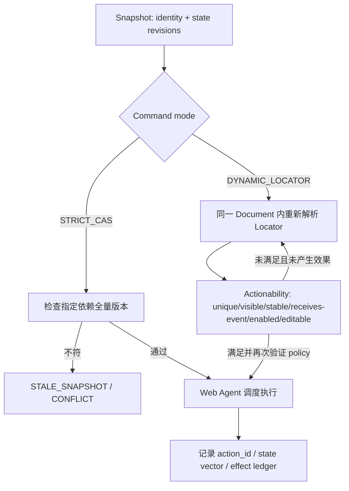

- `StateVector`：`{context_generation,page_generation,document_epoch,navigation_revision,dom_version,focus_scroll_revision,style_layout_revision,policy_revision,projection_revision}`；按操作声明依赖集合，不假装所有事件由一个 DOM 版本涵盖。全部版本均是逻辑单调序列，遇到 ID 复用必切代际。
- **STRICT_CAS** 用于多 Agent 精确协同和带副作用变更，任何依赖变化拒绝。**DYNAMIC_LOCATOR** 用于 Playwright 风格等待，查询可以重新解析；一旦 action 被派发并可能已触发事件/网络副作用，就不允许自动重复点击。
- CSS/ARIA role locator 的可见性与 actionability 需 Layout/Style/Hit-test 信息；不能用文本节点存在替代 `toBeVisible()`。`element_identity` 是可选约束而非 Locator 定义本身。
- 当页面脚本继续变化，应以 `ActionReceipt` 给出定位时版本、实际派发时版本和最终验证状态；对于“异步业务保存成功”仅凭 DOM 更新不能推断服务器已持久化。

### 19.3 外部效果、防重复提交及动作状态（BD-MOD-31 / BD-DAT-05 / BD-IF-10）

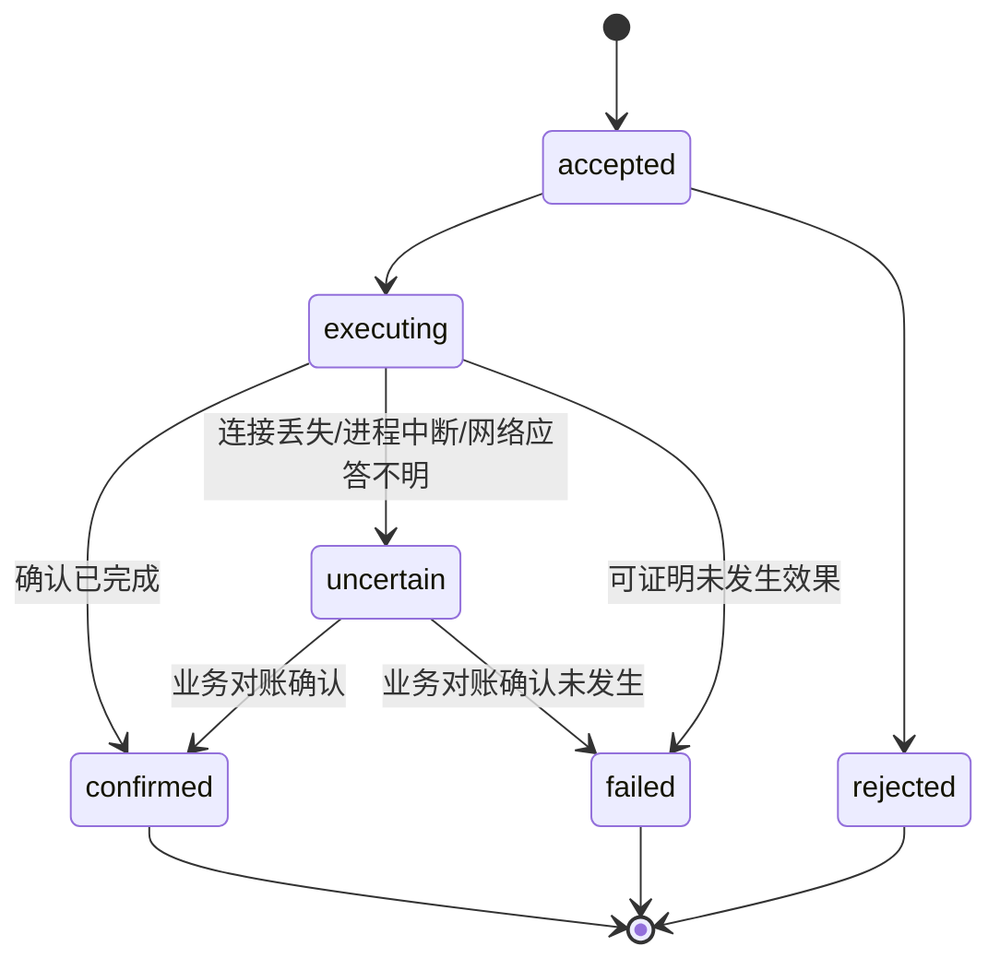

- 每一可能生效的动作持久记录 `EffectRecord{tenant,task_id,action_id,idempotency_key,effect_origin,effect_type,submission_stage,upstream_request_ref,reconciliation_state}`。控制面必须在向沙箱放行**可能产生外部效果的动作前**持久写入可查询意图记录；崩溃恢复不得丢失 accepted/executing 的未知效果。
- Web 页面会自行发起 Fetch/XHR、Beacon、WebSocket 和导航请求；`read_only` 只是调用方意图。Network Broker 根据实际目标、方法、凭证、请求体/动作风险和策略处理，对无法证明无副作用的请求默认保守限制或单次提交；不能只保护来自 Agent API 的 `click()`。
- 操作完成与业务效果分别判定：`action_status=confirmed` 仅表示所承诺的完成层级（已派发/HTTP 有响应/业务对账）达到指定标准，不代表所有远端副作用 exactly-once。提交无应答后优先 `GET /v1/actions/{id}` / 按幂等键检索，若仍未知转人工/业务对账。
- `effects_state` 为 Task 层兼容聚合，至少有一个 `uncertain` 则总体 `uncertain`，否则若有已确认效果则 `confirmed`，否则 `none`；细节必须查询每个 EffectRecord。任务标记 `failed/cancelled` 不能删除效果记录。
- 底层**自动重试**只适用于明确被证明无外部效果的本地/模拟操作或外部系统支持并验证的业务幂等语义。HTTP GET、页面读取或“只点一次”都不是充分安全证据。

### 19.4 安全保护域、身份和资源池（BD-SEC-09/10/11）

- 验证后的服务器主体是 `AuthenticatedPrincipal{tenant_id,agent_id,scopes,credential_version}`；客户端 Body、Header 或网页文本无权改变上述身份。所有 Task、Context、Page、Action、Snapshot、Event、Artifact 的读取/写入均强制以该主体过滤并记录审计。
- 沙箱进程只可以复用给**同租户、同安全边界与同站点锁策略**的任务；不同租户共享的只有无会话信息、经过可信性审查的 Rust 代码/字节码/字体资源等只读基础设施，禁止共享同一活动 JS Realm/页进程。Context 丢弃后销毁私有存储分区并回收进程，避免假清理。
- 跨源请求与响应分开控制：Network Broker 不仅防 SSRF，还必须验证 renderer 所属 site/origin 能否接收敏感响应；无能力验证的跨站 iframe、CORS 或 CSP 场景明确拒绝或放入不受支持集，禁止通过减弱安全策略实现兼容。
- CPU 限额、内存 `memory.max`（或等价）、PID/FD、网络配额在 OS 层强制；单线程死循环通过进程级 watchdog 终止，绝不依靠异步取消抢占恶意同步 JS。

### 19.5 Benchmark 的非劣性前置 Gate（BD-NFR-07）

| 维度 | 必要约束 | 不通过的处理 |
|---|---|---|
| 完整性 | R2 上游 NFR-002 ≥98%、支持范围不缩减，预注册 A—E 全任务及 holdout 均计入 | 不发布吞吐优势结论 |
| 逐场景配对 | 同一任务相同 seed、数据版本、外部网络时钟；按类别给出 Chrome 与 Native 的差值和 95% CI | 不能用“都 ≥98%”冒充行为等价 |
| 性能主结论 | 保留 NFR-003 ≥1.20× 和 NFR-004 的 ≥15%/≤10%，至少 5 轮随机化 A/B；优势必须在置信区间支持下报告 | 差异不稳则标注探索性，不称已达到目标 |
| 视觉/时间 | 预注册截图阈值、布局测量、允许非确定性区域、Event Loop trace 和外部副作用判定 | 不允许跑完后调容差来制造通过 |
| 安全一致 | 同等级沙箱、相同允许网络、服务端数据隔离和审计强度；禁用特性算失败 | 禁止忽略开销较大的安全措施 |

额外的“配对非劣性”阈值和统计功效需由 DEC-07/DEC-12 在基准集冻结时给出；本设计不把未经批准的绝对百分点阈值写成上游 NFR。**硬件/工作负载/统计阈值未冻结前，性能优势主张不成立。**

## 20. 复审测试清单及故障注入预案（均未执行）

| 新测试 ID | 对抗输入 / 最小复现 | 预期安全结果 | 控制项 |
|---|---|---|---|
| RED-BD-019 | 同源 iframe 与顶层窗口同步读写 + 微任务、MutationObserver | 依规范正确排序，无并发写 DOM | BD-MOD-26 |
| RED-BD-020 | DOM 不变，CSS transition/scroll/focus 遮挡目标元素 | STRICT_CAS 阻断错误动作；Locator 重新 actionability | BD-MOD-27/28 |
| RED-BD-021 | React/Vue 重渲染替换节点，同时调用 Locator.click | 正确重定位或超时；不重复提交 | BD-MOD-28 |
| RED-BD-022 | 只读页面自动 Beacon/POST 后断线，重试任务 | Network Broker 拦截/授权，未知效果不重复发送 | BD-MOD-31 |
| RED-BD-023 | 202 Accepted 丢包，复用同一幂等键与不同 Payload | 同 Key 同摘要只收一次；不同摘要拒绝；查询旧状态 | BD-IF-10 |
| RED-BD-024 | JWT 属于租户 A，请求体 identity 写租户 B | 无论字段内容如何均拒绝/归属 A，无跨租户数据 | BD-SEC-09 |
| RED-BD-025 | 沙箱上下文销毁后跨租户加载，注入标记于 JS/Cookies/缓存/共享内存 | 0 跨租户残留；跨租户不共享活动 JS 进程 | BD-SEC-10 |
| RED-BD-026 | 跨源子帧、CORS 预检、DNS rebinding/重定向、敏感 JSON 响应 | 默认阻断越权可见性与私网连接 | BD-SEC-11 |
| RED-BD-027 | R0 启动初始无 policy/metrics 服务 | 启动检查失败关闭；指标与鉴权均可用 | BD-MOD-29 |
| RED-BD-028 | 两次已确认提交 + 一次结果未知 + Task Cancel | Task `uncertain`，逐 Action 账本不丢 | BD-DAT-05 |
| RED-BD-029 | 同步 JS 无限循环 + 指令取消 + 高负载 OOM | 进程 watchdog/cgroup 回收，不影响其他租户 | BD-MOD-30 |
| RED-BD-030 | 创建 Page→多次 navigate→SSE Gap/过期游标 | 可查询导航结果；经授权全量重同步 | BD-IF-11 |
| RED-BD-031 | Native 98% 成功而 Chromium 100%；吞吐达 1.2× | 性能结论禁止标注“等价条件下达标” | BD-NFR-07 |
| RED-BD-032 | 去掉部分 PLAN-ID、断开设计/测试关系 | 门槛检查失败，无法声称全覆盖 | BD-TST-06 |
| RED-BD-033 | 两个测试同 namespace 不同 ID 但同一 DB 记录 | 系统测试判定隔离失败；真实独立资源分配 | BD-MOD-23 |
| RED-BD-034 | 共享内存与 file-backed 页导致进程 RSS 叠加过高 | 同时报告进程树 RSS sum/PSS/cgroup 使用并标明解释差异 | BD-MOD-30 |

**红绿判定规则**：上述测试设计只是“红测待实施”；通过 Green 需要实际 Rust 二进制、回归脚本、日志/pcap/trace、运行环境与 commit SHA。Excel 中 `执行状态=未执行` 不随文档修订自动更新。

## 21. 进入详细设计前的阻断清单与治理

| 编号 | 需要冻结的设计决定（ADR） | 所属门槛 | 当前 |
|---|---|---|---|
| ADR-RED-001 | Web Agent/Event Loop/Realm/Frame 的所有权与时序 POC | R1 Web 事件正确性 | 未冻结 |
| ADR-RED-002 | 状态向量、STRICT_CAS / DYNAMIC_LOCATOR 的前置条件和重试边界 | R2 多 Agent/Bridge | 未冻结 |
| ADR-RED-003 | Page 自动网络效果的策略分类和断连对账存储设计 | R1 网络安全、R2 副作用 | 未冻结 |
| ADR-RED-004 | 客户端身份绑定、Site Lock/响应隔离、跨租户资源复用准则 | R1 安全 Gate | 未冻结 |
| ADR-RED-005 | Playwright 具体版本、API 子集、actionability 验收矩阵 | R2 Bridge | 未冻结 |
| ADR-RED-006 | A–E 基准/视觉容差/非劣性界限/硬件/统计功效 | R3 性能 Gate | 未冻结 |

**最终结论：带阻断项的设计修订版**。本次已完成静态审查、文档纠错及需求映射，不代表真实红测已运行。**只允许推进受控模块 POC 与测试设施详细设计；涉及浏览器真实 Web 安全、Agent 并行操作、未知外部副作用和性能优势的实现方案，必须完成相应 ADR + 红绿实测后再正式冻结。**

## 22. 新增审查依据

- WHATWG HTML Agent/Event Loop: https://html.spec.whatwg.org/multipage/webappapis.html
- Playwright Actionability: https://playwright.dev/docs/actionability
- Playwright Locators: https://playwright.dev/docs/locators
- Playwright Chromium CDP limitation: https://playwright.dev/docs/api/class-browsertype
- Playwright parallelism and external data isolation: https://playwright.dev/docs/test-parallel
- Chromium Process Model / Site Isolation: https://chromium.googlesource.com/chromium/src/+/main/docs/process_model_and_site_isolation.md
- 以上外部依据反映设计审查时的公共文档；具体实现仍需指定版本快照与测试。 
