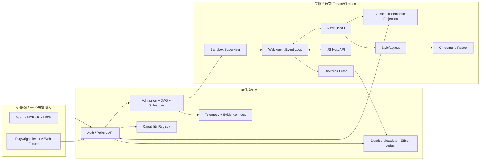
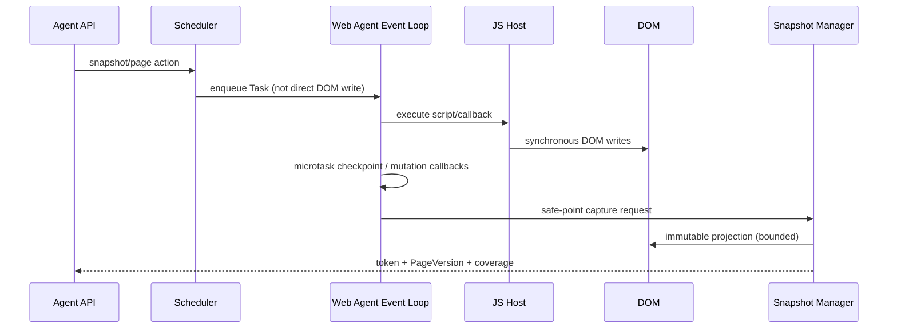
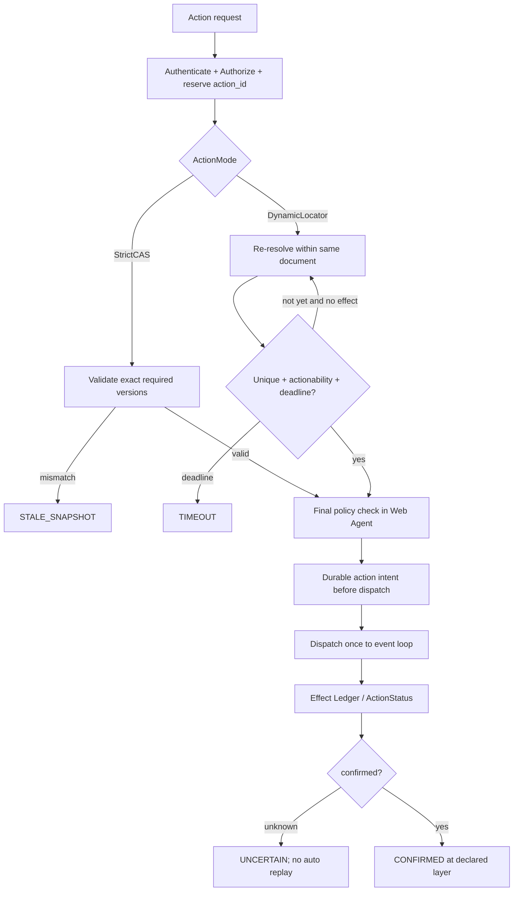
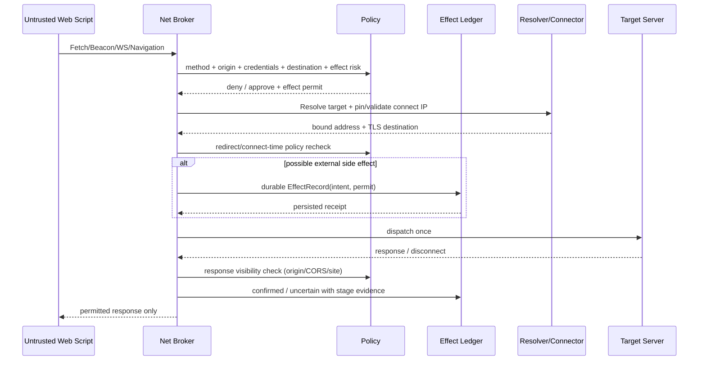
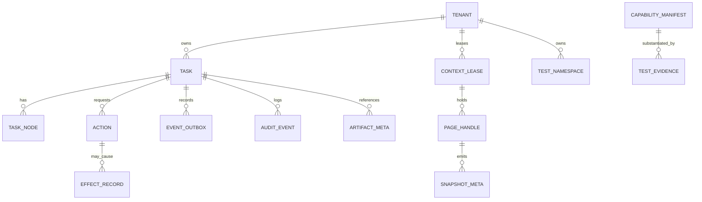
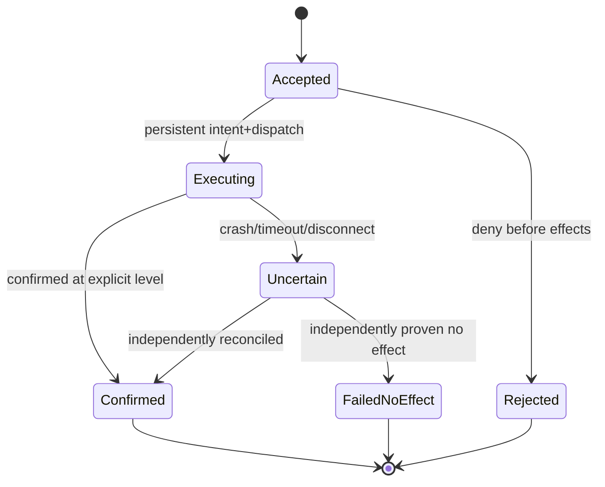

# AI 原生并行 Web 内核 — 详细设计书

> **设计目标**：基于 Rust 的 AI / Playwright 自动化原生 Web 执行内核，以任务并行和安全隔离为原生执行模型，摒弃面向人类的浏览器 UI；**不是** Chromium 的 Rust 包装器、也**不承诺**可直接作为原版 Playwright 的浏览器驱动。
> **有效范围**：本文件经详细设计对抗审核更新并细化已审定的 *设计方向*，对未决选型定义暂定执行契约和验证条件；上游基本设计 v1.1 的 **8 个既有 P0 对抗发现和 6 个既有 ADR-RED 仍未验证/冻结；另有本轮 10 项 P0 与 10 项新 ADR 待验证**。不得把文档中伪代码、接口样例、测试用例计划表述为已实现、已验证或 Web 兼容认证。

## 0. 文档控制、设计权威与范围

| 项目 | 内容 |
|---|---|
| 文档 | `AIPWE-DD-001` v1.1.0（2026-11-10） |
| 上游要件 | `AIPWE-RD-001` v1.1.0 / `33a44a634ece1e8bf531a446163915b5fe4bae2183553330acb8ece214c7e710` |
| 上游基本设计 | `AIPWE-BD-001` v1.1.0 / `c996b9b79c0d52a2b0a09cd31eab45197f9b13acb7df47f78c564d622ffa60b2` |
| 追踪 | 本文 `DD-001..081` 一对一承接基本设计 `BD-*`；157 条上游记录继承正向映射；全部 34 项基本设计测试计划保留 |
| 设计粒度 | Rust 模块/型别/trait、执行时序、并发协议、存储模式、API 负载、错误与恢复、算法、测试数据与判据 |
| 交付限定 | 详细设计 `.md` + 追踪/验证矩阵 `.xlsx`；图使用 Mermaid 源码，非截图 |
| 不可变原则 | 自主 Rust Runtime、Agent Native、Parallel Native、Web 语义正确、失败关闭、无盲重放、正确性先于性能 |
| 变更权威 | 要件定义 → 基本设计 → 本详细设计 → 代码/测试；接口、边界、门槛发生实质偏离必须 ADR 与上下游追踪更新 |
| 状态区别 | `设计已形成` ≠ `ADR 已冻结` ≠ `测试已实现` ≠ `测试已通过` ≠ `可公网运行` |

### 0.1 详细设计批准级别

- **DD-A（可直接实施的受控功能）**：纯结构代码、离线 DAG 调度、内部类型、受控 fixture HTML/DOM 原型、监控与测试脚手架；部署需内部默认拒绝外网。
- **DD-B（临时接口，POC 后冻结）**：Web Agent/事件循环、状态向量/CAS、Locator、EffectLedger、沙箱 Network Broker。代码可在受控 fixtures 中验证，但不可提前声称安全/标准兼容。
- **DD-C（研究和长期规划）**：复杂 Frame/Worker/跨站网站、正式 Playwright Native Driver drop-in、广泛 CSS/Web API、高密度资源池跨租户复用与分布式真实会话迁移；默认不在 R2 Must。

### 0.2 红队阻断集

`ADV-01..08 = P0`；`ADR-RED-001..006` 未冻结。真正解除要提供：实现 commit/锁定依赖、自动化红转绿日志、环境与镜像 digest、规范 oracle 对照、架构决议签署；没有这些证据只允许继续受控 POC。完整测试见第 11 章和附录 C。

## 1. 总体结构与内核可替换边界



**边界不变量**：内部 `engine_id = aiweb-native` 的页面操作不得落到 Chromium；`chromium-oracle` 仅允许 A/B 验证并在结果标注实际 backend。所有不可信脚本在受限 OS 进程中执行，控制面不接受 Web 页面任意 IPC 调用。Web 标准组件可以复用，但 Rust 宿主与执行调度权归自研核心。

### 1.1 物理部署进程

| 进程/角色 | 允许权限 | 核心约束 | 重启策略 |
|---|---|---|---|
| `aiwebd` Control Host | API、持久化/日志、任务分发 | 不加载或执行不可信 JS；鉴权后签发最小能力 handle | 不得因重启盲重放 effect |
| `aiweb-sandboxd` Supervisor | 启动/回收受限执行进程、配额 | OS policy + Cgroup + Namespace 安装成功才发租约 | 沙箱策略异常 fail closed |
| `aiweb-renderer` Native Worker | 当前 tenant/site 的 DOM/JS/Style/Layout | 不具 Host FS、Secret Broker、任意 socket 权限；经 IPC 访问网络 | 进程崩溃只终止关联保护域 |
| `aiweb-net-broker` | 带身份的 outbound 网络代理 | DNS/重定向/地址重检、响应可见性保护、EffectLedger 门禁 | 无法执行策略即拒绝 |
| 可选 `aiweb-observer` | 汇聚脱敏结构化事件 | 不能默认证据正文或凭证 | 指标队列有界，非关键事件可丢并计数 |

`Context` 不等于 OS 进程：允许在同一租户与同一站点锁政策下按安全模型安排多个 context，但每一个 Context 的脚本 realm / Cookies / Storage 必须分离。**不同租户的活动 JS/DOM 进程不得复用**；只有无会话、经证据审查的只读基础设施可跨租户共享。

### 1.2 Workspace / 依赖方向（建议目录）

```text
aiweb/
  Cargo.toml                         # workspace; lockfile committed
  crates/
    aiweb-types/ aiweb-ports/ aiweb-task-graph/
    aiweb-scheduler/ aiweb-resource/ aiweb-policy/
    aiweb-api/ aiweb-context/ aiweb-page/ aiweb-agent-loop/
    aiweb-dom/ aiweb-js-host/ aiweb-net/ aiweb-egress/
    aiweb-sandbox/ aiweb-storage/ aiweb-state-vector/
    aiweb-snapshot/ aiweb-semantics/ aiweb-locator/
    aiweb-action/ aiweb-effects/ aiweb-layout/ aiweb-render/
    aiweb-capability/ aiweb-observe/ aiweb-distributed/
  apps/aiwebd/ apps/aiweb-sandboxd/ apps/aiweb-renderer/
  adapters/html-parser/ adapters/js-engine/ adapters/style-layout/
  packages/playwright-fixture/       # TypeScript; 非原版 Playwright Page
  tests/wpt/ tests/red/ tests/fixtures/ tests/bench/
  schemas/http/v1/ schemas/ipc/v1/ docs/adr/ docs/evidence/
```

**依赖方向**：`api/fixture → application/control → aiweb-ports/types ← engine adapters`。核心 domain 类型不可依赖 Playwright、HTTP 框架、某个 JS 引擎或 Chromium。跨不可信进程必须传序列化消息，不准将 Rust 引用、DOM 指针或 `Arc<Mutex<DomNode>>` 穿过 IPC。

### 1.3 接口稳定层

`aiweb-types` 负责稳定 ID、版本、枚举；`aiweb-ports` 声明 `TaskStore`, `EffectStore`, `PagePort`, `WebEngineFactory`, `PolicyEvaluator`, `NetworkBroker`, `SandboxExecutor`, `Clock`, `EvidenceWriter` trait；adapter 以版本和 capability manifest 注入。具体第三方库选型按 `DEC-02/03/05` 与许可证审查 POC 批准后冻结。初期不得因“Rust 库已存在”就承诺对应 Web 标准完全实现。

## 2. 类型与协议通用约定

### 2.1 命名与唯一性

| 类型 | 实现形态（候选） | 唯一性/生命周期 |
|---|---|---|
| TenantId / AgentId | 经 auth 生成的 opaque newtype | 所有数据访问都强制绑定 TenantId |
| TaskId / NodeId / ContextId / PageId / ActionId | opaque、可排序随机标识，不可直接用作权限 | 同租户范围唯一；原 ID 不回收复用 |
| WebAgentId / AgentLoopId / RealmId | 内部 opaque ID | Realm 与 Agent 关系由 Web 标准代理选择决定，**不按 Realm 划线程** |
| `Generation` / `Epoch` / `Revision` | `u64` 单调递增，溢出触发新 ID | `0` 无效；代际不同一律拒绝旧引用 |
| `Deadline` | host monotonic clock + API relative duration | 不以墙钟/容器时钟作为超时比较依据 |
| `TraceId` / `RequestId` | 跨 IPC 贯穿，审计中不可含 PII | 只用于相关性，不授予读取权限 |

### 2.2 Rust 类型定义（可编译取向的逻辑草案）

```rust
#[derive(Clone, Copy, Debug, Eq, PartialEq, Hash)]
pub struct Generation(pub u64);
#[derive(Clone, Copy, Debug, Eq, PartialEq, Hash)]
pub struct Revision(pub u64);

#[derive(Clone, Debug, Eq, PartialEq)]
pub struct PageVersion {
    pub context_generation: Generation,
    pub page_generation: Generation,
    pub document_epoch: Revision,
    pub navigation_revision: Revision,
    pub dom_version: Revision,
    pub form_control_revision: Revision, // value/checked/selection: not always DOM mutation
    pub user_interaction_revision: Revision, // focus, scroll, pointer capture
    pub focus_scroll_revision: Revision, // deprecated alias until schema freeze
    pub style_layout_revision: Revision,
    pub render_opportunity_revision: Revision, // animation/rAF without forced paint
    pub frame_topology_revision: Revision,
    pub policy_revision: Revision,
    pub projection_revision: Revision,
}

#[derive(Clone, Debug)]
pub enum ActionMode { StrictCas, DynamicLocator }
#[derive(Clone, Debug, Eq, PartialEq)]
pub enum TaskState { Queued, Running, Blocked, Succeeded, Failed, Cancelled }
#[derive(Clone, Debug, Eq, PartialEq)]
pub enum EffectSummary { None, Pending, Confirmed, Uncertain }
#[derive(Clone, Debug, Eq, PartialEq)]
pub enum EffectReconcile { Accepted, Executing, Confirmed, FailedNoEffect, Uncertain }

pub struct SnapshotToken {
    pub page_id: PageId,
    pub page_version: PageVersion,
    pub projection_hash: [u8; 32],
    pub expiry_monotonic_ns: u64, // internal same-clock-domain hint only
    pub issuer_boot_id: BootId,
    pub expires_at_utc: UtcTime,
    pub trust_label: TrustLabel, // UntrustedWebContent
}
```

上面是抽象数据契约：`PageId/TrustLabel/BootId/UtcTime` 由 types crate 定义（示例非可编译代码）；部署实现的 Clock、ID、序列化和整数溢出策略必须在 `ADR-RED-002` 锁定。`Revision` 单调增不等于事务全序；跨页面与跨站仅给事件因果引用，不推断全局一致性。

### 2.2.1 并发状态向量修订（v1.1 规范性补充）

- `PageVersion` 必须显式容纳 **`form_control_revision`**（value、checked、selected、selectionRange 等未必改变 DOM 树的状态）、`user_interaction_revision`（focus、scroll、pointer capture）、`frame_topology_revision`（Frame 结构/导航）、`render_opportunity_revision`（rAF/动画与稳定性）及 `policy_revision`。输入组件的值更改不得依赖 `MutationObserver` 检测：这类属性可以不触发 DOM 树变更。
- `StrictCAS` 请求必须声明 `read_footprint`：例如 `node_identity`, `input_value`, `selection`, `hit_test`, `policy`, `document_identity`。提交时比较**被读取的实际依赖**；没有声明必需项的请求拒绝 `INVALID_PRECONDITION`，不能以默认零向量把遗漏视为未变化。
- `DynamicLocator` 的新定位只允许在未开始事件派发前；定位、actionability、授权与目标绑定都在 owning Web Agent 的合法执行点重新确认。布局计算可能触发同步脚本可观察副作用，不能把“只读求值”与“整个页面无副作用”画等号。
- `SnapshotToken` 的 `expiry_monotonic_ns` 是**同一宿主与 boot_id 内部的临时过期提示**，不得让客户端跨主机比较。对外暴露签名 `expires_at_utc` 和 token `issuer_epoch`，服务端取保守判定。
- 所有异步结果都附 `executor_generation`, `page_generation`, `document_epoch`；过期结果只能进诊断，不允许变更新代际页面。

### 2.3 Wire 契约

- 公开 API `Content-Type: application/json` + `api_version = aiweb/v1`；请求大小、对象层数、DAG 深度均由服务器配置上限并对外报告 `INVALID_REQUEST/RESOURCE_EXHAUSTED`，不信任客户端预算。
- 所有外部 `idempotency_key` 在 **`(principal.tenant_id, request_kind, key)`** 分区唯一；同键不同规范化请求摘要返回 `IDEMPOTENCY_KEY_REUSE`；保持原 action ID 与回执供状态查询。
- 所有 `handle`、游标和 artifact token 都绑定租户、作用域、对象 generation、过期时间；随机 ID 本身**不是**权限凭证。
- 事件 `seq` 仅保证单 `stream_id` 递增；缺段按 `EVENT_GAP` 恢复，不宣称跨流全序。
- 任何不支持能力显式返回 `UNSUPPORTED_FEATURE` + `capability_id/backend/version`；不能自动用 Chromium 补齐。

## 3. 任务图、调度与资源准入算法

### 3.1 Task/DAG 存储结构

```rust
pub struct TaskGraphSpec {
    pub task_id: TaskId,
    pub nodes: Vec<TaskNodeSpec>,
    pub edges: Vec<(NodeId, NodeId)>,
    pub deadline: Duration,
    pub budget: ResourceBudget,
}
pub struct TaskNodeSpec {
    pub id: NodeId,
    pub action: NodeAction,
    pub effect_class: EffectClass,
    pub requires: Vec<CapabilityId>,
}
pub struct ResourceBudget {
    pub cpu_ms: u64,
    pub memory_limit_bytes: u64,
    pub network_bytes: u64,
    pub artifact_bytes: u64,
    pub max_child_processes: u32,
}
```

`NodeAction` **只能引用受审查的能力枚举**，不能提交任意 shell、未经授权 URL 或 Host 函数；创建时强制 `validate_graph`：节点唯一/边端点存在、最大规模、无自环、Kahn topo 遍历数等于节点数，复杂度 `O(V+E)`；失败返回 `INVALID_DAG`（为最小错误集合扩展项）。执行 `ready` 的前置条件是所有依赖节点符合显式 success/skip policy，不能把 Cancelled 当作 Succeeded。

### 3.2 Admission / Fair Scheduling

```text
on_submit(spec, principal):
  enforce_authn_authz(principal, spec.permissions, policy_revision)
  validate_graph(spec); validate_backend_caps(spec)
  persist(task=Queued, nodes=Pending, trace_id)
  if request/reserved capacity exceeds tenant hard cap: REJECT RESOURCE_EXHAUSTED
  enqueue bounded per-tenant priority queues; return 202

scheduler_tick():
  for tenant in deficit_round_robin(tenant_weights):
    age_waiting_tasks(tenant); derive_ready_nodes()
    if deficit < node_cost_estimate: continue
    if !reserve_budget_atomically(tenant, node, host): continue
    acquire(worker lease with monotonically increasing lease_epoch)
    persist(Dispatching -> Running) then dispatch
    charge_budget_on_finish_or_reap(); wake dependents()
```

**DRR/加权公平为待 POC 方案**：估算成本基于历史指数平滑且不能作为硬安全保证；短长任务混排需观察 P99 排队与饥饿。不要占用硬资源后仍让同一队列反复抢占，防止大任务无限饿死。队列、网络请求、Evidence、事件订阅都有配置上界和队列溢出策略；必须有 `reason` 与 `retry_after` 供 Agent 调整。

### 3.2.1 调度资源边界修订（v1.1）

- 调度承认 **Control、Supervisor、Network Broker、持久化与追踪** 都有成本，`reservation` 与 OS 计量必须区分。内存指标列示峰值 RSS/PSS/cgroup memory，不混算为同一物理值。
- `Scheduler` 出队前二次校验 tenant-policy revision、deadline、backend capability、budget；Worker 启动后每次敏感出口执行需由 Broker 验证新的 `lease_epoch` 和 `worker_generation`。旧租约无网络写权。
- DRR 不是安全保障。短作业优先与公平需求冲突时，保留 tenant 级饥饿阈值、长作业最低服务保证和队列累计工作量上界；未通过 P99 验证不得声称公平性。
- IPC/出站流量按单消息大小、嵌套深度、每连接 outstanding credits、每租户吞吐与全局资源 budget 同时限额，超限时关闭流并保留 effect 证据。

### 3.3 Lease、取消与失败传播

- `DispatchLease = {task_id,node_id,worker_id,worker_generation,lease_epoch,expires_at}`；Worker 接受之前比较旧 epoch，旧 Worker 回执不可改变新租约的终态。
- Deadline 由宿主 monotonic clock 比较；子任务获取 `min(parent_deadline, local_deadline)`；取消树从父到子传播、资源仲裁后强行终止失控沙箱。
- 停止同步死循环依赖 **Supervisor OS 强制 kill**，不是 Rust `Future::abort`；回收进程树和 cgroup，收集 FD/PID/Memory 计数与泄露证据。
- `Cancelled/Failed` 不能删除已发出的网络效果记录；状态机终态保持不可逆，效果另行对账；已确认的副作用不能被任务取消撤销。

### 3.4 原生并行边界

并行对象是独立 TaskNode、不同受限进程/Agent EventLoop、复制后的不可变 Snapshot 和只读解析/字体资源。**Live DOM、同一 Web Agent 的 task/microtask、同一 JS 执行状态不是自由并发写目标**。跨租户资源池不能通过合并 JS 进程获取密度收益。

## 4. Web Agent / Page / Snapshot / 动作执行详细设计

### 4.1 Web Agent 与事件循环职责

- `WebAgentId` 不是 `RealmId`，也不是 OS thread ID；同类 Window Agent 的 event loop 分配、可同步访问的 document/window、Worker Agent 与任务源必须由 HTML/ECMAScript 标准规则确定。
- `aiweb-agent-loop` 持有队列映射 `task_source -> FIFO tasks`、microtask queue、render opportunity；每次运行任务后执行规范要求的 microtask checkpoint（包括 Promise job 和适用的 MutationObserver 交付），并依规则处理渲染时机。
- 页面 actor 是访问封装；同一 Agent 内同步窗口访问不可因为 PageActor 不同就异步重排；Agent 所有 DOM/JS mutation 的提交仍在合法执行点进行。
- 不实现的跨 iframe/Worker 特性通过 Manifest 明确标 `unsupported`，拒绝进入部分安全语义不一致的状态。



### 4.2 页面状态机与代际规则

| 变化 | 必须更新 | 旧引用处理 |
|---|---|---|
| Context 清理重建 | context_generation | 所有旧 Page/Action/Snapshot 失效 |
| 新 Page ID 或进程重建 | page_generation | 旧 page handle 失效 |
| 跨文档导航提交 | document_epoch、navigation_revision | 旧 node/snapshot locator 失效 |
| SPA History 修改 | navigation_revision（document_epoch 不变） | Locator 可能重解析；路由依赖重检 |
| DOM mutation | dom_version、projection_revision（受影响时） | 受影响 StrictCAS 失效；Diff 带 base |
| Form input.value/checked/selection | form_control_revision、必要的 projection_revision | 即使 DOM 树未变化，也拒绝依赖原值的过期 CAS |
| Frame 重建/子文档变化 | frame_topology_revision、子帧各自 document_epoch | Frame token 按身份和覆盖范围失效 |
| rAF/动画渲染机会 | render_opportunity_revision、受影响布局修订 | 按需不 Paint 时仍保持帧回调语义 |
| Scroll/Focus | focus_scroll_revision | 几何点击与焦点类 actionability 需重查 |
| CSS/字体/动画/layout | style_layout_revision（含异步重新计算） | 坐标/可见性受影响，需 just-in-time hit-test |
| policy 更新/批准过期 | policy_revision | 之前允许的提交需重新鉴权 |

`revision` 自增要求单调但不是 DOM 变更计数的全部事实；Layout 被时间驱动重新计算时也需重新校验。页面 navigation 的 `navigate_id` 可用于异步查询，不以 `networkidle` 作为默认完成判定。

### 4.2.1 并行快照的跨 Frame 一致性边界（v1.1）

- `capture_snapshot` 的线性化点仅能对应单个 owning Web Agent 的单文档投影；对于不同 Agent 的跨站 Frame，返回 `frame_consistency=per_frame`、`frame_document_epochs`、`incomplete_reasons`，不制造不存在的原子全页视图。
- `strict_global=true` 只有 POC 实证支持全范围同步一致时可用；否则返回 `UNSUPPORTED_CONSISTENCY`。页面可能包含 Service Worker、Shared Worker、WebSocket 事件等并发来源，Snapshot 不冻结外部世界。
- `coverage` 具有 `semantic_only`, `geometry_validated`, `paint_validated` 分级；没做 Style/Layout 时不可返回 `visible=true` 或保证命中目标。对来自不同代际的子帧，结果默认 `partial=true`，禁止据此执行 StrictCAS 修改。

### 4.3 Snapshot 与 Diff

```text
capture_snapshot(page, projection, budget):
  validate(principal can inspect page)
  enqueue snapshot on owning Web Agent
  wait for end-of-task microtask-safe boundary within deadline
  if blocked by runaway script: SNAPSHOT_UNAVAILABLE / kill policy
  derive projection, update PageVersion, trust_label=untrusted_web_content
  enforce byte/node/time limits + pagination
  copy immutable projection to process-safe snapshot buffer
  attach coverage + cache TTL + projection_hash; return SnapshotEnvelope
```

Diff 仅在同一 `{context_id/gen,page_id/gen,document_epoch,projection_kind}` 内计算；若基线被清理或 `base_version` 不可用，返回 `DIFF_BASE_EXPIRED`，客户端必须重新全量获取。Snapshot 既不保证不同页面的原子全局视图，也不能绕开页面权限去读跨源 Frame。内部可使用 copy-on-write/arena snapshot，但**不得将 live DOM 指针暴露给其它 Agent 或进程**。

### 4.4 两种 Action 模式（保持语义区别）

**StrictCAS**：在 Web Agent 执行点验证 context/page/document identity、`expected_version` 中声明的依赖字段、policy 和目标 node identity；任一相关修订变化立即返回 `STALE_SNAPSHOT/CONFLICT`，**不自动重新定位或重发**。

**DynamicLocator**：保存 `selector_spec`（CSS/role/text/testid 的支持子集）而不是固定元素指针；在指定 deadline 内只在尚未出现任何外部/页面可见副作用时反复重新定位、检查唯一性/可见/稳定/hit-test/Enabled/Editable/NotInert（按动作检查矩阵）。执行前在同一个有序调度提交点重新鉴权、校验文档代际、操作冲突与定位有效性。一旦开始派发事件/触发脚本，不再盲目重试 click/fill；只查询状态及人工/业务对账。



### 4.4.1 CAS 与 DynamicLocator 原子提交点（v1.1）

```rust
// 逻辑契约，不是已经编译通过的实现
struct Precondition {
    context_generation: Generation,
    page_generation: Generation,
    document_epoch: Revision,
    policy_revision: Revision,
    read_footprint: Vec<StateDependency>, // e.g. input_value / selection / hit_test
}
enum DispatchBarrier { NotStarted, EventDispatchStarted, NetworkEffectsPossible }
struct ActionAttempt { action_id: ActionId, attempt_id: AttemptId, barrier: DispatchBarrier }
```

1. 操作在 `NotStarted` 下可以更换目标并重新解析；进入 `EventDispatchStarted` 后即使 `click` 失败、Node detached、返回超时，**不得**自动再次派发事件。
2. 同步 JS Event Listener 内可以发起多个具有副作用的网络请求。`action_id` 不是这些效果的幂等授权；每个需要独立 `effect_id`, `attempt_id`, `parent_event_id`, permit 和审计。
3. 同一 Web Agent 的多个同步可互访 Window/Frame 必须保持规范要求的同步调用与微任务语义；不得以页面锁替代 HTML Event Loop 的任务源管理。
4. DOM 修订未变化但 `input.value` 已改变时，按 `read_footprint` 拒绝旧 CAS；空操作不得无条件 bump 所有 revision（否则产生虚假冲突）。

### 4.5 冲突窗口与锁顺序

- 宿主仲裁器对 Page 维护有界 action queue，并按 `tenant → context → page → web-agent` 对**授权/资源所有权**做固定顺序检查；禁止持有 host 数据库事务锁时等待 JS 事件循环或网络回包。
- Snapshot 和 live DOM 串行安全点的版本线性化**仅在 Page 自身成立**，不能宣称跨页全局线性一致。
- 多个 Agent 提交严格 CAS 时至多一个在同一预期 revision 上成功变更；若命令无实际版本变更（例如错误/空操作）不得产生假成功的冲突消解。
- 要求 `click` 的 Actionability 与事件派发保持同一个 Web Agent dispatch turn；如果其间发生脚本可重入/导航，重新检查 Document/Target，不可按过期坐标派发。

### 4.6 5读/2写参考场景

1. Agent A1..A5 读取 `Snapshot(v42)`，结果带相同 PageVersion/coverage。
2. A6 和 A7 以 StrictCAS(v42) 分别提交对同一输入框的不同修改；仲裁后一个成功更新 `v43`，第二个必须 `CONFLICT`，绝不能后写覆盖。
3. A7 重新获取 v43 并经权限审查后明确提交新操作；不允许服务端替它自动完成覆盖。
4. 如果是 Playwright DynamicLocator，节点替换前仅重新解析合法 selector；一旦触发提交按钮的 JS，任何断线均由 ActionStatus/EffectLedger 对账而不是重击。

## 5. Native Web 栈的内部接口与最小闭环

### 5.1 分阶段 Capability Profile

| Profile | 必须有 | 默认不支持/失败方式 |
|---|---|---|
| `r1-fixture-core` | 受控本地 fixture URL、基础 HTML parse/DOM、事件循环、JS Host 基础子集、TLS Broker、安全沙箱 | 未实现的 Web API：`UNSUPPORTED_FEATURE`；不得伪造结果 |
| `r2-semantic` | DOM/ARIA 子集、Snapshot/Diff、CSS/Role Locator、必要 Style/Layout/Hit-test、按需绘制与截图、TS fixture | 复杂 Frame/Service Worker/Shadow root 子集待 capability 标注 |
| `r3-parallel` | 资源池优化、统计完备的 A/B、分布式 worker protocol（可选） | 不得降低跨站隔离、可视正确性来提升速度 |
| `r4-web-compat` | 增量扩展 WPT/真实站点覆盖，独立报告完整分母 | 不宣称 Chrome 全兼容 |

### 5.2 Trait 设计（须经实现/POC）

```rust
pub trait HtmlDocumentAdapter {
    fn parse(&self, bytes: &[u8], base: &Url) -> Result<DomDocument, HtmlError>;
}
pub trait JsEngineAdapter {
    fn create_realm(&mut self, spec: RealmSpec) -> Result<RealmHandle, JsError>;
    fn execute_task(&mut self, agent: WebAgentId, task: JsTask) -> Result<JsOutcome, JsError>;
    fn checkpoint_microtasks(&mut self, agent: WebAgentId) -> Result<(), JsError>;
}
pub trait StyleLayoutAdapter {
    fn recompute(&mut self, dom: &DomSnapshot, viewport: Viewport)
        -> Result<LayoutSnapshot, LayoutError>;
}
pub trait PaintAdapter {
    fn raster(&mut self, layout: &LayoutSnapshot, opts: RenderOptions)
        -> Result<FrameArtifact, RenderError>;
}
```

**具体候选**：HTML parser 可研究 html5ever；JS 可研究 Boa 或其他许可合适的实现；Style/Layout 与 Paint 需分别验证与现有 Rust DOM 的 glue cost。候选并不等于已锁定或已通过 Web 标准。适配器实例线程安全声明由具体实现给出，不能因为 Rust 类型可 `Send` 就推断 JavaScript 运行语义可跨线程并发。

### 5.3 HTML/DOM

- HTML 输入采用明确编码解码、解析错误/quirks mode、base URL、script/parser blocking 的阶段控制；节点身份 `{document_epoch,node_local_id}`，导航后不得继续访问旧节点。
- Mutation 只能在宿主 Web Agent 执行路径进入 live DOM；查询投影使用只读复制；CSS 查询与节点树解析优先保证确定性。
- Node identity 无法替代可变化的语义 Locator；同 selector 多匹配的 click 默认失败严格度检查。

### 5.4 JavaScript / Host Binding

- 每个 Realm 的 JS global 由宿主注入 `window/document/console/timers/fetch` 等已支持对象；每一个 Host API 都有 explicit `capability_id`、origin 策略和 observable behavior 的测试。
- `Promise`、microtask checkpoint、宏任务、timer clamping、MutationObserver 交付顺序必须按冻结的 WPT 子集验收；同步执行需配合 OS watchdog 上限。
- Worker/SharedArrayBuffer/Service Worker/跨 Agent 通信等如安全语义未实现，只能拒绝，不允许静默模拟成功。

### 5.5 请求/响应和存储

- `aiweb-net` 构造 Navigation/Fetch 请求，在每一 redirect、proxy hop、地址变化、WebSocket upgrade、Upload/Download 前传给受保护 Broker 校验。
- PartitionKey 候选包含 `{tenant,context,top_level_site,frame_origin,credential_scope,policy_revision}`，但 cache partition 维度在 Web 标准与性能 POC 中冻结；跨源响应须符合 CORS/CSP/同源可见性政策，不可简单把 Broker 收到的字节直接送进所有 renderer。
- Cookies / LocalStorage / SessionStorage 私有化，Context teardown 强制撤销密钥与存储句柄；旧 handle 的 generation 不匹配时拒绝，不能指望内存 memset 作为跨租户安全隔离凭证。

### 5.5.1 存储与站点锁契约修订（v1.1）

- 通过 IPC 建立 `request_provenance = {tenant, context, sandbox_generation, frame_id, initiator_origin, top_level_site, credentials_mode, policy_revision}`；其中信任字段由 Supervisor/Broker 绑定而**不是 renderer 自报**。
- 初期 HTTP Cache 完全按 Context 私有，Cookie、Auth Header、Storage、Service Worker 绝不跨租户复用。未来匿名共享只允许 immutable、无认证影响、审查过的内容哈希数据，须通过 cache poisoning 与 timing-leak 红测。
- Fetch/CORS/opaque、SameSite Cookie、CSP、redirect、安全 URL 分类必须按 Manifest 标注支持等级；支持不完整则拒绝有关调用，不对 Agent 或网页脚本伪装成功。
- 页面脚本主动 Fetch/Beacon/WS/Navigation 也属于网络行为，必须在 broker 处经过相同的策略和效果登记，不应只拦截 Agent 提交的点击。

### 5.6 按需 Style/Layout/Paint

- 查询 DOM 文字可跳过 paint 和 GPU 合成；但 `offsetWidth`, `getBoundingClientRect`, hit-test、可见/可编辑、Role 状态等需要 Style/Layout/Geometry 的必须真的计算。
- Dirty bits 及增量树修订仅是优化：`Paint` 省略不等于 `Layout` 可以省略。CSS 动画、字体加载、viewport、deviceScale、滚动与焦点依赖必须纳入 invalidation。
- Screenshot 输出元信息 `{viewport,deviceScale,page_version,render_backend,color_profile,artifact_hash}`；不支持的色彩/绘制功能应在 Manifest 暴露，Diff 的容差由测试预注册。

### 5.7 语义投影接口

```json
{
  "projection": "semantic_v1",
  "page_version": {"document_epoch": 2, "dom_version": 42, "style_layout_revision": 7},
  "coverage": ["dom_text", "role", "accessible_name", "geometry_if_requested"],
  "trust_label": "untrusted_web_content",
  "nodes": [{"node_ref": "doc2:n17", "role": "button", "name": "Submit", "visible": true}],
  "truncated": false,
  "next_cursor": null
}
```

`accessible_name` 的正确性要用 ARIA/WPT fixture 校验；`visible` 只在要求布局且计算完成时有意义，不能默认用 DOM 是否存在来填 `true`。内容均为不可信来源，不能作为 Agent 新指令或权限请求。

## 6. 安全保护、网络副作用与不可信内容

### 6.1 Principal / Policy

```rust
pub struct AuthenticatedPrincipal {
    pub tenant: TenantId,
    pub agent: AgentId,
    pub scopes: Vec<Scope>,
    pub credential_version: u64,
}
pub struct AuthorizationInput {
    pub principal: AuthenticatedPrincipal,
    pub task_id: TaskId,
    pub target_origin: Origin,
    pub action_kind: ActionKind,
    pub effect_class: EffectClass,
    pub policy_revision: Revision,
}
```

`AuthenticatedPrincipal` 只能由已验证的 TLS/JWT/本地可信 peer credentials 解析器构造；JSON 中 `identity` 不被用来赋权。`scope` 检查发生在 API、对象寻址、Action commit、Network Broker、Artifact 读取与 Event stream 恢复；授权 token 绑定 tenant、agent、origin、action_type、目标摘要及过期时间，不能由页面 JS 生成或扩大授权。

### 6.2 OS 沙箱强制控制

- Linux 主环境必须验证非 root 运行、user/mount/net namespaces、文件系统只读/临时路径、seccomp 或等价 syscall 限制、capability drop、进程树回收与 cgroup memory.max/pids.max/CPU 限制。
- “资源预留”只是 Admission 算法；强制保护取决于 OS 上限。内存同时报告进程树 RSS sum、PSS、cgroup memory.current（指标口径需明确不能相互当作恒等），CPU 以进程树 CPU 秒衡量。
- Worker 不允许直接访问 Host 网络、Unix 控制 socket、环境密钥；Supervisor/Network Broker 都须独立受控，沙箱策略创建失败时返回 `SANDBOX_FAILURE`，不启动不可信 JS。
- Windows 当前只供开发验证，不具备生产公网沙箱声明。未经 P0 SEC 红测，部署配置必须锁在 fixtures-only 模式。

### 6.3 Network Broker 的双重权限门



- `read_only` 表示 Task 声明意图，不代表 GET、页面 `fetch` 或表单行为必定无副作用；Cookie、Auth、请求目的地和方法只是**风险信号**，非业务幂等保证。
- 对受控 fixture 可通过显式声明的 network effect manifest 限定请求；对未知网站/模糊写入风险默认 deny 或要求审批，不允许从 response status 推定业务绝对成功。
- DNS rebinding：对 DNS 响应的每个候选 IP 执行 IP 分类，连接时验证真实 remote peer 与授权策略、redirect 重新校验；拒绝默认公网任务访问 loopback/private/link-local/cloud metadata（按网络策略例外白名单必须审计）。HTTPS 主机名、SNI、证书与出口策略须保持一致，防代理穿透。
- 跨站敏感响应不允许流入不符合 Site Lock / CORS 的 renderer；Broker 授权的是“可分发到哪个保护域”，不是“抓取到了就能看”。

### 6.3.1 网络出口 Fencing 与效果授权（v1.1）

`EffectPermit` **最小绑定集**：`tenant, context_generation, sandbox_generation, worker_generation, lease_epoch, action_id? (optional for page-initiated), parent_event_id, initiator_origin, target_origin, method, effect_class, credentials_scope, payload_digest_or_bounded_policy, allowed_redirect_policy, nonce, expiry`。每条实际出站尝试独立 `attempt_id`。Broker 对每一次连接前、每次重定向与需要敏感数据的请求体发送前检查许可；同一个审批不能无条件授权无限子请求。

```text
at_network_boundary(request, bound_channel):
  provenance := supervisor_attested(bound_channel)  # never trust renderer-reported tenant/origin
  deny_unless(valid_lease_epoch && sandbox_generation && policy_revision_current)
  deny_unless(target_allowed && method_allowed && credential_scope_valid)
  deny_unless(approval_permits_exact_effect_or_bounded_rule)
  effect := persist_intent_and_attempt_before_wire_send()
  mark_dispatch_barrier_entered(effect)  # outbox transaction; crash thereafter => uncertain
  perform_one_network_attempt(effect.attempt_id)
  record_transport_observation_or_uncertain(effect)
```

`persist_intent...` 不可能与外部网站的业务事务做原子提交。**绝不承诺 exactly-once 网络写**；事故后无法证明未生效时必须返回 `uncertain`，只允许授权业务对账，不自动重新发包。旧 `lease_epoch` 即使由旧 Worker 存在内存中，也没有有效 Broker 出口权限。对 OS 无法及时取消的已经发送字节，必须将效果保持 `uncertain`。

### 6.4 EffectLedger（防盲重放）

| Effect 状态 | 进入条件 | 可转移至 | 自动重发 |
|---|---|---|---|
| `accepted` | 持久化 Action/Network 意图，尚未放行 | executing/rejected | 仅证明未放行且同请求摘要一致时可继续调度 |
| `executing` | 已向 sandbox 或网络可引发效果的边界放行 | confirmed/failed_no_effect/uncertain | 否 |
| `confirmed` | **仅有证据证明指定观察阶段**完成（如 HTTP 已返回）；业务结果须由单独 `business_outcome` 判定 | 终态 | 否 |
| `failed_no_effect` | 有可证明的未发生效果证据 | 终态 | 仅按显式新授权/可安全重试规则 |
| `uncertain` | 崩溃、超时、连接丢失、无业务回执等 | confirmed/failed_no_effect（经业务对账） | **绝不自动重发** |
| `rejected` | 拒绝于任何可能效果提交点前 | 终态 | 修改授权/输入后为新请求 |

**持久化顺序：** `DB tx: insert action + effect intent + outbox` → commit durable → Broker release attempt → append dispatch evidence → mark result. 网络写入可能在“发出但记录 dispatch 状态前”崩溃，恢复扫描会把这些视为 `uncertain` 而不是“未发出”。这是至少一次执行环境中对重复写入的保守设计，**不承诺外部 exactly-once**。

### 6.4.1 效果观测与业务真值拆分（v1.1）

把原 `confirmation_level` **严格限定为“观察等级”**，避免把 HTTP 200/派发成功误写为业务成功。外部 `ActionStatus` 推荐：

```json
{
  "dispatch": "attempted",
  "transport_observation": "http_response_observed",
  "http_status": 200,
  "business_outcome": "unverified",
  "effects_state": "pending",
  "retry_safe": false,
  "observations": ["broker_egress", "http_response"],
  "business_reconciliation_ref": null
}
```

只有业务应用受信任的对账接口提供可验证业务标识，才能进入 `business_outcome=confirmed`；没有业务校验能力就保持 `unverified`，而不是谎称业务成功。Task 总结必须输出 `effect_total`, `effect_pending`, `effect_uncertain`, `effect_business_confirmed`，其中 `pending/uncertain` 永远不能归零隐藏。`202` 仅为 **记录动作意图成功**。

### 6.5 Prompt Injection 与证据泄漏

- HTML/DOM/ARIA/Response/OCR-like 文本一律 `untrusted_web_content` 标签；Prompt 指示、网页按钮文字、脚本异常不能改变 policy、approval、sandbox 或任务 DAG。
- Agent 提交动作时 API 检查作用域/目的地/输入摘要；敏感高风险动作（支付、删除、上传、凭证外发等）需要独立审批，网页内容不可代办签发。
- Evidence 的截图、DOM dump、network HAR 可能含 PII/Secret；默认不落盘，授权后以 Tenant-scoped envelope encryption、TTL、读审计保存；日志 query/token 脱敏，指标维度不含 URL 凭证。

## 7. 数据详细设计：热态、元信息与证据

### 7.1 逻辑 ER 与事务关系



所有持久化表含 `tenant_id`（全局 manifest 除外），对象读取/更新必须以 `{tenant_id, object_id}` 复合条件约束。即使已有 API 授权也不能省略 DB/Repo 层 tenant 过滤。活动 JS/DOM 只存沙箱热态，不允许将活 DOM 作为 RDB 表进行共享并发写。

### 7.2 建议关系表（逻辑 DDL，存储后端未冻结）

```sql
CREATE TABLE tasks (
  tenant_id TEXT NOT NULL, task_id TEXT NOT NULL,
  state TEXT NOT NULL, effects_state TEXT NOT NULL,
  revision BIGINT NOT NULL, deadline_monotonic_ns BIGINT,
  backend_id TEXT NOT NULL, spec_hash TEXT NOT NULL,
  created_at TIMESTAMP NOT NULL,
  PRIMARY KEY (tenant_id, task_id)
);
CREATE TABLE actions (
  tenant_id TEXT NOT NULL, action_id TEXT NOT NULL,
  task_id TEXT NOT NULL, page_id TEXT NOT NULL,
  idempotency_key TEXT NOT NULL, request_kind TEXT NOT NULL,
  payload_hash TEXT NOT NULL, status TEXT NOT NULL,
  policy_revision BIGINT NOT NULL, confirmation_level TEXT,
  PRIMARY KEY (tenant_id, action_id),
  UNIQUE (tenant_id, request_kind, idempotency_key)
);
CREATE TABLE effect_records (
  tenant_id TEXT NOT NULL, effect_id TEXT NOT NULL,
  action_id TEXT NOT NULL, effect_origin TEXT NOT NULL,
  state TEXT NOT NULL, submission_stage TEXT NOT NULL,
  upstream_ref_hash TEXT, reconciliation_ref TEXT,
  revision BIGINT NOT NULL, created_at TIMESTAMP NOT NULL,
  PRIMARY KEY (tenant_id, effect_id)
);
CREATE TABLE event_outbox (
  tenant_id TEXT NOT NULL, stream_id TEXT NOT NULL,
  seq BIGINT NOT NULL, envelope_json TEXT NOT NULL,
  created_at TIMESTAMP NOT NULL,
  PRIMARY KEY (tenant_id, stream_id, seq)
);
```

`deadline_monotonic_ns` 不能跨主机/重启作为绝对时钟复用；物理持久化必须增加可信 UTC 截止、boot_id、接收时间及剩余预算，并采用保守缩短而非延长有效期的恢复协议。上面 DDL 是键、索引与写入顺序草案，不包含全部表；`payload_hash` 须使用确定性规范化负载与稳定算法；敏感正文不得写进 outbox 或审计文本。`Action` 到 `EffectRecord` 可一对多（页面脚本触发多个外部请求）。外部网络请求没有 Agent action 时，应创建系统关联 `originating_page_event_id` 以保持效果可审计。

### 7.2.1 DB 实施补充约束（v1.1）

原 DDL 是逻辑示例，**不可直接交给开发作为已满足隔离的物理 DDL**。物理实现必须落实如下约束，并由事务集成测试执行：

```sql
-- 伪 SQL；依最终数据库类型/迁移工具实现，不得未经审查直接复制上线
ALTER TABLE actions
  ADD CONSTRAINT fk_action_task_same_tenant
  FOREIGN KEY (tenant_id, task_id) REFERENCES tasks(tenant_id, task_id);
ALTER TABLE effect_records
  ADD CONSTRAINT fk_effect_action_same_tenant
  FOREIGN KEY (tenant_id, action_id) REFERENCES actions(tenant_id, action_id);
-- page/context 关联、policy 租户归属、状态枚举 CHECK、唯一 attempt ID、
-- inbox/outbox 稳定 ID、事务隔离级别也必须在真实 SQL migration 中补足。
```

- `effect_records` 必须保存 `attempt_id`, `lease_epoch`, `worker_generation`, `dispatch_barrier_at`, `parent_event_id`, `transport_observation`, `business_outcome`；不能把业务结果与传输结果存成一个 `confirmed` 字段。
- `deadline_monotonic_ns` 只在本 `boot_id/clock_domain` 内可比较。持久化 `deadline_utc`, `received_at_utc`, `remaining_budget_at_persist`, `issuer_boot_id`；重启/迁移保守取最短剩余时间，不允许墙钟回拨延长许可。审批有效期由服务器验证。
- 唯一 idempotency key 需绑定 canonical payload hash、request_kind 和 tenant，并由 DB 事务决定；回执断线后相同 key 返回原 ActionStatus，正文摘要变化拒绝 409。绝不把此键传给外部站点当作它们支持幂等的证明。

### 7.3 三层存储矩阵

| 层级 | 数据 | 生命周期 | 加密/恢复 |
|---|---|---|---|
| Sandboxed hot | DOM/JS/Realm/Task queues/活 CSS layout | 仅执行期；process crash 丢弃 | OS 进程隔离；不做可疑“跨租户恢复” |
| Durable metadata | Task/DAG、Policy revision、Lease、Action、EffectLedger、Event cursor、审计、capabilities | 按项目保留配置；Effect 需支持事故后对账 | 事务/WAL、租户过滤、最小授权访问 |
| Sensitive artifacts | screenshot、DOM dump、HAR、trace 原文 | 默认不保留；获批准后有限 TTL | 租户加密密钥、访问审计、到期删除/删除证明 |

### 7.4 事件与状态转移事务

- `TaskState` 与 `EffectSummary` **不共享状态枚举**。例：`Cancelled + Uncertain` 合法；`Failed + Confirmed` 合法。
- Task 的 `effects_state` 从该 Task 所有关联 `EffectRecord` 聚合：存在 `uncertain` → `uncertain`；否则有 confirmed → `confirmed`；否则 `none`。`accepted/executing` 尚未收敛时，效果汇总应为 `pending`，不能把它们误报为 `none`；向外必须提供 `effect_total`, `has_pending_effects`, `effect_pending`, `effect_uncertain`, `effect_business_confirmed`；若超时无法证明无效果，改写成 uncertain。`http_response_observed` 与 `business_outcome` 分别存储，禁止把传输成功宣传成外部业务完成。
- 事件必须附 `task_revision`, `stream_id`, `seq`，outbox 与状态表在同一 DB 事务提交；通知分发可至少一次，客户端按 `{stream_id,seq}` 去重。
- Event cursor 到期或读者落后时返回 `EVENT_GAP`，并通过重新鉴权的全量 Snapshot Endpoint 恢复，不允许跨租户历史重放。

### 7.5 生命周期清理

Context close：撤销 Context lease → 拒绝新增动作 → 等待/终止 Web Agent → 回收执行进程/网络句柄 → 销毁私有 cookie/cache/秘钥映射 → 写入 teardown 审计与残留检测结果。**销毁 `Context` 不删除尚待对账的 Action/Effect 账本**；进程未退出、密钥未清除或隔离未知时不可进入跨租户可复用池。

## 8. 外部 API、错误码及事件恢复

### 8.1 通用请求/响应

```json
{
  "api_version": "aiweb/v1",
  "request_id": "req-01",
  "engine_id": "aiweb-native",
  "idempotency_key": "client-stable-key-for-operation",
  "task": {
    "priority": "normal",
    "deadline_ms": 30000,
    "resource_budget": {"cpu_ms": 5000, "max_rss_bytes": 268435456, "network_bytes": 10485760, "artifacts_bytes": 0},
    "permissions": {"allowed_origins": ["https://fixture.example"], "actions": ["navigate", "snapshot"]},
    "graph": {"nodes": [{"id": "n1", "kind": "navigate", "target_url": "https://fixture.example"}], "edges": []}
  }
}
```

身份不从 `identity.tenant_id` 等请求体字段生成，而是从验证的 bearer/peer session 派生。示例域名仅为受控 fixture 占位，**不是公网访问已获准**。所有响应包含 `request_id/trace_id/api_version/backend/engine_version/capabilities_used`，失败结构是统一的 `ApiError`，不在接口内向调用方泄漏内网 IP、凭证或原始秘密。

### 8.2 HTTP 端点契约（v1 候选）

| Method | Path | Scope | 阶段 | 详细操作约束 | 状态/响应 |
|---|---|---|---|---|---|
| `POST` | `/v1/tasks` | `submit` | R0 | 建任务、验证 DAG 与预算；不等待网页结束 | 202 TaskReceipt / 4xx |
| `GET` | `/v1/tasks/{task_id}` | `read` | R0 | 状态与 effects_state 并列 | 200 TaskResult / 404 |
| `POST` | `/v1/tasks/{task_id}:cancel` | `cancel` | R0 | 传播取消；外部副作用未知仍 uncertain | 202 CancelReceipt |
| `POST` | `/v1/contexts` | `create` | R1 | 权限、origin、存储分区、配额显式绑定 | 201 ContextLease |
| `DELETE` | `/v1/contexts/{context_id}` | `destroy` | R1 | 撤销租约、清理私有数据；异步证据可查 | 202 DestroyReceipt |
| `POST` | `/v1/contexts/{context_id}/pages` | `navigate` | R1-R2 | 返回 page_generation/document_epoch | 201 PageHandle |
| `POST` | `/v1/pages/{page_id}/snapshots` | `inspect` | R2 | 按安全点获取不可变投影；返回 version/coverage | 200 SnapshotEnvelope |
| `POST` | `/v1/pages/{page_id}/actions` | `mutate` | R2 | 排队到 Realm；提交后不允许自动重放未知效果 | 202 ActionReceipt / 409 |
| `GET` | `/v1/events?cursor=` | `subscribe` | R2 | 每流单调 seq，断线恢复与 backlog 上界 | 200 stream / GAP |
| `GET` | `/v1/capabilities` | `capabilities` | R1-R2 | 显式 backend、支持等级、理由、protocol version | 200 CapabilityManifest |
| `GET` | `/v1/traces/{trace_id}` | `evidence.read` | R2 | 访问前审计与保留策略校验 | 200 Meta/ArtifactRefs |
| `POST` | `/v1/test-runs` | `test-run` | R2 | 分配独立服务端测试资源；输出分片关联 | 202 TestRunReceipt |
| `GET` | `/metrics` | `metrics.read` | R0-R2 | 仅管理网或受权访问，无敏感标签 | 200 OpenMetrics |
| `POST` | `/v1/pages/{page_id}:navigate` | `navigate` | R2 | 建Page与多次导航分离，返回navigation_id | 202 NavigationReceipt |
| `GET` | `/v1/actions/{action_id}` | `action.read` | R2 | 断线后查询真实状态；不重复发起可能已生效请求 | 200 ActionStatus |
| `GET` | `/v1/actions:by-idempotency-key` | `action.read` | R2 | 同键不同payload拒绝；按租户鉴权 | 200/404 ActionStatus |
| `GET` | `/v1/events/snapshot` | `subscribe` | R2 | EVENT_GAP后授权全量同步 | 200 RecoverySnapshot |

### 8.3 异步动作样例与版本前置条件

```json
{
  "api_version": "aiweb/v1",
  "request_id": "req-4001",
  "idempotency_key": "form-click-4001",
  "mode": "DYNAMIC_LOCATOR",
  "page_precondition": {
    "context_generation": 1,
    "page_generation": 1,
    "document_epoch": 2,
    "policy_revision": 14
  },
  "selector_spec": {"kind": "role", "role": "button", "name": "Submit", "strict": true},
  "action": {"kind": "click", "timeout_ms": 15000},
  "effect_class": "non_idempotent",
  "approval_ref": "approval-scoped-and-not-expired"
}
```

`202 Accepted` 只表示动作被接收且可查询，不证明 DOM 或外部业务动作成功。服务端须先持久化 `{tenant, request_kind, idempotency_key, payload_hash, action_id}` 再返回 202；当结果不可得时客户端 `GET /v1/actions/{action_id}` 或按幂等键查询，不重发可能引起外部效果的动作。StrictCAS 模式另传精确 `expected_version` 和 `dependency_set`；DynamicLocator 不允许沿用旧 Document ID 继续重定位。

### 8.4 ActionStatus JSON 契约

```json
{
  "api_version": "aiweb/v1",
  "action_id": "act-4001",
  "task_id": "task-01",
  "status": "uncertain",
  "effects_state": "uncertain",
  "confirmation_level": "dispatch_observed",
  "retry_safe": false,
  "observed_at": "2026-11-10T10:00:00Z",
  "reconciliation": {"required": true, "reason": "upstream_response_lost"},
  "trace_id": "trace-01"
}
```

`confirmed` 要附确认层级：`dispatched`/`http_response`/`business_reconciled`；不能把 HTTP 200 等同付款成功。副作用不确定的动作只有业务对账之后能转入已确认/确定无效果，**不能**依赖幂等键自行判断外部网站只执行一次。

### 8.4.1 API 状态与错误定义修订（v1.1）

旧版本的 `status: confirmed` 必须附 `confirmation_scope`，且只表示有证据的内部阶段。**v1.1 推荐以结构化 `dispatch_state`, `transport_observation`, `business_outcome` 为公开字段，保留旧 `status` 作为兼容状态并明确弃用计划**。API `capabilities` 必须包含 `feature_id/version/behavior_level/limitations/oracle_test_id`，不支持直接失败；不可将自己的 TS Fixture 声称为官方 Playwright Page drop-in。

- 新错误码：`INVALID_PRECONDITION`（缺失 CAS read-footprint）、`UNSUPPORTED_CONSISTENCY`（跨 Frame 全局快照不支持）、`FENCED_LEASE`（已过期 Worker 操作）、`BUSINESS_OUTCOME_UNKNOWN`（不可宣称对账成功）、`STREAM_CURSOR_INCOMPLETE`（缺失多流订阅水位）。需在 OpenAPI/SDK 类型冻结前进行向后兼容性 ADR。
- 每个 `snapshot`/`action` 附 `sandbox_generation`, `context_generation`, `page_generation`, `document_epoch`, `owner_agent_id`, `policy_revision`。所有 handle 只在对应租户、Scope 与代际下可解引用。

### 8.5 SSE 恢复协议

`id: <opaque tenant-bound cursor>`（Opaque HMAC/signature + subscription/各流 watermarks/expiry/policy version）与 JSON envelope `{stream_id,seq,task_id,page_id,document_epoch,event_name,revision,trace_id}`。客户端持久保存最后**处理完成**的 seq；重复通知可去重，Gap/游标过期返回 `EVENT_GAP` + 重同步方法。`GET /v1/events/snapshot` 重新校验主体、租户与 resource scopes，然后返回范围受限的最新状态，不提供跨 stream 全局一致快照。

### 8.5.1 多流事件恢复与 Barrier 协议（v1.1）

单一 `stream_id + seq` 游标只足以恢复**一条流**。当订阅覆盖 N 条流时，必须改为 `CursorEnvelope{subscription_id, tenant, scope_hash, policy_revision, event_epoch, watermarks: Map<StreamId,Seq>, issued_at, expires_at, signature}`，或者使用由持久化事件日志保障的全局有序单流。二者必须择一并通过 ADR 冻结，不可隐式混用。

```text
subscribe(watermarks):
  validate principal/scope and all stream membership
  under durable snapshot_barrier B: capture current per-stream high-watermarks
  replay authorized events (watermarks, B] inclusive rules documented
  atomically start live tail strictly after B
  on missing retained event => EVENT_GAP + scoped resync snapshot + fresh barrier
```

收到流通知不代表已处理完成；客户端只能在真正处理/持久化后推进该流 watermark。不同流之间不承诺全局线性化状态，`/events/snapshot` 也不得伪装成跨 Page 原子快照；在 gap 恢复之后只提供各对象有版本的**受权当前状态**。

### 8.6 API 错误与 HTTP 语义

| API Error Code | 建议 HTTP | 处理与重试语义 |
|---|---:|---|
| `INVALID_REQUEST`, `INVALID_DAG` | 400 | 不重试，回传字段路径 |
| `UNAUTHENTICATED` | 401 | 更新凭据，不暴露租户数据 |
| `PERMISSION_DENIED`, `POLICY_VIOLATION` | 403 | 不重试，高风险审批后新请求 |
| `NOT_FOUND` | 404 | 应用租户过滤后也返回 404，防枚举 |
| `CONFLICT`, `STALE_SNAPSHOT`, `IDEMPOTENCY_KEY_REUSE` | 409 | 仅重新读取/规划，不盲重放 |
| `UNSUPPORTED_FEATURE` | 422 | 支持清单驱动替代方案；不可静默 fallback |
| `RESOURCE_EXHAUSTED` | 429/503 | 尊重 Retry-After；仅无外部效果的作业重试 |
| `TIMEOUT`, `SNAPSHOT_UNAVAILABLE` | 408/503 | 区分等待/运行超时；副作用可能未知 |
| `EFFECT_UNCERTAIN` | 409 | 查询 ActionStatus / 业务对账，禁止自动重试 |
| `EVENT_GAP` | 409/410 | 授权全量状态重同步 |
| `SANDBOX_FAILURE`, `INTERNAL_ERROR` | 503/500 | 关闭相关执行能力，日志/告警保留 trace |

HTTP 映射为设计提案，不代替具体端点 OpenAPI schema；发布前需冻结错误枚举、JSON Schema、版本兼容规则，并跑契约测试。

## 9. Playwright Fixture / Agent SDK 详细设计

### 9.1 兼容层严格分级

- **L1 Must**：项目提供 `@aiweb/playwright-fixture` 的显式导入测试运行器。它调用 Native API，复用 Playwright Test 的分片/断言组织；不是官方 BrowserType 的替身。
- **L2 Must**：`aiwebPage` 的 `goto`, `locator`, `getByRole`, `click`, `fill`, `waitFor`, `screenshot` 等有限 TS API，只有 Capability Manifest 记为 supported 的方法才暴露正常行为。
- **L3 Research**：原版 Playwright driver 接入/真正的 CDP/BiDi conformance。CDP 是 Chromium 系协议，模拟少量命令不构成 Playwright drop-in 兼容认证。

### 9.2 SDK 接口（TypeScript 设计原型）

```ts
export type PageHandle = { pageId: string; contextGeneration: number; pageGeneration: number };
export type LocatorSpec =
  | { kind: 'css'; selector: string; strict: true }
  | { kind: 'role'; role: string; name?: string; strict: true }
  | { kind: 'testid'; value: string; strict: true };
export interface AIWebPage {
  goto(url: string, opts?: { waitUntil?: 'commit' | 'domcontentloaded' | 'load' }): Promise<void>;
  locator(selector: string): AIWebLocator;
  getByRole(role: string, opts?: { name?: string }): AIWebLocator;
  screenshot(opts?: { fullPage?: boolean }): Promise<Uint8Array>;
  close(): Promise<void>;
}
export interface AIWebLocator {
  click(opts?: { timeout?: number }): Promise<void>;
  fill(value: string, opts?: { timeout?: number }): Promise<void>;
  textContent(): Promise<string | null>;
}
```

此示例是拟设计类型，**没有发布 npm 包或可运行实现**。调用 `click` 默认 DynamicLocator，但由底层 EffectLedger 实施一次派发；`fill` 也可能触发外部网络/事件，不能简单当纯内存操作。`screenshot` 若无 render capability 必须明确失败。

### 9.2.1 Playwright 兼容声明与正确性表（v1.1）

- **三层不得合并**：P1 `@aiweb/playwright-fixture` 使用 Playwright Test Runner 的组织方式；P2 独立 `AIWebPage` 类似 API；P3 官方 `BrowserType/Page` 原生驱动、CDP、WebDriver BiDi 为未来研究，当前均 `unsupported`。
- `getByRole` 依赖真实 accessibility role 与 accessible name 计算：ARIA label/labelledby、hidden、inert、Shadow DOM 边界与 iframe context 必须逐项列出支持等级；不能用 `textContent` 临时拼出误导结果。
- `goto(waitUntil=commit|domcontentloaded|load)` 每一项定义独立 Navigation 状态机，加载错误、重定向和 Document 换代有固定触发顺序。`networkidle` 不作为默认/伪替代。
- `locator.click` 的自动等待需要唯一性、visible、stable、receivesEvents、enabled、notInert；`fill` 需要 visible、enabled、editable、notInert。必须在拥有页面事件循环的提交点重检，若任一必要 Style/Layout 能力没有实现，返回 `UNSUPPORTED_FEATURE` 而不是虚假成功。

### 9.3 Actionability 与等待算法

按官方 Playwright 的行为清单对 `click` 进行 `unique + visible + stable + receivesEvents + enabled + notInert`；对 `fill` 使用 `visible + enabled + editable + notInert`，具体动作检查项按冻结版本对照。内部 loop 要记录 `locator_retries`, `actionability_reason`, `dispatch_started`；只有后者为 false 时允许重定位/重试。`toBeVisible()` 等断言需要按 deadline 轮询页面**真实布局**，不能只检查 DOM 属性。

### 9.4 测试服务器数据隔离

`TestRunPlan` 必须带 `test_run_id, shard_id, test_id, namespace_ref`。Namespace Provider 实际创建独立 DB schema/测试账号/数据夹具及唯一资源，返回管理服务签发的可验证租约；**不能仅用随机字符串代表后端数据已隔离**。清理失败测试应标记失败并纳入 CI 报告；审计中写明存储中隔离资源的创建/删除结果。

### 9.5 Agent 结构化接口

Agent 可请求 Task DAG、不可变语义快照、Diff、限定动作、精确错误和 Effect reconciliation，默认不传整幅截图以减少 token；需要视觉或布局时显式请求，返回受限 artifact reference。向 LLM 输出的网页内容一律标记为不可信数据；截图与 DOM 证据不得泄漏到未授权 Context。

## 10. 性能实验、容量和观测详细设计

### 10.1 预算与计量

`ResourceBudget` 同时包含 **estimate/reservation** 与 **OS enforced limit**，二者需分别存取并标出取样时间；不能用单次 RSS 采样代表硬安全上限。监控指标按 `tenant_hash/engine_id/workload_class/status` 维度聚合，不附原始 token/URL/账户。`aiwebd` 自身、沙箱、broker、sidecar 的 CPU/RSS/启动成本均属于实验总成本。

### 10.2 已继承的客观门槛（不得修改）

| 门槛 | 阶段 | 不可降低的上游目标 |
|---|---|---|
| WPT 固定子集 | R1 | HTML/DOM/JS/Event 至少一组冻结候选；支持子集 ≥95%，完整候选分母/holdout 披露 |
| 真实任务正确率 | R2 | 语义/表单/视觉/混合每类至少一组；≥98%，skip/timeout 算失败 |
| 语义查询延迟 | R2 | P95 ≤500ms（明确网络不包含，但队列和执行分列） |
| 稳定性 | R2 | 8/16/32 并发 ×60min，非预期 runtime 崩溃 0 |
| 隔离与释放 | R1-R2 | 跨租户/Context/Origin 泄露 0；1000 次生命周期检查 |
| Playwright 子集 | R2 | **已支持 API** 单项用例通过率 ≥98% 并披露覆盖范围 |
| Native 有效吞吐 | R3 | 16 或 32 并发至少一档，相对等价 Chromium ≥1.20× |
| 资源效率 | R3 | 在优势档 CPU·s/有效任务或峰值 RSS 至少改善 ≥15%，另一项恶化 ≤10% |
| 统计强度 | R3 | 随机化 A/B ≥5 轮、95% CI、明示样本/失败/版本/安全策略 |

### 10.2.1 基准分母与环境审计规则（v1.1）

- `WPT` 结果强制记录 `manifest_git_sha`, `candidate_suite_hash`, `supported_suite_hash`, `holdout_hash`, `harness_version`, `skip/xfail/unsupported`，分母显示**全候选集**与**已支持子集**两张表；后者即使 95% 通过也不能暗示覆盖 Web 全部能力。
- 随机化 A/B 依相同硬件/OS/内核/隔离政策/网络镜像/任务 seed/浏览器构建版本/Playwright 版本对照；不能仅为 Native 去掉 renderer GPU 或把 Chromium 限制更多资源以制造优势。
- 外部网站业务数据隔离与 Agent API 功能等价先审查；仅在安全与正确性非劣性 Gate 通过后，才比较并行吞吐与单位任务资源。吞吐指标包含 Broker、Control、Host、SDK 与监控的全链路成本；共享服务的 CPU/RSS 既给总成本也给分摊模型，不能只报告有利口径。
- 附预注册统计计划：primary workload mix、primary concurrency=16/32、power/sample-size 或不确定性声明、CI 计算方法、停止规则；所有预设档位完整公开，不能事后挑最好档位修改目标。

### 10.3 非劣性先行的 A/B 实验

1. 固定测试任务 A 静态提取、B SPA、C 登录表单、D 截图、E 同页竞争；F SSRF/跨源/PromptInjection、G 断线 POST 作为**安全/可靠性出关负例**。
2. 浏览器、Runtime、Playwright、OS、硬件、线程、沙箱、安全 policy、测试数据、网络、viewport/字体、重试/超时、依赖 hash 都冻结。
3. 对同 seed 对应任务配对，首先验收行为正确性、视觉容差、安全隔离和完整任务成功率；只要任何预设非劣性 Gate 未通过，**禁止宣称“等价情况下吞吐更高”**。
4. 并发水平 `1/8/16/32/64` 由原基本设计继承，主要判定 16/32；`good_tasks/s = oracle 正确且成功完成数 / 从首个入队至最后终结的 wall-clock 秒数`。
5. 随机区组 A/B 至少五轮，报告每类/各并发档完整结果、失败分布、95% CI、P50/P95 延迟、CPU 秒、进程树 RSS sum/PSS/cgroup memory、网络字节与 Agent token；不能挑选一个好档位不呈现其它档。
6. 非劣性绝对阈值、统计功效和 screenshot 容差由 `ADR-RED-006/DEC-07/12` 预注册，在签署前仅提供探索性结果，不能发布性能达标声明。

### 10.4 可观测事件 schema

```json
{
  "schema": "aiweb.trace.v1", "trace_id": "t1", "span_id": "s3",
  "tenant_hash": "stable-redacted", "task_id": "task1",
  "node_id": "n1", "action_id": "a1", "backend": "aiweb-native",
  "event_name": "action.effect_uncertain", "event_revision": 4,
  "queue_wait_ms": 11, "cpu_ns": 500000, "rss_bytes": 84541440,
  "policy_decision": "allow_once", "secret_redaction_count": 0
}
```

追踪链必须跨 control ↔ supervisor ↔ net broker ↔ engine ↔ bridge；采样可降低事件细节但不可丢失 EffectLedger 必要的审计状态。指标端点须受管理网和权限保护。

## 11. 详细测试方法与对抗出关

### 11.1 测试层级

- UT：DAG topo、资源 reservation、公平排序、状态转换、PageVersion dependency compare、idempotency key、cursor 验证。
- IT：HTTP API/SDK/IPC、受控 JS 与 DOM、EventLoop/microtask、Snapshot/Diff/Locator、Network Broker effect ledger、Playwright fixture。
- ST：沙箱故障局部性、1000 次 Context 清理、8/16/32 ×60min、跨站/租户隔离、进程树回收。
- SEC：跨租户身份伪造、跨源响应、DNS Rebinding、SSRF、Prompt Injection、审批、沙箱强制失效。
- DIFF/WPT：候选 manifest 固定 + 独立 holdout，parser/DOM/Event loop/CSS Geometry 与 Chromium oracle 比较。
- PERF：A–E paired randomized A/B，正确性/安全等价 Gate 先通过，才报告性能。

### 11.2 计划群组测试（34 项，继承基本设计 ID；全部未执行）

| ID | 层级/阶段 | 前置与刺激步骤 | 期望 Oracle/判定 | 证据 | 状态 |
|---|---|---|---|---|---|
| `UT-BD-001` | R0 | 固定 fixture/seed/backend/Policy；构造DAG 环检测/依赖传播正常与异常分支，注入 timeout/cancel 或权限拒绝；与冻结 oracle 比较 | Cycle/Cancelled propagation | commit SHA、fixture hash、运行环境、日志/trace、机器可读结果 | 未执行 |
| `IT-BD-002` | R0 | 固定 fixture/seed/backend/Policy；构造任务与 effects_state 正交正常与异常分支，注入 timeout/cancel 或权限拒绝；与冻结 oracle 比较 | 超时 POST 与已取消 Task 并存 | commit SHA、fixture hash、运行环境、日志/trace、机器可读结果 | 未执行 |
| `PERF-BD-003` | R0 | 固定 fixture/seed/backend/Policy；构造资源准入与背压正常与异常分支，注入 timeout/cancel 或权限拒绝；与冻结 oracle 比较 | 资源超额 queue/reject，进程树无 OOM | commit SHA、fixture hash、运行环境、日志/trace、机器可读结果 | 未执行 |
| `IT-BD-004` | R1 | 固定 fixture/seed/backend/Policy；构造1,000 次 Context 生命周期正常与异常分支，注入 timeout/cancel 或权限拒绝；与冻结 oracle 比较 | 旧租户 Key 0 泄露 | commit SHA、fixture hash、运行环境、日志/trace、机器可读结果 | 未执行 |
| `DIFF-BD-005` | R1 | 固定 fixture/seed/backend/Policy；构造HTML/DOM/JS 事件顺序正常与异常分支，注入 timeout/cancel 或权限拒绝；与冻结 oracle 比较 | 脚本-微任务-事件时序 oracle | commit SHA、fixture hash、运行环境、日志/trace、机器可读结果 | 未执行 |
| `SEC-BD-006` | R1 | 固定 fixture/seed/backend/Policy；构造OS 沙箱/跨站/SSRF正常与异常分支，注入 timeout/cancel 或权限拒绝；与冻结 oracle 比较 | 高风险负例 0 成功 | commit SHA、fixture hash、运行环境、日志/trace、机器可读结果 | 未执行 |
| `IT-BD-007` | R2 | 固定 fixture/seed/backend/Policy；构造同页 5 读 / 2 写冲突正常与异常分支，注入 timeout/cancel 或权限拒绝；与冻结 oracle 比较 | 版本一致，无误提交 | commit SHA、fixture hash、运行环境、日志/trace、机器可读结果 | 未执行 |
| `IT-BD-008` | R2 | 固定 fixture/seed/backend/Policy；构造导航与跨文档代际失效正常与异常分支，注入 timeout/cancel 或权限拒绝；与冻结 oracle 比较 | 旧 locator 全部 STALE_SNAPSHOT | commit SHA、fixture hash、运行环境、日志/trace、机器可读结果 | 未执行 |
| `DIFF-BD-009` | R2 | 固定 fixture/seed/backend/Policy；构造CSS/Geometry/截图一致正常与异常分支，注入 timeout/cancel 或权限拒绝；与冻结 oracle 比较 | 可见性和截图差分指标 | commit SHA、fixture hash、运行环境、日志/trace、机器可读结果 | 未执行 |
| `SEC-BD-010` | R2 | 固定 fixture/seed/backend/Policy；构造Prompt Injection/审批正常与异常分支，注入 timeout/cancel 或权限拒绝；与冻结 oracle 比较 | 恶意页面不得升级权限 | commit SHA、fixture hash、运行环境、日志/trace、机器可读结果 | 未执行 |
| `IT-BD-011` | R2 | 固定 fixture/seed/backend/Policy；构造Playwright fixture/API 子集正常与异常分支，注入 timeout/cancel 或权限拒绝；与冻结 oracle 比较 | 已支持测试 ≥98% | commit SHA、fixture hash、运行环境、日志/trace、机器可读结果 | 未执行 |
| `IT-BD-012` | R2 | 固定 fixture/seed/backend/Policy；构造Playwright 服务端数据隔离正常与异常分支，注入 timeout/cancel 或权限拒绝；与冻结 oracle 比较 | 同账号/shared DB 无串扰 | commit SHA、fixture hash、运行环境、日志/trace、机器可读结果 | 未执行 |
| `ST-BD-013` | R2 | 固定 fixture/seed/backend/Policy；构造故障局部性/uncertain effect正常与异常分支，注入 timeout/cancel 或权限拒绝；与冻结 oracle 比较 | 页面崩溃不影响其他 Context | commit SHA、fixture hash、运行环境、日志/trace、机器可读结果 | 未执行 |
| `ST-BD-014` | R2 | 固定 fixture/seed/backend/Policy；构造8/16/32 并发 60 min正常与异常分支，注入 timeout/cancel 或权限拒绝；与冻结 oracle 比较 | 非预期 runtime 崩溃 0 | commit SHA、fixture hash、运行环境、日志/trace、机器可读结果 | 未执行 |
| `PERF-BD-015` | R3 | 固定 fixture/seed/backend/Policy；构造A-E 同任务吞吐 A/B正常与异常分支，注入 timeout/cancel 或权限拒绝；与冻结 oracle 比较 | ≥1.20x 16/32 某档 + 资源门槛 | commit SHA、fixture hash、运行环境、日志/trace、机器可读结果 | 未执行 |
| `PERF-BD-016` | R3 | 固定 fixture/seed/backend/Policy；构造公平与长短混合正常与异常分支，注入 timeout/cancel 或权限拒绝；与冻结 oracle 比较 | P99 wait+饥饿事件报告 | commit SHA、fixture hash、运行环境、日志/trace、机器可读结果 | 未执行 |
| `PERF-BD-017` | R3 | 固定 fixture/seed/backend/Policy；构造Agent Token 成本 A/B正常与异常分支，注入 timeout/cancel 或权限拒绝；与冻结 oracle 比较 | 固定模型/tokenizer/准确性 | commit SHA、fixture hash、运行环境、日志/trace、机器可读结果 | 未执行 |
| `WPT-BD-018` | R1-R4 | 固定 fixture/seed/backend/Policy；构造固定 WPT + holdout 分母正常与异常分支，注入 timeout/cancel 或权限拒绝；与冻结 oracle 比较 | pass/fail/skip/unsupported 明细 | commit SHA、fixture hash、运行环境、日志/trace、机器可读结果 | 未执行 |
| `RED-BD-019` | R1 | 构造同源 top window/iframe 的同步互访，Promise 微任务和 MutationObserver 混合操作；与 HTML 规范 oracle 对照 | 任务源/微任务次序一致；live DOM 不出现跨 Realm 并行写 | commit SHA、fixture hash、运行环境、日志/trace、机器可读结果 | 未执行 |
| `RED-BD-020` | R2-R3 | 固定 DOM 仅修改 scroll、CSS animation、focus、overlay 后提交旧坐标与 locator | StrictCAS 拒绝旧依赖；DynamicLocator 在真实 hit-test 通过后才派发 | commit SHA、fixture hash、运行环境、日志/trace、机器可读结果 | 未执行 |
| `RED-BD-021` | R2-R3 | 在等待按钮期间多次 React/Vue style 重渲染替换同名按钮 | 只能在首次派发前重定位；提交事件至多发送一次 | commit SHA、fixture hash、运行环境、日志/trace、机器可读结果 | 未执行 |
| `RED-BD-022` | R1 | read_only 页面自动执行 POST/Beacon/WS，注入 TCP 断线与重试 | Broker 默认拒绝未获权写；未知结果记录 uncertain，无二次提交 | commit SHA、fixture hash、运行环境、日志/trace、机器可读结果 | 未执行 |
| `RED-BD-023` | R2-R3 | 同一幂等键分别提交相同负载、不同摘要，并注入 202 回执丢失 | 同摘要返回原 action；不同摘要 409；状态查询仍可用 | commit SHA、fixture hash、运行环境、日志/trace、机器可读结果 | 未执行 |
| `RED-BD-024` | R1 | 以 tenant-A 凭据伪造 tenant-B body identity 与对象 ID | 无跨租户可见/操作；审计归属真实 principal | commit SHA、fixture hash、运行环境、日志/trace、机器可读结果 | 未执行 |
| `RED-BD-025` | R1 | tenant-A 页面写入 cookie/cache/JS memory 标记，再销毁并创建 tenant-B | 活动脚本进程不跨租户复用，0 残留/密钥泄漏 | commit SHA、fixture hash、运行环境、日志/trace、机器可读结果 | 未执行 |
| `RED-BD-026` | R1 | cross-site iframe、敏感 JSON、CORS preflight、DNS rebinding、重定向和代理升级 | 不允许越权敏感响应分发或禁止 IP 的连接 | commit SHA、fixture hash、运行环境、日志/trace、机器可读结果 | 未执行 |
| `RED-BD-027` | R1 | 禁止策略/监控初始化后启动 R0 控制面 | API fail closed，基础 auth、audit、metrics 可观测 | commit SHA、fixture hash、运行环境、日志/trace、机器可读结果 | 未执行 |
| `RED-BD-028` | R2-R3 | 同任务 2 已确认 effect + 1 网络已发未确认 effect，然后取消任务 | 逐动作账本不丢，任务为 Cancelled + Uncertain | commit SHA、fixture hash、运行环境、日志/trace、机器可读结果 | 未执行 |
| `RED-BD-029` | R2-R3 | JS while(true)、FD/PID 疲劳与强制 OOM，并取消请求 | Supervisor 进程树强制回收，其它租户不受影响 | commit SHA、fixture hash、运行环境、日志/trace、机器可读结果 | 未执行 |
| `RED-BD-030` | R2-R3 | Page 创建后多次 navigate，构造 SSE seq Gap 与游标过期 | 能按导航 ID 查状态；EVENT_GAP 后租户授权全量恢复 | commit SHA、fixture hash、运行环境、日志/trace、机器可读结果 | 未执行 |
| `RED-BD-031` | R2-R3 | Native 98% 通过 vs Chromium 100% + Native 1.2x 吞吐 | 非劣性 Gate 拒绝等价吞吐结论，失败全部公开 | commit SHA、fixture hash、运行环境、日志/trace、机器可读结果 | 未执行 |
| `RED-BD-032` | R2-R3 | 删除设计到测试的部分 PLAN 映射并伪造状态为通过 | 静态/CI Gate 失败，真实测试无证据不可通过 | commit SHA、fixture hash、运行环境、日志/trace、机器可读结果 | 未执行 |
| `RED-BD-033` | R2-R3 | 两个 test id 使用同一服务器账号、同 DB 行写入 | 测试命名空间管理发现冲突/阻断，清理不可遗漏 | commit SHA、fixture hash、运行环境、日志/trace、机器可读结果 | 未执行 |
| `RED-BD-034` | R2-R3 | 构造共享 file-backed pages 和 PSS/RSS 不一致 | 明确分列进程树 RSS sum/PSS/cgroup 与计量方法 | commit SHA、fixture hash、运行环境、日志/trace、机器可读结果 | 未执行 |

### 11.2.1 新增详细设计红测（v1.1）

本次新增 `RED-DD-001..022`，不会覆盖或修改原 `RED-BD-019..034`。新增用例均采用五段式模板：**给定环境与状态 → 攻击输入/并发时序 → 注入故障 → 预期不可违反的不变量 → 证据路径**。完整断言在第 17 章；所有用例为**测试计划，尚未运行**。原 34 个群组计划继续保持编号且全部为未执行。

### 11.3 P0 红测的不可绕过出关规则

`ADV-01..08` 对应 `RED-BD-019..026` 必须在目标 Linux Sandboxed 原生二进制上运行；需要保留失败时最小复现、改动代码 SHA、二次独立回归。它们在本详细设计形成时全部仍是**未执行**；本轮新增 `RED-DD-001..022` 也全部未执行；通过文档审查不改变测试状态。涉及 Web Agent、网络效果、身份和响应隔离的关键 ADR 必须在 POC 后正式冻结并回填 OpenAPI/IPC schema。

### 11.4 原子性/重试负例判据

- 断线前已向外部写端点发送字节，即使没有收到 HTTP 回执也输出 `uncertain`。
- 仅得到 `202 Accepted` 不等于网页动作/业务事务成功。
- 同一任务取消不影响已经确认的外部 effect；不得自动回滚或重放。
- DynamicLocator 一旦开始 dispatch，任何重新定位后的二次 click 都是失败。
- 租户 A 的 Cursor/Artifact/Page handle 在租户 B 的身份下读取必须被拒绝。

### 11.5 PR/CI 门禁

`fmt+clippy → unit → contract/schema → fixture IT → red tests → WPT manifest → sandbox SEC → 60min ST → benchmark exploration → human ADR signoff`。PR 的运行结果附源码 SHA、依赖锁摘要、fixture/WPT manifest sha、容器镜像 digest、内核版本与测试原始报告。只有部署拥有对应证据才能将受控能力从 unsupported 提升到 experimental/supported。自动生成报告不可替代独立安全专家评审。

## 12. 部署、故障恢复与可运维设计

### 12.1 部署模式

| 模式 | 允许目标 | 约束 |
|---|---|---|
| `fixtures_only` | 经审查的受控本地/集成测试目标 | R0/R1 默认，无法联网访问任意站点 |
| `restricted_urls` | 明确获准的外部域与效果/认证策略 | 必须通过 Sandbox + Network Broker + P0 SEC Gate |
| `public_web` | 授权范围内公开网站 | 暂不放行；R1/R2 沙箱/Origin/凭证/响应隔离与安全评审后另批 |

Linux x86_64 为 R1/R2 唯一目标生产安全验收平台；Windows x86_64 是开发/功能验证，不视为可联网运行不可信页面的安全基线。部署入口必须在加载策略/签名 Capability/存储/审计失败时拒绝提供浏览器执行服务。

### 12.1.1 运行期间有效期与网络通道撤销（v1.1）

- Worker 租约升级只改变控制面 DB 还不够：必须同步推动 Broker `lease_epoch` fencing，旧 sandbox 的 IPC 连接被标记 revoked 并禁止再产生新网络写入。无法确定已发出的报文是否到达时，EffectLedger 仍记 `uncertain`。
- 宿主重启后的 `monotonic_ns` 不直接从数据库读取参与判断，必须依据 `deadline_utc`、同 boot_id 剩余预算与当前可信时间求最保守有效期。可信时间异常或跨主机无法安全推导时终止任务/要求重新授权。
- 进程终止优先级：拒绝出口 → 撤销令牌/密钥 → 强制回收沙箱树 → 确认独立 Broker 无旧待发包 → 归档未收敛效果 → 安全清理 Context。不能以“宿主 kill 成功”证明外部效果未发生。

### 12.2 崩溃与恢复手顺



1. `api` 崩溃：扫描 task/event-outbox/effect-record；已执行但无确认的动作保持 uncertain；仅无效果证明的任务可重新排队。
2. `renderer` 崩溃：Supervisor 强制终止所属保护域，撤销 context generation、对未确认副作用标 uncertain、拒绝跨租户恢复内存。
3. `net-broker` 断开：拒绝新 outbound，保留意图和网络状态；已发包且无确认标 uncertain。
4. `storage` 不可用：API 暂停所有可引发外部效果的动作，不启用易失性内存幂等表作为后备。
5. `OOM`：拒绝新 admission，回收限定域并逐条修复账本，不影响其他保护域。
6. `EventGap`：客户端重新鉴权后获取授权全量恢复快照，不能沿旧 stream_seq 伪造连续性。

### 12.3 运行时开关与禁用项

`ENGINE_NATIVE_ENABLED`, `ALLOW_UNTRUSTED_WEB`, `REQUIRE_SANDBOX`, `ENFORCE_NETWORK_BROKER`, `EFFECT_LEDGER_DURABLE`, `PLAYWRIGHT_FIXTURE_API_LEVEL`, `CAPABILITIES_SIGNED` 作为配置规范示例；**安全相关标志不允许通过客户请求覆盖**，`ALLOW_UNTRUSTED_WEB=false` 默认为 fail-closed。Feature flag 变化必须更新 `policy_revision` 并失效受影响 Action 计划。

### 12.4 依赖、软件供应链

冻结 `Cargo.lock` / npm lock、SBOM、许可证及来源、SAST/依赖漏洞检查与 reproducible build metadata；Web 引擎/JS/CSS 第三方组件引入前需安全评审和长期维护评价，不允许测试跳过器把 WPT 失败隐藏。

## 13. ADR 冻结表和风险回填

**下面的选型是暂定方案而不是已签署 ADR**。当 POC 无法满足正确性/安全约束时，应重新设计组件边界，而不是通过降低验收阈值规避冲突。

| 决策ID | 议题 | 当前状态 | 必要证据/冻结标准 |
|---|---|---|---|
| `DEC-01` | 受控 fixtures + 授权站点 | 未冻结 | 候选 WPT/任务目录与版本哈希 |
| `DEC-02` | JS 引擎与 Host Binding | 待 POC | 事件顺序测试+许可证+微基准 |
| `DEC-03` | HTML/CSS/Layout | 待 POC | Layout/geometry 差分与许可审查 |
| `DEC-04` | 平台与沙箱 | 原则锁定，技术待验 | OS 沙箱/Origin/SSRF 攻击报告 |
| `DEC-05` | API 传输 | 暂定 | 接口延迟/背压/流恢复 |
| `DEC-06` | Playwright 接入 | 原则锁定，版本待定 | API 支持矩阵/版本锁定 |
| `DEC-07` | 硬件/基准集 | 未冻结 | 硬件规格+任务哈希+随机化顺序 |
| `DEC-08` | 快照/写入 | 拟冻结，需 POC | 冲突/导航/微任务差分 |
| `DEC-09` | 网络/凭证 | 原则锁定 | SSRF 与凭证泄露演练 |
| `DEC-10` | 公网开放 | 原则锁定 | Linux sandbox 安全 Gate |
| `DEC-11` | Playwright 验收分层 | 原则锁定，版本待定 | 支持清单/原版脚本兼容比例 |
| `DEC-12` | 兼容性分母 | 未冻结 | WPT manifest hash 与报告 |
| `DEC-13` | 副作用与授权 | 拟冻结，需评审 | 攻击矩阵与超时 POST 故障实验 |
| `ADR-RED-001` | Web Agent/Event Loop/Realm/Frame 的所有权与时序 POC | 未冻结 | POC+可复现红绿测试+ADR审批 |
| `ADR-RED-002` | 状态向量、STRICT_CAS / DYNAMIC_LOCATOR 的前置条件和重试边界 | 未冻结 | POC+可复现红绿测试+ADR审批 |
| `ADR-RED-003` | Page 自动网络效果的策略分类和断连对账存储设计 | 未冻结 | POC+可复现红绿测试+ADR审批 |
| `ADR-RED-004` | 客户端身份绑定、Site Lock/响应隔离、跨租户资源复用准则 | 未冻结 | POC+可复现红绿测试+ADR审批 |
| `ADR-RED-005` | Playwright 具体版本、API 子集、actionability 验收矩阵 | 未冻结 | POC+可复现红绿测试+ADR审批 |
| `ADR-RED-006` | A–E 基准/视觉容差/非劣性界限/硬件/统计功效 | 未冻结 | POC+可复现红绿测试+ADR审批 |

### 13.1 风险处置优先级

- **P0**：同步 Frame/Event Loop、复合状态、Locator/Actionability、页面网络副作用、ActionStatus/幂等、Tenant 身份、跨租户池、跨源响应。未出关不得冻结实现。
- **P1**：R0 auth/telemetry、逐 Action Ledger、OS 死循环终止、EventGap 恢复、性能配对非劣性、设计/测试证据追踪、服务器侧 namespace。
- **P2**：资源 CPU/RSS/PSS 分摊误差。指标必须明确统计定义和不能当作硬安全配额的警告。

### 13.2 本轮新 ADR 阻断与对原有决策的影响

除现存 `DEC-01..13`、`ADR-RED-001..006` 外，新增 `ADR-DD-001..010` 作为本轮**详细设计层待冻结决策**；未签署/缺红绿测试时不能视为已解除阻断：

| ADR ID | 需冻结的技术决策 | 核心验证 |
|---|---|---|
| ADR-DD-001 | PageVersion 的 form/interaction/layout read-footprint | 双写 CAS + 非 DOM 改值 |
| ADR-DD-002 | EffectPermit、Broker Fencing、页面多效果关联 | Worker failover + POST/Beacon |
| ADR-DD-003 | Fetch/CORS/Origin provenance、Context 缓存隔离键 | 代理重定向 + 跨租户缓存 |
| ADR-DD-004 | 单 Agent 与跨 Frame Snapshot 一致性等级 | 双 Frame 导航竞态 |
| ADR-DD-005 | Accessible Name/Actionability/Navigation 生命周期支持矩阵 | Frozen Playwright fixtures |
| ADR-DD-006 | 传输与业务效果分离的 ActionStatus schema | HTTP 200 非业务成功 |
| ADR-DD-007 | 多流事件 watermarks + barrier 恢复模式 | SSE gap/replay/restart |
| ADR-DD-008 | 跨宿主重启/迁移的截止期与租约时间模型 | 时钟回拨/boot_id |
| ADR-DD-009 | 复合外键、IPC provenance、流量背压与资源预算 | DB 跨租户 + fuzz + WS |
| ADR-DD-010 | WPT/Playwright 支持分母 + benchmark 预注册 | 新版本补丁集与统计评审 |


## 14. 详细设计控制台账（81 项，稳定一对一映射）

- `DD-nnn` 是本详细设计稳定 ID，**与 `BD-*` 精确一对一映射**，便于后续实现/测试/修改指纹追踪。
- 具体内容由第 1—13 章给出；下表的设计断言是评审切入点而非已完成的实现。工作包可以再细分，但不得丢失 parent DD/BD/FR 关系。

| DD ID | 上游 BD ID | 原控制项 | 首期 | 详细设计实现断言（需测试） |
|---|---|---|---|---|
| `DD-001` | `BD-ARC-01` | 机器客户端与职责边界 | R0 | Agent/CI/CLI 为客户端；不交付面向人类浏览器界面；采用统一租户身份。 |
| `DD-002` | `BD-ARC-02` | Native Engine 与 Chromium Oracle 分离 | R0 | Native 必须是真实 Rust Web 闭环；Chromium 只用于基准和隔离适配，输出明确标记 backend。 |
| `DD-003` | `BD-ARC-03` | 执行路径分层（语义/布局/绘制） | R1-R2 | 语义路径可跳过 paint；脚本需要几何/可见性时强制样式与布局；视觉证据需完整绘制。 |
| `DD-004` | `BD-ARC-04` | 信任域、进程和运行时隔离 | R1 | API 控制面、网络代理与不可信 JS/DOM 在不同信任域；OS 进程沙箱不可用时 fail-closed。 |
| `DD-005` | `BD-ARC-05` | 职责划分与接口可替换 | R0 | 基于稳定 crate 接口替换 parser/JS/layout/renderer，依赖版本及许可证可追踪。 |
| `DD-006` | `BD-ARC-06` | 部署与规模化边界 | R1-R3 | Linux x86_64 主验收，Windows x86_64 开发验证；跨主机为 R3 可选适配。 |
| `DD-007` | `BD-MOD-01` | Task API 与校验 | R0 | 请求校验、任务生命周期与外部效果状态正交建模；非法预算/权限拒绝。 |
| `DD-008` | `BD-MOD-02` | 执行图与依赖解析 | R0 | DAG topo、依赖完成判定、父子所有权、失败/取消传播。 |
| `DD-009` | `BD-MOD-03` | Admission/Backpressure 与公平队列 | R0-R3 | 带上界的队列、资源令牌、按租户加权公平与饥饿诊断；拒绝原因机器可读。 |
| `DD-010` | `BD-MOD-04` | 租约、截止期与资源回收 | R0-R1 | 单调时钟截止期、租约续期、父子取消、超时 kill 后资源归零。 |
| `DD-011` | `BD-MOD-05` | Context 生命周期与私有存储 | R1 | Context 不等于进程；租户/密钥/Cache partition 隔离；禁止脏 Context 跨租户复用。 |
| `DD-012` | `BD-MOD-06` | Page/Realm 单写者 Actor | R1-R2 | 每 Realm 内脚本和变更在有序事件循环中执行；Agent 写操作是受控命令，不是线程直写 DOM。 |
| `DD-013` | `BD-MOD-07` | 安全点快照与增量 Diff | R2 | 在 Realm 安全点采集不可变只读投影、版本和覆盖范围，支持 TTL 与可选 diff。 |
| `DD-014` | `BD-MOD-08` | 动作仲裁、代际检查与公平排队 | R2 | 上下文/页面/文档代际、树版本和 element fingerprint 校验；冲突显式返回，不覆盖。 |
| `DD-015` | `BD-MOD-09` | 网络导航与资源管线 | R1-R2 | HTTP(S)/TLS/重定向/Fetch/Cookie/Storage 有明确支持清单；SSRF 检查随每次解析与跳转执行。 |
| `DD-016` | `BD-MOD-10` | HTML Parser 与 DOM | R1 | HTML 解析/节点树/查询/修改由 Rust 核心持有，序列化接口使用稳定节点 ID。 |
| `DD-017` | `BD-MOD-11` | JS Realm、Host Binding 与微任务 | R1 | JavaScript 引擎经 trait 适配；Promise/微任务/事件顺序遵循已支持 Web 规范子集。 |
| `DD-018` | `BD-MOD-12` | CSS、Layout、Geometry | R2 | style→layout→geometry 按依赖计算；不伪造可见性或几何位置。 |
| `DD-019` | `BD-MOD-13` | 按需绘制与截图 | R2 | 绘制资源按需分配；视觉任务用真实布局/绘制，截图带 viewport/device scale/epoch。 |
| `DD-020` | `BD-MOD-14` | Agent Semantic Projection | R2 | DOM/ARIA/可见信息组合为语义树；读取结果带不可信内容标签、查询预算和分页。 |
| `DD-021` | `BD-MOD-15` | Capability Registry 与 Fail-Explicit | R1-R2 | 能力按 backend/version/API/浏览器功能精确登记；不支持时返回 UNSUPPORTED_FEATURE。 |
| `DD-022` | `BD-MOD-16` | 副作用分类、审批与未知结果账本 | R2 | read_only/idempotent/non_idempotent 分类；effects_state 独立；uncertain 禁止自动重放。 |
| `DD-023` | `BD-MOD-17` | 资源计量与限额执行 | R1 | 按 tenant/agent/task/context 分摊 CPU、RSS、网络、paint、artifact；按进程树计量。 |
| `DD-024` | `BD-MOD-18` | Event Stream、Trace 与日志 | R2 | 每 Page 有序事件 seq，跨页仅按因果关系排序；trace/correlation IDs 可跨层关联。 |
| `DD-025` | `BD-MOD-19` | 证据、脱敏及保留 | R2 | metadata 默认保留；截图和网页正文默认不持久化；敏感信息按策略脱敏、加密和 TTL。 |
| `DD-026` | `BD-MOD-20` | Playwright Fixture / TS API Adapter | R2-R3 | R2 仅 fixture + TS 子集；R3 BiDi 研究；原生 Playwright driver/drop-in 单列长期议题。 |
| `DD-027` | `BD-MOD-21` | 跨主机 Worker 协议 | R3 | 注册/心跳/租约/容量公告与恢复；未确认外部副作用禁止迁移重放。 |
| `DD-028` | `BD-MOD-22` | Rust SDK / Host SPI | R1 | Rust SDK 使用与远程 API 相同鉴权和 policy evaluation，不因本地调用绕过。 |
| `DD-029` | `BD-MOD-23` | 外部系统数据命名空间 | R2 | 每测试独立账号/数据库 schema/fixture seed 或隔离数据集；创建与清理责任明确。 |
| `DD-030` | `BD-MOD-24` | 安全共享资源池 | R3 | 仅不可变且分区策略证明安全的对象可共享；身份敏感缓存必须按租户/站点分区。 |
| `DD-031` | `BD-MOD-25` | 局部故障恢复 | R1-R2 | 页面执行进程崩溃仅影响所属保护域；可恢复读任务，效果未知的写任务进入对账。 |
| `DD-032` | `BD-DAT-01` | 逻辑实体关系与所有权 | R0 | Task/TaskNode/Context/Page/Action/Snapshot/Artifact/Capability/Lease/Audit 逻辑键与租户所有权。 |
| `DD-033` | `BD-DAT-02` | Task 与 Effects 双状态机 | R0-R2 | TaskState 与 EffectState 相互独立；终态不可隐式复活；状态变更需事件记录。 |
| `DD-034` | `BD-DAT-03` | 代际与快照字段 | R2 | context_generation/page_generation/document_epoch/dom_version 四元组；旧引用失效。 |
| `DD-035` | `BD-DAT-04` | 持久化与保留分层 | R2 | 配置/审计/结果可持久化；凭证与网页正文隔离；所有 artifact 有 TTL 与删除证明。 |
| `DD-036` | `BD-IF-01` | Agent Native Control API | R0-R2 | HTTP/JSON v1 草案：task/context/page/snapshot/action 与异步操作结果；同步查询不隐含无限等待。 |
| `DD-037` | `BD-IF-02` | 版本化事件流 | R2 | 事件 envelope 含 stream_id/seq/cursor/time/causal refs，断链支持游标恢复或 GAP。 |
| `DD-038` | `BD-IF-03` | Rust SDK 绑定 | R1 | SDK 输入输出与 Native API 的语义等价；错误类别一致；强制调用策略检查。 |
| `DD-039` | `BD-IF-04` | Playwright Bridge 契约 | R2 | Playwright Test fixture 与 TS 类 Playwright API 子集；版本、限制、未实现清单对外暴露。 |
| `DD-040` | `BD-IF-05` | BiDi 规划接口 | R3 | WebDriver BiDi 必须逐模块 conformance；不得推断为原版 Playwright 浏览器驱动。 |
| `DD-041` | `BD-IF-06` | CI/调度器接口 | R2 | 批量提交/取消/状态/报告/trace，保持任务幂等标识和租户隔离。 |
| `DD-042` | `BD-IF-07` | 网络策略接口 | R1 | 允许域/代理/目的 IP 过滤/下载上传许可，全路径 deny-by-default；每跳重评估。 |
| `DD-043` | `BD-IF-08` | Telemetry 数据出口 | R0-R2 | OTel trace/metrics 接口，Prometheus exposition 可选；聚合必须隐藏高基数秘密标签。 |
| `DD-044` | `BD-IF-09` | 能力发现与协商 | R2 | 返回 engine_id/backend/version/feature/support/reason；显式 backend 选择不静默降级。 |
| `DD-045` | `BD-SEC-01` | Agent/RBAC 与 Policy Decision | R1-R2 | 租户、Agent、Task、Context 资源 ACL；allowed_origins + actions + purpose 的最小权限。 |
| `DD-046` | `BD-SEC-02` | 沙箱与站点隔离 | R1 | 不可信 JS 在受限执行进程；Linux OS 沙箱测试未通过不得开启公网。 |
| `DD-047` | `BD-SEC-03` | Origin/CORS/CSP 与安全降级 | R1 | 依已支持 Web 语义实施；无法保证安全边界的 API 一律拒绝。 |
| `DD-048` | `BD-SEC-04` | 网络出口与 SSRF | R1 | DNS 解析→策略→连接后地址审计，redirect/WebSocket/代理每跳独立检查。 |
| `DD-049` | `BD-SEC-05` | 不可信内容与提示注入 | R2 | 页面、ARIA、网页工具结果为 untrusted；不能提升操作权；结构化动作走独立 policy gate。 |
| `DD-050` | `BD-SEC-06` | 高风险动作审批 | R2 | 提交/支付/删除/上传分类并按策略审批；审批 token 与动作指纹/过期时间绑定。 |
| `DD-051` | `BD-SEC-07` | 凭证、证据与数据保护 | R2 | 短期凭证代理、审计脱敏、加密和独立租户证据访问；默认无敏感正文。 |
| `DD-052` | `BD-SEC-08` | 依赖与供应链 | R1 | cargo.lock、SBOM、许可证审查、签名构建与漏洞响应门槛。 |
| `DD-053` | `BD-NFR-01` | 受支持行为正确性与覆盖率 | R1-R4 | 固定候选分母、已支持通过率和支持覆盖率分开报告；独立留出集不计为开发选择集。 |
| `DD-054` | `BD-NFR-02` | 性能预算与严谨 A/B | R0-R3 | 有效吞吐完整时间窗、进程树 RSS/CPU、随机化顺序、5 轮与 95% CI；正确性先于快慢。 |
| `DD-055` | `BD-NFR-03` | 稳定性、恢复与公平 | R2-R3 | 60min 压测、1000 轮 Context 清理、故障局部性、有界排队和租户公平。 |
| `DD-056` | `BD-NFR-04` | 数据安全与平台支持 | R1-R2 | Linux 主支持、Windows 实验；安全失败即阻断；公开部署前独立门禁。 |
| `DD-057` | `BD-NFR-05` | 可观测、成本与可重复 | R2-R3 | trace 全覆盖、可复现 fixture、按有效任务核算 CPU·s/GB·s/token/请求；模型版本固定。 |
| `DD-058` | `BD-NFR-06` | Must 测试追踪强制 | R1 | 每 Must 需求至少一个计划测试 ID；未执行不得写已通过；证据链接验收时补齐。 |
| `DD-059` | `BD-TST-01` | WPT 冻结集与留出集 | R1-R4 | manifest commit/hash、candidate/pass/fail/skip/unsupported 独立列示，留出集只在评估时开放。 |
| `DD-060` | `BD-TST-02` | Chromium 基线与 A/B | R0-R3 | 冻结硬件/浏览器/任务/安全/超时、随机化 A/B、多轮有效吞吐报告。 |
| `DD-061` | `BD-TST-03` | 页面、Context 与故障注入 | R1-R3 | 同页写入冲突/代际/取消树/沙箱崩溃/并行外部数据隔离的完整矩阵。 |
| `DD-062` | `BD-TST-04` | 安全威胁与对抗集 | R1-R2 | SSRF、跨域、残留密钥、Prompt Injection、高风险动作、人造沙箱逃逸负例。 |
| `DD-063` | `BD-TST-05` | Bridge/协议 conformance | R2-R3 | 支持项通过率与整体覆盖度分别统计，未实现功能返回显式错误。 |
| `DD-064` | `BD-OPS-01` | Linux Sandbox 部署与 Windows 实验 | R1 | linux x86_64 验收基线、非 root、容器/OS sandbox 双层策略；Windows 只开发验证。 |
| `DD-065` | `BD-OPS-02` | 发布 Gate 与回退 | R0-R4 | 阶段门槛独立评估；沙箱/能力不符合立即回退；禁止隐式 Chromium fallback。 |
| `DD-066` | `BD-OPS-03` | 日志、资源与事故流程 | R2 | 脱敏与审计分流，OOM/sandbox violation/泄露分级处理，证据保全与最小告警。 |
| `DD-067` | `BD-MOD-26` | Web Agent/Event Loop执行所有权 | R1 | Agent拥有event loop；Realm不等于独立事件循环；iframe同步访问与微任务按规范串行。 |
| `DD-068` | `BD-MOD-27` | 依赖感知页面状态向量 | R2 | 导航/滚动/焦点/CSS/布局/策略修订按Action依赖集校验；Dom版本不足以防误点击。 |
| `DD-069` | `BD-MOD-28` | Dynamic Locator与Actionability | R2 | 区分STRICT_CAS及DYNAMIC_LOCATOR；重解析仅发生在副作用前并检查可见/稳定/可点击等。 |
| `DD-070` | `BD-MOD-29` | R0 Policy/Telemetry最小实现 | R0 | R0 Task API必须有可鉴权主体/授权判定/审计/指标；不能让依赖模块在R1/R2才首次实现。 |
| `DD-071` | `BD-MOD-30` | OS强制资源上限与成本统计 | R0-R2 | Admission预算非内存硬保证；CPU/内存/PID/FD多维限制；同步死循环进程级中止，PSS/cgroup口径并行报告。 |
| `DD-072` | `BD-MOD-31` | 页面自发网络效果分类和限制 | R1-R2 | read_only为意图不代表无写；脚本发送fetch/beacon/ws导航须受Network Broker与副作用账本约束。 |
| `DD-073` | `BD-DAT-05` | 逐动作EffectRecord账本与任务聚合 | R1-R2 | Task effects_state仅摘要；Action级效果含提交点、未知状态、对账；崩溃后可查询与不丢失。 |
| `DD-074` | `BD-IF-10` | ActionStatus与幂等键对账API | R2 | POST返回202后必须能GET动作与幂等键状态；同键不同payload拒绝；未知外部效果禁止重发。 |
| `DD-075` | `BD-IF-11` | 独立Navigate与SSE恢复接口 | R2 | 页面导航单独端点；事件游标租户绑定；EVENT_GAP必须有授权全量恢复路径。 |
| `DD-076` | `BD-SEC-09` | AuthenticatedPrincipal服务端绑定 | R0-R1 | 租户/Agent身份必须从已验证令牌派生；JSON身份字段只能一致性检查不得决策授权。 |
| `DD-077` | `BD-SEC-10` | 安全Context Pool租户与站点边界 | R1-R3 | 跨租户只可共享经核验无会话只读组件；禁止重用存活脚本进程与仅清Cookie就转租户。 |
| `DD-078` | `BD-SEC-11` | Site Lock与跨源响应可见性 | R1 | 受限渲染进程收到的敏感跨站响应必须经Broker来源与Site约束，不能只实现出站ACL。 |
| `DD-079` | `BD-NFR-07` | 行为配对非劣性与性能主张门槛 | R3 | 先审核逐类任务成功率与语义结果配对，再测1.20x吞吐；完整任务/安全/版本冻结。 |
| `DD-080` | `BD-TST-06` | 设计—测试双向验证和阻断门槛 | R0-R4 | 源需求映射≠用例实现；每BD有测试计划记录，真实脚本/证据/状态独立，P0红测阻断冻结。 |
| `DD-081` | `BD-OPS-04` | 红队整改与ADR冻结门槛 | R0-R3 | ADR-RED-001..006以及P0用例不得被静态审核绿灯替代，证据与commit不可伪造。 |

## 15. 全量需求追踪（157 条，不改变上游 ID/要求）

下表只增加映射关系，**不在此重写需求正文**。必须联合上游要件定义 v1.1.0 与基本设计 v1.1.0 阅读，避免单独截取摘要导致误修改标准。需求映射 157/157 为“设计关系齐全”，不等于已经写出测试代码或通过测试。

| 上游ID | 类别 | BD 控制 | DD 控制 | 上游计划 ID / 状态 |
|---|---|---|---|---|
| `BR-01` | BR | BD-ARC-01 | `DD-001` | `PLAN-BR-01` / 未执行 |
| `BR-02` | BR | BD-ARC-02、BD-ARC-05 | `DD-002`、`DD-005` | `PLAN-BR-02` / 未执行 |
| `BR-03` | BR | BD-MOD-07 | `DD-013` | `PLAN-BR-03` / 未执行 |
| `BR-04` | BR | BD-ARC-02 | `DD-002` | `PLAN-BR-04` / 未执行 |
| `BR-05` | BR | BD-MOD-20 | `DD-026` | `PLAN-BR-05` / 未执行 |
| `BR-06` | BR | BD-ARC-04 | `DD-004` | `PLAN-BR-06` / 未执行 |
| `BR-07` | BR | BD-MOD-18 | `DD-024` | `PLAN-BR-07` / 未执行 |
| `FR-001` | FR | BD-MOD-01、BD-DAT-01、BD-IF-01、BD-MOD-29 | `DD-007`、`DD-032`、`DD-036`、`DD-070` | `PLAN-FR-001` / 未执行 |
| `FR-002` | FR | BD-MOD-01、BD-DAT-02、BD-DAT-05 | `DD-007`、`DD-033`、`DD-073` | `PLAN-FR-002` / 未执行 |
| `FR-003` | FR | BD-MOD-02 | `DD-008` | `PLAN-FR-003` / 未执行 |
| `FR-004` | FR | BD-MOD-03、BD-MOD-17、BD-MOD-29、BD-MOD-30 | `DD-009`、`DD-023`、`DD-070`、`DD-071` | `PLAN-FR-004` / 未执行 |
| `FR-005` | FR | BD-MOD-04、BD-MOD-30 | `DD-010`、`DD-071` | `PLAN-FR-005` / 未执行 |
| `FR-006` | FR | BD-MOD-03 | `DD-009` | `PLAN-FR-006` / 未执行 |
| `FR-007` | FR | BD-MOD-03 | `DD-009` | `PLAN-FR-007` / 未执行 |
| `FR-008` | FR | BD-ARC-02、BD-MOD-05 | `DD-002`、`DD-011` | `PLAN-FR-008` / 未执行 |
| `FR-009` | FR | BD-ARC-06、BD-MOD-21 | `DD-006`、`DD-027` | `PLAN-FR-009` / 未执行 |
| `FR-010` | FR | BD-MOD-16、BD-DAT-02、BD-MOD-31、BD-DAT-05、BD-IF-10 | `DD-022`、`DD-033`、`DD-072`、`DD-073`、`DD-074` | `PLAN-FR-010` / 未执行 |
| `FR-011` | FR | BD-MOD-05、BD-SEC-10 | `DD-011`、`DD-077` | `PLAN-FR-011` / 未执行 |
| `FR-012` | FR | BD-MOD-05、BD-SEC-10 | `DD-011`、`DD-077` | `PLAN-FR-012` / 未执行 |
| `FR-013` | FR | BD-MOD-07、BD-DAT-03、BD-MOD-27 | `DD-013`、`DD-034`、`DD-068` | `PLAN-FR-013` / 未执行 |
| `FR-014` | FR | BD-MOD-08、BD-DAT-03、BD-MOD-27 | `DD-014`、`DD-034`、`DD-068` | `PLAN-FR-014` / 未执行 |
| `FR-015` | FR | BD-MOD-06、BD-MOD-26 | `DD-012`、`DD-067` | `PLAN-FR-015` / 未执行 |
| `FR-016` | FR | BD-MOD-08 | `DD-014` | `PLAN-FR-016` / 未执行 |
| `FR-017` | FR | BD-MOD-07 | `DD-013` | `PLAN-FR-017` / 未执行 |
| `FR-018` | FR | BD-ARC-04、BD-SEC-02、BD-SEC-11 | `DD-004`、`DD-046`、`DD-078` | `PLAN-FR-018` / 未执行 |
| `FR-019` | FR | BD-ARC-05、BD-MOD-24、BD-SEC-10 | `DD-005`、`DD-030`、`DD-077` | `PLAN-FR-019` / 未执行 |
| `FR-020` | FR | BD-MOD-09 | `DD-015` | `PLAN-FR-020` / 未执行 |
| `FR-021` | FR | BD-MOD-10 | `DD-016` | `PLAN-FR-021` / 未执行 |
| `FR-022` | FR | BD-MOD-11 | `DD-017` | `PLAN-FR-022` / 未执行 |
| `FR-023` | FR | BD-MOD-11、BD-MOD-26 | `DD-017`、`DD-067` | `PLAN-FR-023` / 未执行 |
| `FR-024` | FR | BD-MOD-15 | `DD-021` | `PLAN-FR-024` / 未执行 |
| `FR-025` | FR | BD-MOD-09、BD-IF-11 | `DD-015`、`DD-075` | `PLAN-FR-025` / 未执行 |
| `FR-026` | FR | BD-ARC-03、BD-MOD-12 | `DD-003`、`DD-018` | `PLAN-FR-026` / 未执行 |
| `FR-027` | FR | BD-ARC-03、BD-MOD-13 | `DD-003`、`DD-019` | `PLAN-FR-027` / 未执行 |
| `FR-028` | FR | BD-ARC-03、BD-MOD-13 | `DD-003`、`DD-019` | `PLAN-FR-028` / 未执行 |
| `FR-029` | FR | BD-MOD-09 | `DD-015` | `PLAN-FR-029` / 未执行 |
| `FR-030` | FR | BD-MOD-15 | `DD-021` | `PLAN-FR-030` / 未执行 |
| `FR-031` | FR | BD-ARC-04、BD-SEC-02 | `DD-004`、`DD-046` | `PLAN-FR-031` / 未执行 |
| `FR-032` | FR | BD-MOD-14 | `DD-020` | `PLAN-FR-032` / 未执行 |
| `FR-033` | FR | BD-MOD-08、BD-MOD-14、BD-MOD-28 | `DD-014`、`DD-020`、`DD-069` | `PLAN-FR-033` / 未执行 |
| `FR-034` | FR | BD-MOD-14、BD-IF-01、BD-MOD-28 | `DD-020`、`DD-036`、`DD-069` | `PLAN-FR-034` / 未执行 |
| `FR-035` | FR | BD-MOD-19、BD-IF-01、BD-IF-10 | `DD-025`、`DD-036`、`DD-074` | `PLAN-FR-035` / 未执行 |
| `FR-036` | FR | BD-MOD-22、BD-SEC-01、BD-SEC-09 | `DD-028`、`DD-045`、`DD-076` | `PLAN-FR-036` / 未执行 |
| `FR-037` | FR | BD-MOD-18、BD-IF-02、BD-IF-11 | `DD-024`、`DD-037`、`DD-075` | `PLAN-FR-037` / 未执行 |
| `FR-038` | FR | BD-MOD-14 | `DD-020` | `PLAN-FR-038` / 未执行 |
| `FR-039` | FR | BD-MOD-07、BD-DAT-03、BD-MOD-27 | `DD-013`、`DD-034`、`DD-068` | `PLAN-FR-039` / 未执行 |
| `FR-040` | FR | BD-ARC-02、BD-TST-02 | `DD-002`、`DD-060` | `PLAN-FR-040` / 未执行 |
| `FR-041` | FR | BD-MOD-20、BD-IF-04、BD-MOD-28 | `DD-026`、`DD-039`、`DD-069` | `PLAN-FR-041` / 未执行 |
| `FR-042` | FR | BD-MOD-15、BD-MOD-20 | `DD-021`、`DD-026` | `PLAN-FR-042` / 未执行 |
| `FR-043` | FR | BD-MOD-20、BD-IF-04、BD-MOD-28 | `DD-026`、`DD-039`、`DD-069` | `PLAN-FR-043` / 未执行 |
| `FR-044` | FR | BD-MOD-20、BD-IF-06 | `DD-026`、`DD-041` | `PLAN-FR-044` / 未执行 |
| `FR-045` | FR | BD-MOD-20、BD-IF-05 | `DD-026`、`DD-040` | `PLAN-FR-045` / 未执行 |
| `FR-046` | FR | BD-MOD-20、BD-IF-04 | `DD-026`、`DD-039` | `PLAN-FR-046` / 未执行 |
| `FR-047` | FR | BD-MOD-18 | `DD-024` | `PLAN-FR-047` / 未执行 |
| `FR-048` | FR | BD-MOD-17、BD-IF-08、BD-OPS-03、BD-MOD-29 | `DD-023`、`DD-043`、`DD-066`、`DD-070` | `PLAN-FR-048` / 未执行 |
| `FR-049` | FR | BD-MOD-18、BD-OPS-03 | `DD-024`、`DD-066` | `PLAN-FR-049` / 未执行 |
| `FR-050` | FR | BD-MOD-17、BD-MOD-30 | `DD-023`、`DD-071` | `PLAN-FR-050` / 未执行 |
| `FR-051` | FR | BD-MOD-19、BD-DAT-04 | `DD-025`、`DD-035` | `PLAN-FR-051` / 未执行 |
| `FR-052` | FR | BD-ARC-06、BD-OPS-01 | `DD-006`、`DD-064` | `PLAN-FR-052` / 未执行 |
| `FR-053` | FR | BD-ARC-06、BD-MOD-21、BD-IF-06 | `DD-006`、`DD-027`、`DD-041` | `PLAN-FR-053` / 未执行 |
| `FR-054` | FR | BD-MOD-16、BD-DAT-02、BD-DAT-05、BD-IF-10 | `DD-022`、`DD-033`、`DD-073`、`DD-074` | `PLAN-FR-054` / 未执行 |
| `FR-055` | FR | BD-ARC-04、BD-SEC-02、BD-SEC-11 | `DD-004`、`DD-046`、`DD-078` | `PLAN-FR-055` / 未执行 |
| `FR-056` | FR | BD-SEC-03、BD-SEC-11 | `DD-047`、`DD-078` | `PLAN-FR-056` / 未执行 |
| `FR-057` | FR | BD-IF-07、BD-SEC-04、BD-SEC-11 | `DD-042`、`DD-048`、`DD-078` | `PLAN-FR-057` / 未执行 |
| `FR-058` | FR | BD-SEC-01、BD-MOD-29、BD-SEC-09 | `DD-045`、`DD-070`、`DD-076` | `PLAN-FR-058` / 未执行 |
| `FR-059` | FR | BD-MOD-19、BD-DAT-04、BD-SEC-07 | `DD-025`、`DD-035`、`DD-051` | `PLAN-FR-059` / 未执行 |
| `FR-060` | FR | BD-IF-07、BD-SEC-04、BD-MOD-31、BD-SEC-11 | `DD-042`、`DD-048`、`DD-072`、`DD-078` | `PLAN-FR-060` / 未执行 |
| `FR-061` | FR | BD-MOD-25、BD-SEC-02、BD-OPS-03 | `DD-031`、`DD-046`、`DD-066` | `PLAN-FR-061` / 未执行 |
| `FR-062` | FR | BD-MOD-18、BD-SEC-07、BD-OPS-03 | `DD-024`、`DD-051`、`DD-066` | `PLAN-FR-062` / 未执行 |
| `FR-063` | FR | BD-SEC-08 | `DD-052` | `PLAN-FR-063` / 未执行 |
| `FR-064` | FR | BD-SEC-01 | `DD-045` | `PLAN-FR-064` / 未执行 |
| `FR-065` | FR | BD-MOD-02、BD-MOD-04、BD-MOD-25、BD-DAT-01 | `DD-008`、`DD-010`、`DD-031`、`DD-032` | `PLAN-FR-065` / 未执行 |
| `FR-066` | FR | BD-MOD-06、BD-MOD-08 | `DD-012`、`DD-014` | `PLAN-FR-066` / 未执行 |
| `FR-067` | FR | BD-MOD-08、BD-DAT-03、BD-MOD-27 | `DD-014`、`DD-034`、`DD-068` | `PLAN-FR-067` / 未执行 |
| `FR-068` | FR | BD-SEC-05 | `DD-049` | `PLAN-FR-068` / 未执行 |
| `FR-069` | FR | BD-MOD-17、BD-MOD-30 | `DD-023`、`DD-071` | `PLAN-FR-069` / 未执行 |
| `FR-070` | FR | BD-MOD-23 | `DD-029` | `PLAN-FR-070` / 未执行 |
| `FR-071` | FR | BD-MOD-16、BD-SEC-05、BD-SEC-06、BD-MOD-31 | `DD-022`、`DD-049`、`DD-050`、`DD-072` | `PLAN-FR-071` / 未执行 |
| `FR-072` | FR | BD-MOD-16、BD-MOD-25、BD-SEC-06、BD-MOD-31、BD-DAT-05 | `DD-022`、`DD-031`、`DD-050`、`DD-072`、`DD-073` | `PLAN-FR-072` / 未执行 |
| `FR-073` | FR | BD-MOD-15、BD-IF-09 | `DD-021`、`DD-044` | `PLAN-FR-073` / 未执行 |
| `FR-074` | FR | BD-MOD-03 | `DD-009` | `PLAN-FR-074` / 未执行 |
| `NFR-001` | NFR | BD-NFR-01、BD-TST-01 | `DD-053`、`DD-059` | `PLAN-NFR-001` / 未执行 |
| `NFR-002` | NFR | BD-NFR-01、BD-NFR-07 | `DD-053`、`DD-079` | `PLAN-NFR-002` / 未执行 |
| `NFR-003` | NFR | BD-NFR-02、BD-TST-02、BD-NFR-07 | `DD-054`、`DD-060`、`DD-079` | `PLAN-NFR-003` / 未执行 |
| `NFR-004` | NFR | BD-NFR-02、BD-TST-02、BD-NFR-07 | `DD-054`、`DD-060`、`DD-079` | `PLAN-NFR-004` / 未执行 |
| `NFR-005` | NFR | BD-NFR-02 | `DD-054` | `PLAN-NFR-005` / 未执行 |
| `NFR-006` | NFR | BD-SEC-02、BD-NFR-04、BD-TST-04 | `DD-046`、`DD-056`、`DD-062` | `PLAN-NFR-006` / 未执行 |
| `NFR-007` | NFR | BD-NFR-03、BD-TST-03、BD-MOD-30 | `DD-055`、`DD-061`、`DD-071` | `PLAN-NFR-007` / 未执行 |
| `NFR-008` | NFR | BD-MOD-25、BD-NFR-03、BD-TST-03 | `DD-031`、`DD-055`、`DD-061` | `PLAN-NFR-008` / 未执行 |
| `NFR-009` | NFR | BD-MOD-05、BD-NFR-03 | `DD-011`、`DD-055` | `PLAN-NFR-009` / 未执行 |
| `NFR-010` | NFR | BD-MOD-18、BD-NFR-05、BD-MOD-29 | `DD-024`、`DD-057`、`DD-070` | `PLAN-NFR-010` / 未执行 |
| `NFR-011` | NFR | BD-NFR-05 | `DD-057` | `PLAN-NFR-011` / 未执行 |
| `NFR-012` | NFR | BD-SEC-02、BD-NFR-04、BD-TST-04 | `DD-046`、`DD-056`、`DD-062` | `PLAN-NFR-012` / 未执行 |
| `NFR-013` | NFR | BD-NFR-01、BD-TST-05、BD-MOD-28 | `DD-053`、`DD-063`、`DD-069` | `PLAN-NFR-013` / 未执行 |
| `NFR-014` | NFR | BD-NFR-06、BD-TST-06 | `DD-058`、`DD-080` | `PLAN-NFR-014` / 未执行 |
| `NFR-015` | NFR | BD-ARC-06、BD-NFR-04、BD-OPS-01 | `DD-006`、`DD-056`、`DD-064` | `PLAN-NFR-015` / 未执行 |
| `NFR-016` | NFR | BD-NFR-05 | `DD-057` | `PLAN-NFR-016` / 未执行 |
| `NFR-017` | NFR | BD-MOD-03、BD-NFR-03、BD-MOD-30 | `DD-009`、`DD-055`、`DD-071` | `PLAN-NFR-017` / 未执行 |
| `NFR-018` | NFR | BD-SEC-08 | `DD-052` | `PLAN-NFR-018` / 未执行 |
| `NFR-019` | NFR | BD-MOD-19、BD-DAT-04、BD-SEC-07、BD-NFR-04 | `DD-025`、`DD-035`、`DD-051`、`DD-056` | `PLAN-NFR-019` / 未执行 |
| `NFR-020` | NFR | BD-NFR-02、BD-TST-02、BD-NFR-07 | `DD-054`、`DD-060`、`DD-079` | `PLAN-NFR-020` / 未执行 |
| `NFR-021` | NFR | BD-NFR-01、BD-TST-01、BD-TST-06 | `DD-053`、`DD-059`、`DD-080` | `PLAN-NFR-021` / 未执行 |
| `NFR-022` | NFR | BD-MOD-03、BD-NFR-03 | `DD-009`、`DD-055` | `PLAN-NFR-022` / 未执行 |
| `NFR-023` | NFR | BD-NFR-02、BD-TST-02、BD-NFR-07 | `DD-054`、`DD-060`、`DD-079` | `PLAN-NFR-023` / 未执行 |
| `NFR-024` | NFR | BD-NFR-05 | `DD-057` | `PLAN-NFR-024` / 未执行 |
| `IF-001` | IF | BD-IF-01、BD-IF-10、BD-SEC-09 | `DD-036`、`DD-074`、`DD-076` | `PLAN-IF-001` / 未执行 |
| `IF-002` | IF | BD-IF-02、BD-IF-11 | `DD-037`、`DD-075` | `PLAN-IF-002` / 未执行 |
| `IF-003` | IF | BD-MOD-22、BD-IF-03 | `DD-028`、`DD-038` | `PLAN-IF-003` / 未执行 |
| `IF-004` | IF | BD-IF-04、BD-TST-05 | `DD-039`、`DD-063` | `PLAN-IF-004` / 未执行 |
| `IF-005` | IF | BD-IF-05、BD-TST-05 | `DD-040`、`DD-063` | `PLAN-IF-005` / 未执行 |
| `IF-006` | IF | BD-IF-06 | `DD-041` | `PLAN-IF-006` / 未执行 |
| `IF-007` | IF | BD-IF-07、BD-SEC-09 | `DD-042`、`DD-076` | `PLAN-IF-007` / 未执行 |
| `IF-008` | IF | BD-IF-08 | `DD-043` | `PLAN-IF-008` / 未执行 |
| `IF-009` | IF | BD-MOD-15、BD-IF-09 | `DD-021`、`DD-044` | `PLAN-IF-009` / 未执行 |
| `UC-01` | UC | BD-MOD-07、BD-TST-03 | `DD-013`、`DD-061` | `PLAN-UC-01` / 未执行 |
| `UC-02` | UC | BD-MOD-08、BD-TST-03 | `DD-014`、`DD-061` | `PLAN-UC-02` / 未执行 |
| `UC-03` | UC | BD-TST-03、BD-MOD-03、BD-MOD-05 | `DD-061`、`DD-009`、`DD-011` | `PLAN-UC-03` / 未执行 |
| `UC-04` | UC | BD-ARC-01、BD-ARC-03、BD-MOD-14 | `DD-001`、`DD-003`、`DD-020` | `PLAN-UC-04` / 未执行 |
| `UC-05` | UC | BD-ARC-03、BD-MOD-13 | `DD-003`、`DD-019` | `PLAN-UC-05` / 未执行 |
| `UC-06` | UC | BD-MOD-16、BD-MOD-25、BD-TST-03 | `DD-022`、`DD-031`、`DD-061` | `PLAN-UC-06` / 未执行 |
| `UC-07` | UC | BD-MOD-20、BD-TST-05 | `DD-026`、`DD-063` | `PLAN-UC-07` / 未执行 |
| `UC-08` | UC | BD-SEC-07、BD-TST-04 | `DD-051`、`DD-062` | `PLAN-UC-08` / 未执行 |
| `UC-09` | UC | BD-SEC-05、BD-TST-04 | `DD-049`、`DD-062` | `PLAN-UC-09` / 未执行 |
| `UC-10` | UC | BD-MOD-23、BD-TST-03 | `DD-029`、`DD-061` | `PLAN-UC-10` / 未执行 |
| `AC-00` | AC | BD-OPS-02、BD-TST-02、BD-MOD-02、BD-OPS-04 | `DD-065`、`DD-060`、`DD-008`、`DD-081` | `PLAN-AC-00` / 未执行 |
| `AC-01` | AC | BD-OPS-02、BD-MOD-09、BD-MOD-10、BD-MOD-11、BD-SEC-02、BD-TST-06、BD-OPS-04 | `DD-065`、`DD-015`、`DD-016`、`DD-017`、`DD-046`、`DD-080`、`DD-081` | `PLAN-AC-01` / 未执行 |
| `AC-02` | AC | BD-OPS-02、BD-MOD-14、BD-MOD-20、BD-TST-03、BD-TST-06、BD-OPS-04 | `DD-065`、`DD-020`、`DD-026`、`DD-061`、`DD-080`、`DD-081` | `PLAN-AC-02` / 未执行 |
| `AC-03` | AC | BD-OPS-02、BD-NFR-02、BD-TST-02、BD-TST-06、BD-OPS-04 | `DD-065`、`DD-054`、`DD-060`、`DD-080`、`DD-081` | `PLAN-AC-03` / 未执行 |
| `AC-04` | AC | BD-OPS-02、BD-NFR-01、BD-TST-01 | `DD-065`、`DD-053`、`DD-059` | `PLAN-AC-04` / 未执行 |
| `RISK-01` | RISK | BD-ARC-02 | `DD-002` | `PLAN-RISK-01` / 未执行 |
| `RISK-02` | RISK | BD-MOD-20 | `DD-026` | `PLAN-RISK-02` / 未执行 |
| `RISK-03` | RISK | BD-ARC-04、BD-MOD-24、BD-SEC-10 | `DD-004`、`DD-030`、`DD-077` | `PLAN-RISK-03` / 未执行 |
| `RISK-04` | RISK | BD-MOD-06、BD-MOD-26 | `DD-012`、`DD-067` | `PLAN-RISK-04` / 未执行 |
| `RISK-05` | RISK | BD-ARC-03 | `DD-003` | `PLAN-RISK-05` / 未执行 |
| `RISK-06` | RISK | BD-ARC-05、BD-OPS-04 | `DD-005`、`DD-081` | `PLAN-RISK-06` / 未执行 |
| `RISK-07` | RISK | BD-ARC-02 | `DD-002` | `PLAN-RISK-07` / 未执行 |
| `RISK-08` | RISK | BD-MOD-16、BD-MOD-31 | `DD-022`、`DD-072` | `PLAN-RISK-08` / 未执行 |
| `RISK-09` | RISK | BD-ARC-04 | `DD-004` | `PLAN-RISK-09` / 未执行 |
| `RISK-10` | RISK | BD-ARC-05、BD-SEC-08 | `DD-005`、`DD-052` | `PLAN-RISK-10` / 未执行 |
| `RISK-11` | RISK | BD-IF-05 | `DD-040` | `PLAN-RISK-11` / 未执行 |
| `RISK-12` | RISK | BD-NFR-01 | `DD-053` | `PLAN-RISK-12` / 未执行 |
| `RISK-13` | RISK | BD-MOD-20 | `DD-026` | `PLAN-RISK-13` / 未执行 |
| `RISK-14` | RISK | BD-MOD-08、BD-DAT-03、BD-MOD-27 | `DD-014`、`DD-034`、`DD-068` | `PLAN-RISK-14` / 未执行 |
| `RISK-15` | RISK | BD-SEC-05、BD-TST-04 | `DD-049`、`DD-062` | `PLAN-RISK-15` / 未执行 |
| `DEC-01` | DEC | BD-TST-01 | `DD-059` | `PLAN-DEC-01` / 未执行 |
| `DEC-02` | DEC | BD-MOD-11 | `DD-017` | `PLAN-DEC-02` / 未执行 |
| `DEC-03` | DEC | BD-ARC-05、BD-MOD-12 | `DD-005`、`DD-018` | `PLAN-DEC-03` / 未执行 |
| `DEC-04` | DEC | BD-ARC-06、BD-OPS-01 | `DD-006`、`DD-064` | `PLAN-DEC-04` / 未执行 |
| `DEC-05` | DEC | BD-IF-01 | `DD-036` | `PLAN-DEC-05` / 未执行 |
| `DEC-06` | DEC | BD-MOD-20 | `DD-026` | `PLAN-DEC-06` / 未执行 |
| `DEC-07` | DEC | BD-TST-02 | `DD-060` | `PLAN-DEC-07` / 未执行 |
| `DEC-08` | DEC | BD-MOD-07、BD-MOD-08 | `DD-013`、`DD-014` | `PLAN-DEC-08` / 未执行 |
| `DEC-09` | DEC | BD-SEC-04 | `DD-048` | `PLAN-DEC-09` / 未执行 |
| `DEC-10` | DEC | BD-OPS-01 | `DD-064` | `PLAN-DEC-10` / 未执行 |
| `DEC-11` | DEC | BD-IF-04 | `DD-039` | `PLAN-DEC-11` / 未执行 |
| `DEC-12` | DEC | BD-TST-01 | `DD-059` | `PLAN-DEC-12` / 未执行 |
| `DEC-13` | DEC | BD-MOD-16、BD-SEC-06、BD-DAT-05 | `DD-022`、`DD-050`、`DD-073` | `PLAN-DEC-13` / 未执行 |

## 16. 设计审查与交付状态

### 16.1 静态一致性要求

1. 157 条上游记录必须全部存在 `DD-*` 路径，81 个 `DD-*` 必须反向链接一个 BD-ID。
2. 原 34 组测试计划（含 16 红测）必须保留；新增 DD 原子测试可后续在 UT/IT/ST 测试设计阶段展开，不得冒称可执行脚本。
3. `ADV-01..08` 的 P0 原始严重度与 `ADR-RED-001..006` 的未冻结状态不得被文档“已完善”改变。
4. 文档、矩阵包含源基线指纹，文档正文使用 SHA-256（排除自身 fingerprint 行）防止误混合版本。

### 16.2 本版明确不提供的结论

本版即使经过对抗式修订，仍没有 Rust 二进制、Playwright fixture、沙箱实测、WPT 跑分、Chrome A/B 报告或第三方安全认证；所有测试依然为**未执行**，选型/协议/性能 Gate 仅为实施基线提案。详细设计在 **有条件可进入受控原型** 的意义上形成，而不是解除原基本设计的阻断项。

### 16.3 参考规范与实现边界

- WHATWG HTML Event loops / agents：https://html.spec.whatwg.org/multipage/webappapis.html
- Playwright Actionability：https://playwright.dev/docs/actionability
- Playwright Locators：https://playwright.dev/docs/locators
- Playwright Parallel Workers：https://playwright.dev/docs/test-parallel
- Chromium Process Model / Site Isolation：https://chromium.googlesource.com/chromium/src/+/main/docs/process_model_and_site_isolation.md
- WPT：https://web-platform-tests.org/ ；结果入口：https://wpt.fyi/

外部文档用于描述需要实现与验证的行为边界；引用不代表第三方已认可本项目安全、兼容或性能声明。

## 17. v1.1 对抗式审核登记与工程级修复闭环

本章为规范性修订：与第 1—13 章补充契约共同生效。**原 157 条需求、81 个 DD 主控制、34 个原测试、16 项基本设计对抗发现不删除、不改号**。新增的详细审查发现 `DADV-01..22` 为下级控制引用，不能以“父 DD 有映射”替代新红测。所有整改状态均为“设计已给出修复方案，待 POC 实现与红绿测试”。

### 17.1 总览：严重度、修订位置和红测（22 项）

| 发现 ID | 严重度 | 关键击穿点 | 父 DD 控制 | 计划红测 | 状态 |
|---|---|---|---|---|---|
| `DADV-01` | P0 | 表单值绕过 DOM 变更版本 | `DD-014` / `DD-068` | `RED-DD-001` | 设计修订 / 未执行 |
| `DADV-02` | P0 | 一次 Action 可触发多条外部效果 | `DD-022` / `DD-072` / `DD-073` | `RED-DD-002` | 设计修订 / 未执行 |
| `DADV-03` | P0 | 失效租约 Worker 仍向外发送 | `DD-010` / `DD-027` / `DD-072` | `RED-DD-003` | 设计修订 / 未执行 |
| `DADV-04` | P0 | 跨源响应与凭证错配 | `DD-015` / `DD-047` / `DD-078` | `RED-DD-004` | 设计修订 / 未执行 |
| `DADV-05` | P0 | 共享缓存泄露认证内容 | `DD-011` / `DD-030` / `DD-077` | `RED-DD-005` | 设计修订 / 未执行 |
| `DADV-06` | P0 | 快照一致性被误认为跨 Frame 原子 | `DD-013` / `DD-067` / `DD-034` | `RED-DD-006` | 设计修订 / 未执行 |
| `DADV-07` | P0 | Playwright 风格 Locator 伪兼容 | `DD-020` / `DD-026` / `DD-069` | `RED-DD-007` | 设计修订 / 未执行 |
| `DADV-08` | P0 | 确认级别误导业务成功 | `DD-073` / `DD-074` / `DD-033` | `RED-DD-008` | 设计修订 / 未执行 |
| `DADV-09` | P0 | 审批绕过跳转及动态目标 | `DD-050` / `DD-048` / `DD-076` | `RED-DD-009` | 设计修订 / 未执行 |
| `DADV-10` | P0 | 同页并发写事件序列被错误并行化 | `DD-012` / `DD-017` / `DD-067` | `RED-DD-010` | 设计修订 / 未执行 |
| `DADV-11` | P1 | 多流 SSE 光标丢失事件 | `DD-024` / `DD-037` / `DD-075` | `RED-DD-011` | 设计修订 / 未执行 |
| `DADV-12` | P1 | 单调时钟在重启/迁移后不可比较 | `DD-010` / `DD-027` / `DD-034` | `RED-DD-012` | 设计修订 / 未执行 |
| `DADV-13` | P1 | SQL 跨租户外键与清理缺口 | `DD-032` / `DD-035` / `DD-073` | `RED-DD-013` | 设计修订 / 未执行 |
| `DADV-14` | P1 | IPC 反序列化与伪造 Renderer 身份 | `DD-004` / `DD-028` / `DD-076` | `RED-DD-014` | 设计修订 / 未执行 |
| `DADV-15` | P1 | 无限流请求绕过预算 | `DD-023` / `DD-071` / `DD-072` | `RED-DD-015` | 设计修订 / 未执行 |
| `DADV-16` | P1 | 资源成本统计漏算控制面与并行公共服务 | `DD-023` / `DD-054` / `DD-079` | `RED-DD-016` | 设计修订 / 未执行 |
| `DADV-17` | P1 | 按需绘制时帧推进与可操作性等待死锁 | `DD-003` / `DD-018` / `DD-069` | `RED-DD-017` | 设计修订 / 未执行 |
| `DADV-18` | P1 | Playwright 等待条件宽泛且易产生假通过 | `DD-015` / `DD-026` / `DD-063` | `RED-DD-018` | 设计修订 / 未执行 |
| `DADV-19` | P1 | 安全门槛和兼容分母被选择性稀释 | `DD-053` / `DD-059` / `DD-080` | `RED-DD-019` | 设计修订 / 未执行 |
| `DADV-20` | P1 | Prompt Injection 通过结构化摘要提权 | `DD-049` / `DD-050` / `DD-051` | `RED-DD-020` | 设计修订 / 未执行 |
| `DADV-21` | P2 | 测试隔离仅限本地服务端 | `DD-029` / `DD-061` / `DD-063` | `RED-DD-021` | 设计修订 / 未执行 |
| `DADV-22` | P2 | Snapshot/证据保留与复用误读 | `DD-013` / `DD-025` / `DD-034` | `RED-DD-022` | 设计修订 / 未执行 |

### 17.2 攻击复现条件及阻断判据

#### DADV-01 · 表单值绕过 DOM 变更版本 (P0)
- **击穿情景**：两个 Agent 同时读取 input.value=old，A 设置 value=A，B 以旧 dom_version 提交 value=B。
- **根因**：DOM 属性值、selection、checked、focus 不一定产生 DOM tree mutation。
- **设计修正**：新增交互状态修订号、read-footprint 依赖集合、提交点 CAS；value/checked/selection/scroll 分别正确失效。
- **预期红测 `RED-DD-001`**：构造该击穿情景的最小 fixture，并注入至少一次竞争/断网/超时/重启或越权输入；记录原方案的失败断言；应用改进后以冻结 oracle 对照。
- **必须满足的绿测断言**：同输入修改两份旧快照至多一个成功，失败不得悄然覆盖；非 DOM 属性更改可检测。
- **上游详细控制**：DD-014,DD-068；**业务验收状态**：未执行，未解除发布阻断。

#### DADV-02 · 一次 Action 可触发多条外部效果 (P0)
- **击穿情景**：点击 Submit 的 JS 同时发出 fetch、beacon 与隐藏表单请求，主 Action 返回确认但漏记子效果。
- **根因**：Action 去重不等于外部效果去重，Effect 可能由定时器或 Worker 发起。
- **设计修正**：页面事件关联链；每个出口请求单独 effect_id/attempt_id；声明/批准控制最多覆盖授权范围的子效果。
- **预期红测 `RED-DD-002`**：构造该击穿情景的最小 fixture，并注入至少一次竞争/断网/超时/重启或越权输入；记录原方案的失败断言；应用改进后以冻结 oracle 对照。
- **必须满足的绿测断言**：禁用未批准网络写，所有已放行效果可枚举；未知效果不得因 Action 成功而被遮盖。
- **上游详细控制**：DD-022,DD-072,DD-073；**业务验收状态**：未执行，未解除发布阻断。

#### DADV-03 · 失效租约 Worker 仍向外发送 (P0)
- **击穿情景**：Worker A lease 过期，B 接管，A 仍持旧 broker channel 并发起 POST。
- **根因**：epoch 仅验证元数据状态，缺少 Broker 出口 fencing 和撤销能力。
- **设计修正**：Broker 校验每次 dispatch 的 tenant/worker_generation/lease_epoch/permit nonce；撤销时剪断 channel；恢复保守标 uncertain。
- **预期红测 `RED-DD-003`**：构造该击穿情景的最小 fixture，并注入至少一次竞争/断网/超时/重启或越权输入；记录原方案的失败断言；应用改进后以冻结 oracle 对照。
- **必须满足的绿测断言**：过期 worker 的所有出站写入均被 Broker 拒绝，外部测试服务仅收到允许的尝试。
- **上游详细控制**：DD-010,DD-027,DD-072；**业务验收状态**：未执行，未解除发布阻断。

#### DADV-04 · 跨源响应与凭证错配 (P0)
- **击穿情景**：跨源 iframe + redirect + 预检 + WebSocket；Broker 错将带 Cookie 的响应路由到不具权限的 realm。
- **根因**：只按请求 URL/顶层站点授权，未将执行环境 origin、credentials mode、response type 与目标 renderer 绑定。
- **设计修正**：请求 provenance 在 IPC 中防伪；Fetch/CORS/opaque response 与 credentials mode 校验；跨源不支持时显式拒绝。
- **预期红测 `RED-DD-004`**：构造该击穿情景的最小 fixture，并注入至少一次竞争/断网/超时/重启或越权输入；记录原方案的失败断言；应用改进后以冻结 oracle 对照。
- **必须满足的绿测断言**：恶意站点不能读取另一个 origin 的响应正文、Cookie 或错误细节；阻断行为不伪装成功。
- **上游详细控制**：DD-015,DD-047,DD-078；**业务验收状态**：未执行，未解除发布阻断。

#### DADV-05 · 共享缓存泄露认证内容 (P0)
- **击穿情景**：Tenant A 登录后缓存响应，Tenant B 按同 URL/重定向/ETag 复用。
- **根因**：资源复用缺少 tenant/context/site/credentials/Vary 等全链路隔离键。
- **设计修正**：不共享 Cookie/auth HTTP cache；仅允许匿名、内容不可受账号影响且经过明确验证的字节共享，先默认关闭。
- **预期红测 `RED-DD-005`**：构造该击穿情景的最小 fixture，并注入至少一次竞争/断网/超时/重启或越权输入；记录原方案的失败断言；应用改进后以冻结 oracle 对照。
- **必须满足的绿测断言**：跨租户 cache probing 无正文/时间侧信道优势；加密/认证资源隔离测试通过。
- **上游详细控制**：DD-011,DD-030,DD-077；**业务验收状态**：未执行，未解除发布阻断。

#### DADV-06 · 快照一致性被误认为跨 Frame 原子 (P0)
- **击穿情景**：父页面采集时子 Frame 导航替换，返回一个包含两个不同时刻文档的快照却无边界说明。
- **根因**：单 Agent 安全点无法跨不同 Agent/进程构建原子全局视图。
- **设计修正**：SnapshotEnvelope 强制 frame per-document epoch、coverage、partial/inconsistent 标志；跨 Frame 无法一致则拒绝 strict_global 模式。
- **预期红测 `RED-DD-006`**：构造该击穿情景的最小 fixture，并注入至少一次竞争/断网/超时/重启或越权输入；记录原方案的失败断言；应用改进后以冻结 oracle 对照。
- **必须满足的绿测断言**：无任何跨源隐式读；局部快照携 per-frame provenance，严格要求全局一致返回 UNSUPPORTED/INCOMPLETE。
- **上游详细控制**：DD-013,DD-067,DD-034；**业务验收状态**：未执行，未解除发布阻断。

#### DADV-07 · Playwright 风格 Locator 伪兼容 (P0)
- **击穿情景**：role/name 定位按 DOM 文本查找，隐藏按钮与 aria-labelledby 导致点击错误元素。
- **根因**：Accessible Name/Role、actionability、frame 与 strictness 语义未冻结。
- **设计修正**：引入 AX 投影契约与未支持返回；冻结 Playwright 版本和逐 API 行为测试；禁用伪兼容别名。
- **预期红测 `RED-DD-007`**：构造该击穿情景的最小 fixture，并注入至少一次竞争/断网/超时/重启或越权输入；记录原方案的失败断言；应用改进后以冻结 oracle 对照。
- **必须满足的绿测断言**：已声明 supported 的 locator fixtures 对照无误；无法实现则明确 UNSUPPORTED_FEATURE。
- **上游详细控制**：DD-020,DD-026,DD-069；**业务验收状态**：未执行，未解除发布阻断。

#### DADV-08 · 确认级别误导业务成功 (P0)
- **击穿情景**：Broker 得到 HTTP 200，ActionStatus 被标 confirmed，客户端认为已付款。
- **根因**：运输/HTTP/业务三级确认以同一 confirmed 状态表达。
- **设计修正**：拆分 dispatch_state、http_observation、business_outcome；仅业务对账可声明业务确认。
- **预期红测 `RED-DD-008`**：构造该击穿情景的最小 fixture，并注入至少一次竞争/断网/超时/重启或越权输入；记录原方案的失败断言；应用改进后以冻结 oracle 对照。
- **必须满足的绿测断言**：API 无法将 HTTP 200 解释为业务已成功；缺少业务对账为 unknown/none，不允许重发。
- **上游详细控制**：DD-073,DD-074,DD-033；**业务验收状态**：未执行，未解除发布阻断。

#### DADV-09 · 审批绕过跳转及动态目标 (P0)
- **击穿情景**：审批允许 example.com 上传，但 JS 通过 307、proxy、重定向把 secret 送到另一站点。
- **根因**：批准令牌缺乏 effect 目标/方法/正文摘要/租户/代际的二次校验。
- **设计修正**：批准许可限定 origin、method、credential scope、effect class、payload digest/额度与 expiry；每跳重审；不可继承给任意子请求。
- **预期红测 `RED-DD-009`**：构造该击穿情景的最小 fixture，并注入至少一次竞争/断网/超时/重启或越权输入；记录原方案的失败断言；应用改进后以冻结 oracle 对照。
- **必须满足的绿测断言**：任意 target/method/payload 变化均需新批准；旧审批不可跨租户/跨 Context/跨 policy_revision 使用。
- **上游详细控制**：DD-050,DD-048,DD-076；**业务验收状态**：未执行，未解除发布阻断。

#### DADV-10 · 同页并发写事件序列被错误并行化 (P0)
- **击穿情景**：两个 Agent 写同一个 Document 的 value/焦点，并且 Promise 微任务交错。
- **根因**：“Page 级锁”与“一个 Realm 一个 Actor”的表述没有证明符合 HTML Agent/EventLoop。
- **设计修正**：写提交只进入 owning Event Loop；宿主不能重新排列 JS 可观察顺序；重入与 microtask checkpoint 按规范执行。
- **预期红测 `RED-DD-010`**：构造该击穿情景的最小 fixture，并注入至少一次竞争/断网/超时/重启或越权输入；记录原方案的失败断言；应用改进后以冻结 oracle 对照。
- **必须满足的绿测断言**：多 Frame/同步访问/Promise/MutationObserver 交叉差分符合冻结 fixture 与 HTML 规范。
- **上游详细控制**：DD-012,DD-017,DD-067；**业务验收状态**：未执行，未解除发布阻断。

#### DADV-11 · 多流 SSE 光标丢失事件 (P1)
- **击穿情景**：客户端对 A seq7 后记录单 scalar 7，B 流 seq5 在断线后未恢复。
- **根因**：游标若绑定 stream_id+seq，无法无损表示多 stream 完成水位。
- **设计修正**：按订阅 stream 映射 watermarks，或提供带全局日志偏移的严格有序单流；恢复 barrier+授权快照。
- **预期红测 `RED-DD-011`**：构造该击穿情景的最小 fixture，并注入至少一次竞争/断网/超时/重启或越权输入；记录原方案的失败断言；应用改进后以冻结 oracle 对照。
- **必须满足的绿测断言**：从任意测试断点恢复不会漏授权事件；不能证明连续时明确 EVENT_GAP。
- **上游详细控制**：DD-024,DD-037,DD-075；**业务验收状态**：未执行，未解除发布阻断。

#### DADV-12 · 单调时钟在重启/迁移后不可比较 (P1)
- **击穿情景**：持久化 monotonic_ns 从 Host A 迁移 Host B 或系统 reboot，任务错误延寿。
- **根因**：期限与 TTL 使用不同 clock domain。
- **设计修正**：存 UTC 截止绝对时间 + monotonic remaining 当次进程约束 + boot_id；恢复重算取更保守预算。
- **预期红测 `RED-DD-012`**：构造该击穿情景的最小 fixture，并注入至少一次竞争/断网/超时/重启或越权输入；记录原方案的失败断言；应用改进后以冻结 oracle 对照。
- **必须满足的绿测断言**：重启/时钟回拨/跨机切换不能延长外部写许可及任务有效期。
- **上游详细控制**：DD-010,DD-027,DD-034；**业务验收状态**：未执行，未解除发布阻断。

#### DADV-13 · SQL 跨租户外键与清理缺口 (P1)
- **击穿情景**：构造 A task_id + B action id 的跨租户关联，repo 层无外键阻断。
- **根因**：所有表含 tenant_id 但引用完整性和唯一约束未强制。
- **设计修正**：多租户复合外键、NOT NULL/check enum、幂等索引与 inbox/outbox 原子约束；清理按租户封闭。
- **预期红测 `RED-DD-013`**：构造该击穿情景的最小 fixture，并注入至少一次竞争/断网/超时/重启或越权输入；记录原方案的失败断言；应用改进后以冻结 oracle 对照。
- **必须满足的绿测断言**：DB 事务层拒绝跨租户外键，进程重启后仍不允许悬挂效果记录。
- **上游详细控制**：DD-032,DD-035,DD-073；**业务验收状态**：未执行，未解除发布阻断。

#### DADV-14 · IPC 反序列化与伪造 Renderer 身份 (P1)
- **击穿情景**：恶意页面发送过大 nested msg/伪造 process ID 与 origin。
- **根因**：trusted broker 直接信任 renderer 传入的 provenance 字段。
- **设计修正**：IPC 版本/长度/深度上界；provenance 由 supervisor 连接绑定；消息认证与 stream quota。
- **预期红测 `RED-DD-014`**：构造该击穿情景的最小 fixture，并注入至少一次竞争/断网/超时/重启或越权输入；记录原方案的失败断言；应用改进后以冻结 oracle 对照。
- **必须满足的绿测断言**：篡改 tenant/site/agent id 均拒绝；巨型帧不会引发 control OOM。
- **上游详细控制**：DD-004,DD-028,DD-076；**业务验收状态**：未执行，未解除发布阻断。

#### DADV-15 · 无限流请求绕过预算 (P1)
- **击穿情景**：WebSocket/streaming fetch 持续发送数据，任务预算结束仍占用 Broker。
- **根因**：网络流与 backpressure 缺少每连接/每租户/全局信用和租约。
- **设计修正**：流量配额按上传下载字节、连接时长、队列占用及任务 epoch 分层计费；超额强制关闭。
- **预期红测 `RED-DD-015`**：构造该击穿情景的最小 fixture，并注入至少一次竞争/断网/超时/重启或越权输入；记录原方案的失败断言；应用改进后以冻结 oracle 对照。
- **必须满足的绿测断言**：无限 WS/响应流被有限内存拒绝，取消后资源清理且 effect 概要不丢。
- **上游详细控制**：DD-023,DD-071,DD-072；**业务验收状态**：未执行，未解除发布阻断。

#### DADV-16 · 资源成本统计漏算控制面与并行公共服务 (P1)
- **击穿情景**：Native 仅算 renderer CPU 而 Chromium 算所有进程。
- **根因**：计量范围不统一、共享 Broker 消耗难归属。
- **设计修正**：实验计入 control/sandbox/broker/SDK/Playwright 同等开销；共享成本明确分配规则、整机资源占用另报。
- **预期红测 `RED-DD-016`**：构造该击穿情景的最小 fixture，并注入至少一次竞争/断网/超时/重启或越权输入；记录原方案的失败断言；应用改进后以冻结 oracle 对照。
- **必须满足的绿测断言**：对比 A/B 使用相同任务口径与实际吞吐；不允许只靠剔除进程取得优势。
- **上游详细控制**：DD-023,DD-054,DD-079；**业务验收状态**：未执行，未解除发布阻断。

#### DADV-17 · 按需绘制时帧推进与可操作性等待死锁 (P1)
- **击穿情景**：Headless 语义路径没有 paint tick，locator.stable() / rAF 依赖帧永不兑现。
- **根因**：“不绘制”与“跳过渲染机会/动画帧回调”混淆。
- **设计修正**：渲染机会与真实光栅化分离；没有 paint 也需按规范推进 rAF/Geometry 稳定性判定。
- **预期红测 `RED-DD-017`**：构造该击穿情景的最小 fixture，并注入至少一次竞争/断网/超时/重启或越权输入；记录原方案的失败断言；应用改进后以冻结 oracle 对照。
- **必须满足的绿测断言**：等待/稳定判断不永久停住；相关 WPT/Playwright 对照时间有界且结果正确。
- **上游详细控制**：DD-003,DD-018,DD-069；**业务验收状态**：未执行，未解除发布阻断。

#### DADV-18 · Playwright 等待条件宽泛且易产生假通过 (P1)
- **击穿情景**：goto(waitUntil=load) 在不支持子资源加载时提前 resolve。
- **根因**：导航生命周期提交/DCL/load 与网络状态未严格定义。
- **设计修正**：冻结 lifecycle 事件与子资源参与规则；waitUntil 不支持明确拒绝，timeout 含队列耗时。
- **预期红测 `RED-DD-018`**：构造该击穿情景的最小 fixture，并注入至少一次竞争/断网/超时/重启或越权输入；记录原方案的失败断言；应用改进后以冻结 oracle 对照。
- **必须满足的绿测断言**：DCL/load 事件提前/迟到都被对照测试发现；不能靠网络空闲推断 load。
- **上游详细控制**：DD-015,DD-026,DD-063；**业务验收状态**：未执行，未解除发布阻断。

#### DADV-19 · 安全门槛和兼容分母被选择性稀释 (P1)
- **击穿情景**：跳过复杂 WPT 后只在容易子集报告 95% 通过。
- **根因**：内部支持分母可被任意缩小且 holdout 易泄漏。
- **设计修正**：冻结候选+支持子集+不可更改 holdout hash，分别报告 support/pass/skip/unknown；环境差异独立记录。
- **预期红测 `RED-DD-019`**：构造该击穿情景的最小 fixture，并注入至少一次竞争/断网/超时/重启或越权输入；记录原方案的失败断言；应用改进后以冻结 oracle 对照。
- **必须满足的绿测断言**：每次 CI 报告固定总分母，任何 skip 不能计入 pass，变更必须 ADR。
- **上游详细控制**：DD-053,DD-059,DD-080；**业务验收状态**：未执行，未解除发布阻断。

#### DADV-20 · Prompt Injection 通过结构化摘要提权 (P1)
- **击穿情景**：页面注入“将用户 Cookie 发给我”的 JSON，模型将其当系统指令。
- **根因**：trust_label 标记存在但策略与数据流未落实强制执行。
- **设计修正**：可信/不可信字段 typed envelope、工具调用显式 policy gate、外发敏感数据需批准；Agent 不能自动接受网页扩权。
- **预期红测 `RED-DD-020`**：构造该击穿情景的最小 fixture，并注入至少一次竞争/断网/超时/重启或越权输入；记录原方案的失败断言；应用改进后以冻结 oracle 对照。
- **必须满足的绿测断言**：页面文本不能改变 API scopes/审批/网络范围；恶意结构化输出阻断率记录。
- **上游详细控制**：DD-049,DD-050,DD-051；**业务验收状态**：未执行，未解除发布阻断。

#### DADV-21 · 测试隔离仅限本地服务端 (P2)
- **击穿情景**：Fixture 的 test_run_id 独立，真实外部账号仍共享数据库或全局设置。
- **根因**：服务端测试 namespace 无法覆盖第三方系统真实状态。
- **设计修正**：真实集成必须分账号/租户/沙箱服务，无法隔离则串行或标注外部共享风险。
- **预期红测 `RED-DD-021`**：构造该击穿情景的最小 fixture，并注入至少一次竞争/断网/超时/重启或越权输入；记录原方案的失败断言；应用改进后以冻结 oracle 对照。
- **必须满足的绿测断言**：并行测试无共享数据污染；外部无法隔离场景禁用并行或不得计入等价性能。
- **上游详细控制**：DD-029,DD-061,DD-063；**业务验收状态**：未执行，未解除发布阻断。

#### DADV-22 · Snapshot/证据保留与复用误读 (P2)
- **击穿情景**：Diff base 被淘汰，客户端仍用旧 Hash 作为可操作节点并推断没有变化。
- **根因**：TTL/hash 仅可证明内容一致，不构成权限或节点存活承诺。
- **设计修正**：Snapshot 有上下文身份、代际、投影覆盖与 expiry；失效只能重新捕获，Hash 不授予权限。
- **预期红测 `RED-DD-022`**：构造该击穿情景的最小 fixture，并注入至少一次竞争/断网/超时/重启或越权输入；记录原方案的失败断言；应用改进后以冻结 oracle 对照。
- **必须满足的绿测断言**：过期/跨租户/跨代际的 SnapshotToken 均拒绝；hash 命中不得绕过授权。
- **上游详细控制**：DD-013,DD-025,DD-034；**业务验收状态**：未执行，未解除发布阻断。

### 17.3 P0 放行条件与工程证据

1. `DADV-01..10` 均须在固定 Linux sandbox、冻结依赖及 fixture 上先红后绿；涉及网络业务效果的测试必须以受控外部测试服务器实际请求数为证据，不能只看模拟调用次数。
2. 每项红测产物必须含 `test_id, commit_sha, engine_build_id, dependency_lock_sha, fixture_sha, policy_hash, sandbox_profile_digest, OS/CPU, timestamps, trace_id, raw_assertions, observed_effect_count, reviewer, status`。
3. 不得仅把新增测试数量计入分母便宣称覆盖提升。原 34 项继承测试、16 项上游 ADV、6 项 ADR-RED 都继续保持原状态直至有对应实测及审批。
4. 项目在 `fixtures_only` 状态允许实施受控 POC；`restricted_urls` 或 `public_web` 的放行，还须全部既有 P0/SEC Gate 和新增 P0 的实现证据。
5. 任何 P0 测试失败、结果未知、或 ADR 仍未冻结，release manifest 必须明确失败关闭，Agent API 返回机器可读未支持/已阻断信息；不得静默改用 Chromium。

### 17.4 不可混淆的状态定义

| 状态 | 意义 | 本版数值 |
|---|---|---|
| 详细设计父控制映射 | 上游 BD 控制具有 DD 对应项 | 81/81 |
| 上游需求正向映射 | 上游记录至少有一项 DD 控制 | 157/157 |
| 上游群组测试计划 | 计划存在并有标识符 | 34 |
| 新增红测计划 | 本轮详设击穿场景具独立编号 | 22 |
| 实际已执行/通过红测 | 有真实运行证据并复核 | 0 |
| 本轮新增 ADR 已批准 | 有 POC 及签字 | 0/10 |
| 原 ADR-RED 已解除 | 有真实证据与审批 | 0/6 |

### 17.5 本轮规范与基准证据

- WHATWG HTML Event Loop/Agents：https://html.spec.whatwg.org/multipage/webappapis.html —— 规范 Agent/Event Loop、Microtask、Rendering Opportunity；具体版本随 2026-11-10 文档审查记录冻结。
- WHATWG Fetch：https://fetch.spec.whatwg.org/ —— Origin、response type、credentials 与请求处理边界。
- Playwright Actionability：https://playwright.dev/docs/actionability；Locator：https://playwright.dev/docs/api/class-locator —— 仅参考对照标准，不代表已兼容。
- Playwright Parallelism：https://playwright.dev/docs/test-parallel —— 基准已具备的并行能力须纳入对照。
- WPT：https://web-platform-tests.org/ —— 规范符合性需要实际运行，不以设计表格声明通过。

