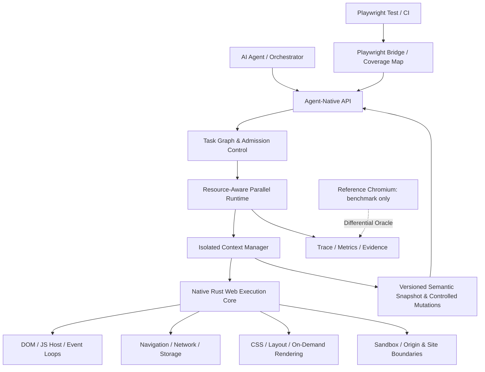
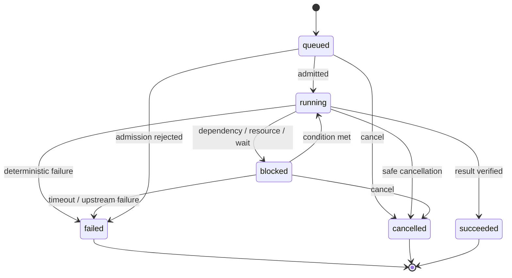

# AI 原生并行 Web 内核 — 要件定义书

> **产品定位**：Parallel-Native · Agent-Native · Web Execution Engine。内核是服务于 AI Agent 和自动化程序的 **Web 执行基础设施**，而不是取消图形界面的传统消费级浏览器。以 Rust 实现自主的核心执行模型，并围绕任务、状态、资源、隔离与自动化进行内核级设计。
>
> **文档状态说明**：本文件是可用于启动基本设计的 v1.1 自审修订草案，不宣称已实现、已通过测试或获得 IPA 认证。未明确的架构取舍在“待决策项”标出。性能数字是拟定验收目标，需在基准环境锁定后批准。

## 0. 文档治理

| 项目 | 定义 |
|---|---|
| 文档 ID | AIPWE-RD-001 |
| 版本 / 日期 | 1.0.0 / 2026-11-10 |
| 需求负责人 | 产品负责人（待指派） |
| 适用阶段 | 要件定义；作为基本设计、详细设计、UT/IT/ST、验收的上游基线 |
| 需求标识 | BR（业务目标）、FR（功能）、NFR（非功能）、IF（接口）、AC（验收）、RISK（风险）、DEC（待决策） |
| 优先级 | Must / Should / Could；Must 为相应阶段出关必要条件 |
| 发布分层 | R0 实验性原理验证、R1 安全受限的自研内核、R2 Agent/自动化可用、R3 并行优势验证、R4 扩展兼容 |
| 变更追踪 | 任何需求变更必须保留 ID、变更原因、影响范围、用例、计划测试映射和文档指纹；未执行测试不得标记“已验证” |

### 0.1 修订记录

| 版本 | 日期 | 内容 |
|---|---|---|
| 1.0.0 | 2026-11-10 | 建立 AI 专用、原生并行、自主 Web 执行、Playwright 接入、安全隔离及验收基线 |
| 1.1.0 | 2026-11-10 | 对抗式自审：修正用户边界、Playwright 实际接入路径、快照代际与副作用状态、WPT 选样、威胁模型、性能公平性和追踪测试计划 |

### 0.2 IPA 对应原则

参照 IPA 的“业务需求→系统化需求→验证/妥当性确认→追踪”思想组织：目标、使用场景、系统边界、功能/非功能、外部接口、业务规则、风险、测试与验收。**并非 IPA 官方模板、认证或完整工程生命周期全部交付。** 需求一经确认，后续工程文档按 ID 正向追踪；测试用例也须反向追踪。

## 1. 背景、问题与目标

### 1.1 现状问题

传统浏览器及其 Headless 自动化体系，以网页/进程/窗口和人工交互兼容为主要历史模型。Playwright 已拥有 Worker、BrowserContext 与 Sharding；问题不是“它不能并行”，而是多 Agent/高密度自动化工作负载需要更精细的任务生命周期、统一资源治理、可并行语义读取、可控页面变更、基于证据的执行恢复与按需视觉计算。现有工具可能通过外部调度部分解决问题，但无法使其成为新内核的内生契约。

### 1.2 业务目标

| ID | 目标 | 可测量价值 | 发布阶段 |
|---|---|---|---|
| BR-01 | AI 与自动化程序为唯一客户端类型，不交付人工浏览器 UI | 用户 API 不依赖人工 UI；无地址栏/书签/窗口管理需求 | R0 |
| BR-02 | 自主 Web 执行内核与原生并行运行时 | R1 具备 Rust 原生解析、DOM、任务执行最小闭环；非单纯 Chromium 封装 | R1 |
| BR-03 | 多 AI Agent 对同页安全协作 | 同一页面代际/快照版本多读、遵守 Web 事件语义的有序写入、冲突可观测与恢复 | R2 |
| BR-04 | 高密度多任务的资源效率 | 锁定工作负载下，吞吐/资源效率达到 R3 指标 | R3 |
| BR-05 | Playwright 可利用并行能力 | 阶段性 Bridge 能运行列明的 Playwright 测试子集，且报告覆盖度 | R2 |
| BR-06 | 安全地运行不可信页面 | 公开互联网能力必须满足隔离、权限与审计出关条件 | R1+ |
| BR-07 | 结果可审计、可重放、可比较 | 每项任务生成结构化结果、状态/错误、效果确定性及可选证据 | R2 |

### 1.3 项目成功与失败边界

成功：在**明确公布的能力集、网站集合和工作负载**上，以可证实的一致性完成 AI 浏览任务，并在并行吞吐、资源效率或 Agent 操作成本上形成优势。失败：仅把 Chromium 换个 Rust 调度外壳后自称自主内核；仅增加 Worker 数量却使单位有效任务成本升高；以错误结果换取速度；以共享数据换取隔离失效；宣称任意网站/Playwright 全功能兼容但不能举证。

## 2. 利害相关方与操作场景

| 角色 | 责任 / 期望 | 不承担的责任 |
|---|---|---|
| AI Agent（主调用方） | 声明目标、读取语义快照、提交带前置条件操作、订阅事件 | 不直接破坏其他 Agent 的状态边界 |
| Agent Orchestrator | 构造执行图、设置优先级/资源预算、治理跨 Context 任务 | 不绕过浏览器安全模型 |
| Playwright Runner | 通过已声明的 runner/fixture 适配器执行测试、获取 trace/结果 | 不假设自研引擎等同 Chromium |
| 平台管理员/CI | 配置配额、环境策略、审计和诊断 | 不通过人工 UI 浏览网页 |
| 不可信网站脚本 | 在受限 Web 运行环境中执行 | 不能获取宿主文件、其他租户、其他站点秘密 |
| 内核开发/测试团队 | 维护功能、兼容性测试与安全审查 | 不将 WPT 测试数直接当全部网页兼容性 |

### 2.1 核心用例

| ID | 场景 | 前置条件 | 结果及边界 |
|---|---|---|---|
| UC-01 | 同一页 5 个 Agent 并行读取不同区域 | 页面处于可观测快照版本 V | 各 Agent 读取一致 V，无写入竞争 |
| UC-02 | 两个 Agent 试图修改同一元素 | 都基于 V 提交动作 | 一个先提交；另一个返回冲突或按策略重新验证，不静默覆盖 |
| UC-03 | 50 个独立网页测试排队执行 | 全局 CPU/内存配额已设 | 背压、调度、独立 Context 与结果汇总 |
| UC-04 | 非视觉提取页面内容 | 已到指定生命周期/等待条件；不得假设页面静止 | 语义读取，不必绘制无用图像；需布局信息时正确计算布局 |
| UC-05 | 定位、点击、截图和回归测试 | 对应渲染/事件能力可用 | 按需视觉计算、精准事件、标准化证据 |
| UC-06 | 某页面 JS/渲染进程崩溃 | 多任务运行中 | 故障局部化，其余 Context 保持，写操作不盲目重试 |
| UC-07 | Playwright 分片测试接入 | Bridge 声明已支持的接口子集 | 同一测试集可同环境对照 Chromium 与自研引擎 |
| UC-08 | 授权访问企业站点 | 明确授权、网络策略和凭证代理 | 凭证隔离、脱敏追踪、禁止跨租户泄露 |
| UC-09 | 恶意网页文本试图诱导 Agent 泄露机密 | DOM/ARIA 含伪造系统指令 | 视为不可信数据，不获得 API 权限或秘密 |
| UC-10 | Playwright 多 Worker 操作同一后端数据库 | 浏览器 Context 互相隔离但服务端可能共享账号 | 测试数据/账号命名空间隔离，结果互不串扰 |

## 3. 系统边界与范围

### 3.1 在范围内

- Rust 自主实现的核心执行宿主：任务生命周期、Context 隔离、事件/状态调度、DOM/JS 宿主绑定、浏览器安全边界、观察/操作接口；标准能力允许复用第三方 Rust crate，须记录许可证与替换边界。
- **并行内生**：跨 Context 的可伸缩执行、多 Agent 同页 MVCC 式读快照/有序操作、跨任务共享安全可复用的只读结果、背压、可取消、预算。
- Web 子集逐步增长：网络/TLS、HTML、DOM、JavaScript、事件循环、CSS/布局、导航、存储、Fetch、Frame、截图；每项标明版本/覆盖度。
- Headless-only **运行形态**，但不是把人类浏览器隐藏 UI；语义接口是主接口。
- 原生 Rust SDK、HTTP/gRPC（待基本设计选型）、事件订阅、MCP/Agent 适配、Playwright Bridge（按覆盖度渐进兼容）。
- 安全：公开互联网打开前必须有 OS 沙箱、Origin/Site 隔离、权限/网络出口控制与审计，不因 Rust 自身内存安全而降低要求。

### 3.2 明确不在本次范围内

桌面浏览器 UI、书签/历史界面、应用商店式插件扩展、音乐/视频播放体验、DRM、打印/PDF 产品、移动浏览器外壳、人类辅助功能 UI、浏览器同步账户、绕过验证码/反机器人验证、突破网站权限或访问限制、声称兼容所有 Web 规范。注意：**无可视 UI 不等于无可访问性树**，AI 语义接口仍需要语义与可访问性基础。

### 3.3 自研边界

1. R0 可为测量和对照使用 Chromium **参考后端**，但不得把该路径宣传为自研浏览器内核成果。
2. R1 至少有自主 Rust Web 执行闭环（Network → HTML/DOM → JS 事件/操作 → 语义结果），并对受支持页面验证正确性。
3. 外部引擎组件（如 HTML parser、JS Engine、Styling/Layout）可作为库嵌入；许可证、ABI、依赖风险必须公开。
4. Playwright 桥接明确拆分为三个产品：① **Playwright Test 运行器集成**（通过自定义 fixture/测试辅助库调用原生 API，不声称浏览器 `page` 完整替代）；② **Playwright 风格 TypeScript API 子集**（公开接口差异与受支持断言/定位器）；③ **真正的原生 Playwright 浏览器连接兼容**（单独的长期研发目标，不纳入 R2 Must）。官方 `connectOverCDP` 仅支持 Chromium 系浏览器，WebDriver BiDi 接口也不会自动获得 Playwright 的完整驱动兼容。
5. R2/R3 继续按需实现浏览器渲染与交互行为；不能因“不面向人”而删除网页运行所需的布局/浏览器 API。

## 4. 原则与逻辑关系

### 4.1 不可违背的架构原则

| 编号 | 原则 | 解释 |
|---|---|---|
| P-01 | Parallel First | 任务/Context 生命周期与资源分配在内核层定义，而非外部简单并发启动 |
| P-02 | Agent First | 语义树、结构化动作、版本信息和证据优先于像素/鼠标坐标 |
| P-03 | Headless by Design | 不开发人类 UI；按 Web 语义的需要计算样式/布局，按请求进行绘制 |
| P-04 | Web Semantics First | 不通过越过事件循环、DOM 语义或同源边界来换性能 |
| P-05 | Safe Isolation First | 共享受控基础设施，隔离页面状态和不可信代码 |
| P-06 | Compatibility by Evidence | 每个 API 和网站场景有明确覆盖矩阵、差分证据与不支持错误 |
| P-07 | Backpressure over Overcommit | 调度由资源预算和 QoS 决定，禁止无上限并发 |
| P-08 | No Silent Replay of Effects | POST、支付、提交等副作用不能因故障自动重放 |

### 4.2 逻辑架构（非部署设计）



### 4.3 任务与执行状态语义

- **Task**：Agent 的外层工作请求，含目标、优先级、截止时间、预算、依赖、幂等键、权限；可跨多个页面。
- **Execution Graph**：由 Task 构成的有向依赖图；只能并行执行语义上独立的节点，禁止将网页内部有序 JS 执行任意并行化。
- **Context**：运行状态和安全策略的隔离单元（不等于 OS 进程）；对存储、凭证、网络、配额有显式边界。
- **Page/Realm/Event Loop**：遵守 Web 定义的 JS/DOM 操作时序；跨 Realm 通过规定机制通信。
- **Snapshot**：在明确一致性规则下创建的只读、带版本标识的语义投影；不是任意时刻无锁读取活动 DOM 指针。
- **Action**：有 precondition（版本、元素身份、权限）的状态变更；统一入队，允许冲突返回；重试需评估外部副作用。
- **Render Demand**：语义、布局、栅格/截图分层；省略 paint 时仍必须满足脚本读取的布局需求。

## 5. 功能需求（FR）

> 阶段标识为需求**首次必须具备**的里程碑；往后阶段应持续有效。验收方法：UT=单测，IT=集成，ST=系统，SEC=安全，PERF=性能，DIFF=差分。

### 5.1 原生任务与并行运行时

| ID | 优先级 | 阶段 | 需求（应当） | 验收证据 |
|---|---|---|---|---|
| FR-001 | Must | R0 | 接受结构化 Task（task_id、目标、上下文、优先级、deadline、配额、权限） | IT：任务 schema 校验与拒绝非法参数 |
| FR-002 | Must | R0 | Task 生命周期使用 queued/running/blocked/succeeded/failed/cancelled；另用 `effects_state` 表示 none/confirmed/uncertain，不混用两类状态 | IT：任务状态与外部效果状态正交校验 |
| FR-003 | Must | R0 | 根据依赖图仅运行就绪节点，并检测循环依赖 | UT/IT：DAG、阻塞、失败传播 |
| FR-004 | Must | R0 | 基于 CPU、RSS、并发数、I/O 预算做入场控制与背压 | PERF：超配额排队而不 OOM |
| FR-005 | Must | R0 | 支持取消、deadline、超时资源回收并向上游返回明确状态 | IT：取消后无孤儿子任务 |
| FR-006 | Should | R2 | 支持权重公平与优先级，避免短任务长期饥饿 | PERF：混合负载公平性报告 |
| FR-007 | Should | R2 | 对不同工作负载（语义/交互/视觉）使用不同调度策略 | PERF：调度选择可观测 |
| FR-008 | Must | R1 | 采用独立运行时/Context 管理，而非每次 Task 强制创建完整浏览器实例 | IT：任务与 Context 非 1:1 的验证 |
| FR-009 | Should | R3 | 支持多主机 Worker 注册、健康检查、租约与失联回收 | IT：节点失联与安全重派 |
| FR-010 | Must | R2 | 对有外部副作用的动作禁止未经确认的自动重放；状态未知时标记 `effects_state=uncertain` 并启动人工/业务对账流程 | IT：故障注入下未知效果最多一次自动提交尝试，无隐式重试 |

### 5.2 Context、Agent 协作及状态一致性

| ID | 优先级 | 阶段 | 需求（应当） | 验收证据 |
|---|---|---|---|---|
| FR-011 | Must | R1 | Context 之间隔离 Cookie、Storage、Cache 身份、权限、JS 全局对象 | SEC/IT：跨 Context 非泄露矩阵 |
| FR-012 | Must | R1 | 提供 Context 创建/销毁/租用/释放，支持回收后无残留 | IT：重复创建 1,000 次的隔离检验 |
| FR-013 | Must | R2 | 同一页面代际内可向多个 Agent 提供版本化只读语义快照；导航、Realm 销毁和 Context 重建须更换代际 | IT：并发读取版本一致性 |
| FR-014 | Must | R2 | 动作提交需携带或绑定页面代际、前置版本、目标元素身份，发现导航/重建则拒绝旧动作 | IT：版本或页面代际不匹配返回 STALE_SNAPSHOT |
| FR-015 | Must | R2 | 同一 Realm 中 Agent 操作与网页脚本写入按 Web 事件循环/任务语义提交，不能用 CAS 绕过页面内的脚本副作用 | DIFF：事件触发顺序对照 |
| FR-016 | Must | R2 | 并发写冲突必须拒绝、重验证或显式调停，禁止静默覆盖 | IT：冲突场景结果确定 |
| FR-017 | Should | R2 | 对快照提供差分（新增、删除、属性与文本变化） | IT：Diff 与全量投影一致 |
| FR-018 | Must | R1 | 隔离边界不等同于 Context，跨站执行遵循 Origin/Site 与进程沙箱策略 | SEC：跨站数据访问负例 |
| FR-019 | Should | R3 | 独立任务复用可共享只读组件或安全分区缓存 | SEC/PERF：共享不导致泄露 |

### 5.3 自研 Web 执行能力与视觉按需

| ID | 优先级 | 阶段 | 需求（应当） | 验收证据 |
|---|---|---|---|---|
| FR-020 | Must | R1 | 自研 Rust 内核提供 URL、HTTP(S)、重定向、TLS 校验与资源获取 | IT：导航及失败场景 |
| FR-021 | Must | R1 | 解析受支持 HTML 为 DOM，具备元素查询、属性和文本操作 | WPT 子集/UT：DOM 结果对照 |
| FR-022 | Must | R1 | 执行受支持 JavaScript，并实现与 DOM 的宿主绑定 | DIFF：脚本修改 DOM 的结果一致 |
| FR-023 | Must | R1 | 实现受支持事件循环、定时器、Promise/微任务和 DOM 事件时序 | DIFF：顺序测试通过 |
| FR-024 | Must | R1 | 对不支持的 Web API 返回显式 capability/error，不伪装成功 | IT：不支持清单与错误映射 |
| FR-025 | Must | R2 | 支持受控导航与页面生命周期事件、等待条件和超时 | IT：导航取消/跳转/竞态 |
| FR-026 | Must | R2 | 对支持范围内的页面，提供基础 CSS 样式、布局和几何定位 | DIFF：布局/可见性几何对照 |
| FR-027 | Must | R2 | 支持按需截图，且画面须来自正确布局/绘制管线 | DIFF：截图基准及容差 |
| FR-028 | Must | R2 | 纯语义任务可跳过不必要的 paint/raster，但不得跳过所需布局和脚本副作用 | PERF/DIFF：结果等价且 paint 减少 |
| FR-029 | Must | R2 | 支持网络 Fetch/XHR、Cookie/Storage 等所选基线 API（具体覆盖由能力矩阵锁定） | WPT 子集/IT |
| FR-030 | Should | R4 | 根据 WPT 与真实网站证据扩展 Frame、Worker、CSS、Web API 兼容性 | 新增功能差分报告 |
| FR-031 | Must | R1 | 公开互联网发布前，禁止无沙箱地直接运行不可信脚本 | SEC：违规配置无法上线 |

### 5.4 Agent 原生语义操作

| ID | 优先级 | 阶段 | 需求（应当） | 验收证据 |
|---|---|---|---|---|
| FR-032 | Must | R2 | 提供结构化语义树（角色、名称、文本、可见状态、DOM 关联） | IT：与对照页面一致 |
| FR-033 | Must | R2 | 提供稳定元素定位/重新定位语义，并提示元素失效 | IT：DOM 变动时无误操作 |
| FR-034 | Must | R2 | 提供 navigate/inspect/query/click/fill/select/wait/evaluate（受控） | IT：逐动作通过受支持用例 |
| FR-035 | Must | R2 | 动作回报包含前后版本、结果、耗时、错误和证据引用 | IT：响应字段完整 |
| FR-036 | Must | R2 | 宿主对 Agent 身份、任务权限、允许域名及操作种类执行授权 | SEC：越权全部拒绝 |
| FR-037 | Should | R2 | 支持事件订阅（DOM/网络/页面生命周期）及流式差分 | IT：订阅顺序/断线处理 |
| FR-038 | Should | R3 | 为 Agent 提供批量只读查询/压缩结构化输出，降低重复调用 | PERF：token/请求数对照 |
| FR-039 | Must | R2 | 任何状态快照声明一致性语义（版本、时间、数据覆盖范围） | IT：文档与返回匹配 |

### 5.5 Playwright 与外部自动化

| ID | 优先级 | 阶段 | 需求（应当） | 验收证据 |
|---|---|---|---|---|
| FR-040 | Must | R0 | 建立原版 Playwright+Chromium 基准工作负载，锁定浏览器/框架版本 | PERF：基准可重复运行 |
| FR-041 | Must | R2 | 提供 Playwright Test fixture 适配器 + Playwright 风格 TS API 子集，列明 Locator/等待/断言/网络/截图支持矩阵；不得混称原生浏览器驱动 | IT：逐接口覆盖报告 |
| FR-042 | Must | R2 | Bridge 对未实现功能显式拒绝，不伪造 Playwright 成功 | IT：UNSUPPORTED_FEATURE 负例 |
| FR-043 | Must | R2 | 通过自定义 fixture/TS 适配器支持测试操作子集：导航、定位、断言、表单、等待、基础网络观察；可运行的原版 Playwright 测试比例另行报告 | IT：基准 Test Suite |
| FR-044 | Should | R3 | 支持并行 Worker/CI 分片任务接入并保持每测试 Context 独立 | IT/PERF：多分片结果汇总 |
| FR-045 | Should | R3 | 以自有版本化协议为核心，BiDi 作为标准兼容目标；原生 Playwright protocol 与 Chromium CDP 兼容分别立项，不以部分命令实现宣布 drop-in | 协议 conformance 报告 |
| FR-046 | Must | R2 | 报告 Playwright npm/runner 版本、fixture/adapter 版本和支持的 API 子集；不声称无需改动即可运行全部 Playwright 用例 | 文档检查与回归测试 |
| FR-047 | Should | R2 | Trace 与测试结果可关联 task/context/page/action IDs | IT：任一失败可定位上下游 |

### 5.6 可观测性、部署与资源治理

| ID | 优先级 | 阶段 | 需求（应当） | 验收证据 |
|---|---|---|---|---|
| FR-048 | Must | R0 | 指标含有效吞吐、完成率、P50/P95、RSS、CPU 秒、排队时长 | PERF：指标定义与采集校验 |
| FR-049 | Must | R2 | 对失败输出结构化错误码和 trace_id，可采集最小证据 | IT：故障定位闭环 |
| FR-050 | Must | R1 | 任务/Context 配额含 CPU、内存、超时、网络与 artifact 限额 | SEC/PERF：配额违规隔离 |
| FR-051 | Should | R2 | 支持持久化任务元信息，但默认不落盘敏感网页正文 | SEC：落盘审计 |
| FR-052 | Must | R1 | R1 支持 Linux x86_64 受控实验/沙箱验收；Windows x86_64 限开发验证，未通过独立 Windows 沙箱验收不得用于不可信网页 | ST：平台验收清单 |
| FR-053 | Should | R3 | 提供跨机器调度接口，与宿主 Agent Orchestrator 松耦合 | IT：Worker 替换兼容 |
| FR-054 | Must | R2 | 任何中断/失败须清晰标识 `effects_state`；任务可 failed/cancelled 而效果仍为 uncertain | IT：超时 POST 标记 effects_state=uncertain 而不改写任务状态 |

### 5.7 安全、隐私和策略

| ID | 优先级 | 阶段 | 需求（应当） | 验收证据 |
|---|---|---|---|---|
| FR-055 | Must | R1 | 对不可信网页使用 OS 进程沙箱、最小权限和站点隔离策略 | SEC：逃逸/跨站测试 |
| FR-056 | Must | R1 | 正确执行 Same-Origin、CORS、CSP 等已支持安全模型；不支持时禁止危险降级 | SEC/WPT 子集 |
| FR-057 | Must | R1 | 默认禁止访问宿主内网/元数据地址，需显式授权白名单 | SEC：SSRF 用例 |
| FR-058 | Must | R1 | API 访问令牌按租户/Agent/Context 授权、轮换和撤销 | SEC：权限矩阵 |
| FR-059 | Must | R2 | 敏感字段在日志、快照、截图证据中可依策略隐藏/限制保留 | SEC：泄露扫描 |
| FR-060 | Must | R1 | 出站流量、下载、上传、WebSocket、重定向受网络与安全策略约束 | SEC：策略绕过负例 |
| FR-061 | Must | R1 | 发现引擎缺陷/沙箱失效时可禁用相关 capability 或隔离部署 | ST：故障安全关闭 |
| FR-062 | Should | R2 | 审计包含 Agent、任务、目标域、动作类型、决策，不记录原始密钥 | SEC：审计报告 |
| FR-063 | Must | R1 | 依赖组件有许可证/SBOM/漏洞处理机制，发布前审核高危风险 | SEC：SBOM 与漏洞登记 |
| FR-064 | Must | R2 | 不提供验证码规避、反机器人绕过及未授权数据访问功能 | 设计检查及 API 范围审核 |

### 5.8 自审新增的并行与可信执行需求

| ID | 优先级 | 阶段 | 需求（应当） | 验收证据 |
|---|---|---|---|---|
| FR-065 | Must | R1 | 子任务、Page、Context 的所有权/租约关系可追踪，父任务取消或超时须传播并可回收孤儿资源 | IT：取消树、租约丢失与资源回收 |
| FR-066 | Must | R2 | 同页多 Agent 的写入仲裁必须包含公平排队、动作超时及不可重入控制，禁止长期占有页面写锁 | IT：争用、饥饿和释放恢复 |
| FR-067 | Must | R2 | 快照携带 context_generation、page_generation、document_epoch 和单调版本；导航与跨文档替换强制失效旧引用 | IT：跨导航旧 locator/动作全部拒绝 |
| FR-068 | Must | R2 | 网页正文、DOM、ARIA 文本、Tool 输出均标记为不可信来源；权限判断与指令层不可被页面内容覆盖 | SEC：提示注入、工具结果注入和越权矩阵 |
| FR-069 | Must | R1 | 资源计量按租户/Agent/Task/Context 归集，CPU/RSS/网络/渲染与共享资源有明确分摊口径 | PERF：限额与账单相符，进程树无漏记 |
| FR-070 | Must | R2 | Playwright 并行测试须支持隔离外部服务器测试数据/账号命名空间，不能仅依赖 Context 私有状态 | IT：同账户与共享 DB 冲突用例 |
| FR-071 | Must | R2 | 高风险动作（提交、支付、上传、删除）须按策略要求显式授权/审批，且不得将页面内容视作授权 | SEC：恶意站点诱导执行被拒绝 |
| FR-072 | Must | R2 | Context/页面崩溃恢复不得自动重放副作用动作；仅标注为纯读取/显式幂等且经授权的动作可重试 | IT：网络断开、崩溃与重复提交测试 |
| FR-073 | Should | R2 | 对客户端开放能力发现/版本协商，运行时返回支持级别和差异提示，禁止静默降级至 Chromium 后端 | IT：特性探测与显式后端标记 |
| FR-074 | Should | R3 | 在容量不足、租户争用与长短任务混合负载中提供队列年龄、拒绝原因和公平调度诊断 | PERF：饥饿监测与配置验证 |

## 6. 非功能需求（NFR）

> 性能指标只对**锁定测试集合和硬件**有意义；不能在功能范围、成功率或沙箱不同的情况下比较。目标采用 R2 可靠性门槛和 R3 优势门槛两层。所有数值为建议基线，进入基本设计前须以实测确认。

| ID | 类别 | 阶段 | 拟定验收要求 | 测量方法 |
|---|---|---|---|---|
| NFR-001 | 正确性 | R1 | R1 预注册固定 WPT 子集：按 HTML/DOM/JS/事件类别各至少 1 个可执行套件，已支持集合通过率 ≥95%，并披露整个候选集支持覆盖率及独立留出集；跳过/预期失败不可计为通过 | 冻结 manifest/commit + WPT harness + 留出集 CI，报告 pass/fail/skip 总分母 |
| NFR-002 | 任务正确性 | R2 | 预注册受控任务集（至少语义/表单/视觉/混合各 1 类），完整可比任务成功率 ≥98%；不支持、跳过和超时计失败，逐类列样本数 | 独立基准 oracle / 重复 3 轮 |
| NFR-003 | 吞吐 | R3 | 预注册 A–E 同一组可比任务、相同安全策略且全量计失败；16/32 Context 至少一档有效吞吐 ≥ Chromium 基线 1.20×，并公布全部档位与逐类表现 | 双后端 A/B，报告全部档位 |
| NFR-004 | 资源 | R3 | 在吞吐优势档位，单位有效任务 CPU 秒或峰值 RSS 至少一项改善 ≥15%，另一项恶化不超过 10%；峰值 RSS 必须包含所有子进程/代理，且成功率和完整任务覆盖均不低于对照 | 同机器、同负载、同沙箱、同任务语义；进程树总 RSS 与 CPU 秒/成功任务 |
| NFR-005 | 响应 | R2 | 所选受控轻量测试集的语义查询 P95 ≤500ms（不含页面网络等待） | 记录查询起止与队列耗时 |
| NFR-006 | 隔离 | R1 | 已定义跨租户、跨 Context、跨 Origin 攻击测试零成功泄露 | 安全矩阵/故障注入 |
| NFR-007 | 稳定性 | R2 | 8/16/32 并发持续 60min，非预期 runtime 崩溃率 =0 | 混合压力 + 内存检查 |
| NFR-008 | 容错 | R2 | 单个页面崩溃不导致其他隔离 Context 的测试丢失 | 杀进程注入实验 |
| NFR-009 | 回收 | R2 | Context 释放后私有存储不可被下一租户读取；无持续线性内存增长 | 1,000 次复用与泄露测试 |
| NFR-010 | 可观测 | R2 | 100% Task 终态含状态、耗时、错误或成功、trace_id | Trace schema 验证 |
| NFR-011 | 可重复 | R2 | 同版本同输入 fixture 在规定非确定性约束下输出稳定；外部网络须标记变化来源 | 重复运行差分 |
| NFR-012 | 安全 | R1 | 面向公开互联网启用前安全威胁评审、沙箱和网络边界必过，不允许例外绕过 | 独立审查记录 |
| NFR-013 | 兼容 | R2 | Playwright Bridge 的每个“已支持”API 用例通过率 ≥98%；覆盖度单独公布 | Bridge conformance 清单 |
| NFR-014 | 可维护 | R1 | 每个 Must 需求至少 1 个计划测试 ID 和预期证据；执行前均标记“未执行”，实施后须补充链接与结果 | 需求矩阵校验脚本 |
| NFR-015 | 可移植 | R2 | 支持 Linux x86_64 生产基线；Windows x86_64 作为开发/验收目标 | CI 构建/运行/沙箱审查 |
| NFR-016 | 成本 | R3 | 按有效任务计算 CPU·s、GB·s、Agent tokens 和外部请求次数 | 统一资源账单口径 |
| NFR-017 | 运维 | R2 | 资源耗尽时有界拒绝或排队，禁止无限积压/OOM | 超载故障测试 |
| NFR-018 | 供应链 | R1 | 输出 Rust 依赖锁、SBOM、许可证和构建指纹 | CI 产物审查 |
| NFR-019 | 数据保护 | R2 | 凭证不出现在常规日志；敏感 artifacts 默认禁用或有限保留 | 注入伪密钥检测 |
| NFR-020 | 测试可信度 | R3 | A/B 报告包含硬件、OS、沙箱、版本、样本数、置信区间或波动区间与失败明细 | 审核基准报告 |

### 6.1 自审新增非功能要件

| ID | 类别 | 阶段 | 拟定验收要求 | 测量方法 |
|---|---|---|---|---|
| NFR-021 | 正确性覆盖 | R2 | 受支持能力覆盖率与通过率分别披露；冻结候选集、未实现数、跳过数、独立留出集结果，禁止仅报子集高通过率 | CI/WPT 公开明细和 blind holdout |
| NFR-022 | 调度公平 | R3 | 混合长短任务/不同租户负载下，所有被接纳且资源可满足的任务在定义时限内获服务；报告 P99 队列等待与饥饿事件 | 压测至少 3 轮和公平性报告 |
| NFR-023 | 基准统计 | R3 | 对照使用锁定顺序随机化 A/B 实验、至少 5 轮测量、95% 置信区间；性能优势需在主要重复样本中保持方向一致 | 原始日志、效应量和置信区间 |
| NFR-024 | 模型成本 | R3 | Agent token 成本比较固定目标模型、tokenizer、提示词、输出准确度、工具往返；包含解码/schema 的总成本 | Token 账单和误差核对 |

### 6.2 基准测试实验设计

**固定**：同一台机器（CPU 核、内存、GPU、磁盘与网络）、同一 Linux/Windows 配置、同一任务语料、浏览器/框架版本、沙箱策略、网络录制或可控服务端、超时和重试政策。**变化**：执行后端、并发档位 1/8/16/32/64、语义/表单/视觉/混合工作负载。R3 性能主结论每种至少 5 次独立重复、随机化执行次序，并报告中位数、P95、95% 置信区间、分布与所有失败；早期探索性实验允许 3 次但不得用于宣称优势。有效吞吐 = **预注册任务集内成功且语义正确的任务数 / 墙钟秒数**；统计从第一项任务入队开始，到全部任务终结为止，包含初始化/排队/失败/重试开销，不得剔除不支持任务。失败、跳过、降级不能计入成功。64 并发为压力测试目标，不强制全档性能获益。

任务池分层：A 静态内容/表格提取；B 受控 SPA DOM 交互；C 多页面登录状态与表单；D 几何/截图；E 多 Agent 同页读写冲突；F 跨站安全负例；G 重试/中断/外部副作用。R3 对照必须覆盖 A–E，并在**两后端都具有等价且通过准确性验收的任务**上比较；同时公开 A–E 完整候选任务的实现覆盖率，不能删除困难任务制造优势。E 类需要用功能等价的外部 Agent 协作层作为 Chromium 对照。F、G 是安全/可靠性门槛而非吞吐加分项。

## 7. 外部接口需求（IF）

| ID | 对象 | 方向 | 契约要求 | 首次阶段 |
|---|---|---|---|---|
| IF-001 | Agent Native API | 入/出 | Task、Context、Page、Snapshot、Action、Evidence 版本化 JSON schema | R0/R2 |
| IF-002 | Event Stream | 出 | 带 seq、timestamp、task_id、context_id、page_id 的有序事件 | R2 |
| IF-003 | Rust SDK | 入/出 | 同一语义的本地接口；不绕过授权/隔离 | R1 |
| IF-004 | Playwright Bridge | 入/出 | Playwright Test 自定义 fixture/runner 集成与 Playwright 风格 TS API 子集分别登记；版本与适配程度公开，不默认 native driver | R2 |
| IF-005 | WebDriver BiDi | 入/出 | 以 W3C Working Draft 为演进依据，模块级实现清单 | R3 |
| IF-006 | CI/Orchestrator | 入/出 | 批量提交、取消、结果/trace 下载、资源配额 | R2 |
| IF-007 | Network Policy | 入 | 允许域名/内网控制/代理与证书策略 | R1 |
| IF-008 | Metrics/Logs | 出 | Prometheus/OpenTelemetry 兼容形式（最终映射待基本设计） | R2 |
| IF-009 | Capability Discovery | 入/出 | `engine_id`、`backend`、`engine_version`、`protocol_version`、`support_level` 与不支持原因，避免静默回退 | R2 |

### 7.1 示例请求契约（逻辑结构，非最终协议）

```yaml
api_version: aiweb/v1
request_id: req_001
agent_id: agent_readonly_01
task:
  id: task_001
  kind: inspect
  priority: normal
  timeout_ms: 30000
  budget:
    max_cpu_ms: 5000
    max_rss_mb: 256
  context:
    isolation: fresh
    allowed_origins:
      - https://example.org
  page:
    navigate: https://example.org
  operation:
    action: snapshot
    projection: semantic
    consistency: snapshot_at_boundary
    trust_policy: untrusted_page_content
```

**返回字段要求**：`request_id`、`task_id`、`status`、`context_id`、`page_id`、`snapshot_version`、`page_generation`、`document_epoch`（如适用）、`result`、`trace_id`、`capabilities_used`、`errors[]`、`effects_state`、`engine_id`、`backend`。页面写操作必须具有 `precondition.snapshot_version`、`page_generation` 与 `document_epoch`（或由服务端明确锁定等价前置条件），失败不可默默忽略。

### 7.2 最小错误码体系

`INVALID_REQUEST`、`POLICY_VIOLATION`、`PERMISSION_DENIED`、`UNSUPPORTED_FEATURE`、`CONTEXT_NOT_FOUND`、`STALE_SNAPSHOT`、`CONFLICT`、`TIMEOUT`、`RESOURCE_EXHAUSTED`、`NAVIGATION_FAILED`、`SANDBOX_FAILURE`、`EFFECT_UNCERTAIN`、`INTERNAL_ERROR`。每个错误包含是否安全重试、发生阶段、关联 trace_id；**未知外部副作用不标记为可自动重试**。

## 8. 信息/状态与生命周期要件

### 8.1 主要实体

| 实体 | 主键 | 重要字段 | 保留原则 |
|---|---|---|---|
| Task | task_id | owner、type、priority、deadline、budget、state | 策略控制；可重放元信息 |
| TaskNode | node_id | task_id、dependency_ids、effect_class、state | 记录依赖边与阻塞原因 |
| Context | context_id | tenant/agent、origin_policy、quota、lease、generation | 销毁后不能跨租户复用秘密 |
| Page | page_id | context_id、url、realm_id、page_generation、document_epoch、lifecycle | 同源与隔离边界映射 |
| Snapshot | snapshot_id | page_id、page_generation、document_epoch、version、projection、consistency、timestamp | 按 TTL 保留，防长驻膨胀 |
| Action | action_id | agent_id、target、precondition、effect_class、effects_state、result | 可审核，变更需顺序化 |
| Artifact | artifact_id | trace、screenshot、privacy_class、retention | 默认限制敏感内容 |
| Capability | capability_id | engine_version、feature、support_level、evidence | 可机器查询的支持矩阵 |

### 8.2 任务状态机



**正交的副作用状态**：`effects_state = none | confirmed | uncertain`，与 Task 的 `succeeded | failed | cancelled` 等生命周期状态分离。外部副作用可能已发生但调用超时，此时即便 Task 为 `failed`，`effects_state` 也必须保持 `uncertain` 并禁止自动重试。

**状态一致性说明**：Web 页面内部可能发生异步网络与脚本变化，`snapshot_at_boundary` 表示在明确可观测的运行时边界采集一份逻辑一致投影，不保证页面世界永久静止。跨 Context/站点不承诺分布式全局一致快照。对外部世界（支付、发消息等）无法实现一般性的 exactly-once，必须传达未知结果并要求业务对账。

## 9. 安全与威胁模型

安全边界依次为：外部 API 调用者 → Agent 权限 → Task/Context → Web Origin / Site → 不可信页面脚本 → OS 进程沙箱 → 宿主文件/网络/密钥。不得把 Rust memory safety 视为沙箱替代品。

| 威胁 | 必需防护 | 防护失败处理 |
|---|---|---|
| 恶意页面逃逸到宿主 | 低权限进程、OS 沙箱、系统调用/文件/网络限制 | 禁用公开网页能力，阻止上线 |
| 跨站/跨租户数据窃取 | Site/Origin 隔离、凭证分区、网络响应验证 | 熔断相关执行环境，保全审计 |
| Agent 越权访问 | Agent/tenant ACL、域名和动作白名单 | 拒绝并记录事件 |
| 恶意网页诱导 Agent 执行指令（Prompt Injection） | DOM/ARIA/网页正文/工具结果标注不可信；能力与批准不可由页面内容升级 | 阻断越权动作并记录证据 |
| 外部共享数据库/账号造成测试串扰 | 每测试资源命名空间、租户/账号隔离、测试后清理 | 失败用例隔离并回收资源 |
| SSRF/内网探测 | 出站解析与重定向每跳 IP 策略、私网默认拒绝 | 中止连接，记录策略拒绝 |
| 资源耗尽/死循环 | CPU/RSS/时间/网络预算，进程杀限 | 局部停止并释放资源 |
| 秘钥与个人信息泄露 | 秘钥代理、日志脱敏、artifact TTL/加密/ACL | 阻断导出、审计与撤销 |
| 重复提交/外部效果 | 副作用标记、幂等键、未知效果状态 | 人工/上游业务核查后重试 |
| 依赖投毒/供应链风险 | SBOM、锁文件、来源审核与漏洞处理 | 停止发布/回滚 |

**访问合规**：只对授权的站点与数据进行自动化。项目不提供规避 CAPTCHA、反爬机制、网站封禁或访问权限的能力。

## 10. 阶段实施边界及出关（Acceptance Gates）

| ID | 版本 | 可交付能力 | 出关条件（必须） |
|---|---|---|---|
| AC-00 | R0 | Task Graph + 调度/配额实验平台；Chromium 仅对照 | 能复现基线、DAG/背压/取消、安全策略设计已定义；不宣称原生内核已完成 |
| AC-01 | R1 | 自研 Rust 原生最小 Web 执行闭环；受限场景 | HTML/DOM/JS 绑定/事件闭环、能力矩阵、受控 fixture；安全边界通过；公开网站仅在沙箱验收后开放 |
| AC-02 | R2 | Agent 语义读取/受控变更、Context 隔离、按需视觉和 Playwright 子集 | UC-01—UC-10 对应的已支持场景、NFR-002/005/007/008/009/010/013 和安全 Gate |
| AC-03 | R3 | 规模化并行优势 | 固定 A–E 任务、16/32 并发至少一档满足 NFR-003 与 NFR-004；不降低成功率和安全性 |
| AC-04 | R4 | 兼容扩展 | 新增 WPT/真实网站覆盖均有能力 ID、差分结果和回归测试；未支持项公开列明 |

### 10.1 必须验收的主要实验

| 场景 | 方法 | 通过标准 |
|---|---|---|
| 同页多读单写 | 5 个 Agent 并发快照、2 个 Agent 同时写 | 读版本一致，冲突显式，DOM/事件语义不乱序 |
| 跨租户残留 | 1,000 次 Context 释放/复用，植入不同密钥 | 0 次读取他租户密钥，资源可回收 |
| 任务调度 | 1/8/16/32/64 档，混合 CPU/网络/视觉压力 | 16/32 达 R3 目标；超限有背压，不能 OOM |
| 视觉优化 | 同页面语义提取 vs 布局/截图 | 输出语义等价，省略绘制有性能证据 |
| Web 行为差分 | 预注册 WPT 测试集、留出集及受控 SPA 站点 | 已支持的规范行为与对照一致，异常可解释 |
| Playwright 接入 | Bridge 回归清单的 Locator/等待/表单/网络操作 | TS fixture/adapter 已支持接口 ≥98% 通过；报告原版 Playwright 脚本可运行比例，不能混淆 |
| 崩溃与副作用 | 杀掉子进程并模拟 POST 超时 | 其他 Context 存活，未知效果不自动重发 |
| 安全 | 同源、跨站、SSRF、Prompt Injection、文件系统、密钥泄露 | 安全负例 0 次成功，公开浏览前沙箱门槛达成 |

## 11. 风险、约束及应对

| ID | 风险 | 严重度 | 对策 / 终止标准 |
|---|---|---|---|
| RISK-01 | JS/DOM/CSS/Web API 兼容成本远高于预期 | 极高 | 限定可测试 Web 子集；WPT 分域推进；超期则保持清晰能力边界 |
| RISK-02 | 自研引擎误认为 CDP 接口即可直接 Playwright drop-in | 高 | 独立 Bridge+驱动版本矩阵，明确非 Chromium CDP 限制 |
| RISK-03 | 共享优化造成跨 Context 信息泄露 | 极高 | 先隔离再优化；风险共享缓存需安全审查 |
| RISK-04 | 内核并行破坏 Web 事件与脚本顺序 | 极高 | 单 Realm 有序语义；并行限制在独立任务及只读投影 |
| RISK-05 | 完全去绘制导致布局和可见性错误 | 高 | Layout 与 Paint 分开控制，按需保证 API 可见性语义 |
| RISK-06 | AI 多 Agent 代码变更引发架构漂移 | 高 | 稳定 crate API、schema、契约测试、模块所有权与审查 |
| RISK-07 | 假性性能优势来自弱沙箱、少功能或较低正确性 | 极高 | 同 workload、同安全基线、同成功标准，对照条件完整公开 |
| RISK-08 | 非幂等任务重试导致真实业务损失 | 极高 | 未知效果状态、默认禁止自动重放、外部业务对账 |
| RISK-09 | Windows 与 Linux 沙箱行为差异 | 高 | Linux 先生产基线；Windows 逐项实现，不默认同等安全 |
| RISK-10 | 第三方 Rust 组件许可证或维护风险 | 中 | SBOM、许可证矩阵、接口封装、依赖替换设计 |
| RISK-11 | WebDriver BiDi Working Draft 演进 | 中 | 版本化协议适配、能力矩阵、回归锁定 |
| RISK-12 | 平台兼容性目标扩张导致个人项目失控 | 极高 | R1/R2 指标优先；超出范围进入 R4 候选清单 |
| RISK-13 | Playwright fixture 兼容被误称原生 Playwright 驱动兼容 | 极高 | runner、TS API、wire protocol 三层分别验收与版本管理；明确“不支持原样零改动” |
| RISK-14 | 页面代际失效导致 Agent 将旧快照操作应用于新文档 | 极高 | context/page/document 代际检查，导航强制使旧引用失效 |
| RISK-15 | 网页内容提示注入诱导 Agent 泄漏凭证/越权操作 | 极高 | 信任标签、工具/内容分离、高风险动作授权、对抗样例测评 |

## 12. 待决策项（须在基本设计前冻结）

| ID | 议题 | 推荐默认 | 冻结条件 |
|---|---|---|---|
| DEC-01 | 初始目标页面集合 | 受控静态/SPA/表单 + 小规模授权真实站点 | 给出 fixture 版本与名单 |
| DEC-02 | JS 引擎及 host binding | 选 Rust 可嵌入引擎，POC 验证微任务/DOM 绑定 | 许可证、事件正确性与性能实验 |
| DEC-03 | 解析/Styling/Layout 组件 | 优先可复用成熟组件，禁止提前自造完整 CSS | API/兼容性/维护成本评审 |
| DEC-04 | OS 沙箱与部署优先级 | Linux x86_64 首先生产化；Windows 开发/测试 | 威胁模型与安全实测 |
| DEC-05 | Agent API 传输 | Rust 原生 + JSON schema；HTTP/gRPC 再选 | 可观测性与背压 POC |
| DEC-06 | Playwright 接入形态 | 先 Bridge 子集，不承诺原生 drop-in；BiDi 作为标准化方向 | Playwright 具体版本与测试范围 |
| DEC-07 | 性能基线硬件和成功语料 | 固定一台开发机与 CI 配置分别测量 | A/B 测试环境和样本冻结 |
| DEC-08 | 快照一致性与锁粒度 | 运行时安全点采集、版本化只读投影、写入前置校验 | 同页读写冲突契约评审 |
| DEC-09 | 网络、代理、凭证系统 | 最小授权；禁止内网默认出口 | 运维/安全策略确认 |
| DEC-10 | R1 公共互联网开放策略 | 默认关闭，只对 fixture/授权站点开启 | OS 沙箱、安全门槛记录 |
| DEC-11 | Playwright 适配验收分层 | R2 runner fixture + TS API 子集；native driver 需独立立项 | 具体 npm 版本、可运行测试和功能差异冻结 |
| DEC-12 | 兼容覆盖率统计分母 | 冻结 WPT manifest/真实任务基准及独立留出集 | 基准冻结并公开所有 skip/unsupported |
| DEC-13 | 跨 Agent 的副作用、权限和信任策略 | `effects_state` 正交；页面内容不可信；高风险动作审批 | API 状态机/安全审查通过 |

## 13. 需求追踪与变更治理

- 将 `FR-*` / `NFR-*` / `BR-*` / `IF-*` 的 ID 保持跨版本稳定；删除时标为废弃，不重新使用。
- 基本设计模块须列对应需求 ID；详细设计/实现提交须引用设计与需求 ID；UT/IT/ST 的测试用例须能反查到每项 Must 需求。
- 每次变更执行“兼容性、安全性、资源效率、Playwright Bridge、测试覆盖、Agent 信任边界”六维影响评估。
- 文档指纹：UTF-8 正文内容中 **移除 `fingerprint: ...` 整行**，对其余原字节计算 SHA-256；这一方法避免自引用。xlsx 的“总览”同步记录该指纹，以便后续版本关联。
- 默认验收失败采取 fail-closed：不能以“仅演示”“仅 AI 使用”为理由关闭安全测试；未实现功能需返回显式错误。

## 14. 术语表

| 术语 | 定义 |
|---|---|
| Agent-Native | 以 AI Agent 为优先调用者，并允许 Playwright/CI 等机器客户端使用同一服务；不以人类鼠标/像素为唯一入口 |
| Parallel-Native | 将并行调度、资源配额、状态/隔离/冲突语义定义在执行内核中 |
| Headless by Design | 从架构层不交付浏览器 UI；与传统 UI 浏览器隐藏窗口的 Headless 模式不同 |
| Task Graph | 任务与依赖关系组成的有向执行图，须兼顾副作用与依赖顺序 |
| BrowserContext | 浏览器状态隔离的逻辑单位，不必与 OS 进程 1:1 对应 |
| Realm | JavaScript 执行环境；其事件与共享状态须遵循 Web 语义 |
| Semantic Snapshot | 按明确定义的一致性边界读取的带版本只读语义投影 |
| Bridge | 对接现有自动化框架的协议/SDK 适配层，不等于内核本体 |
| WPT | Web Platform Tests，跨浏览器 Web 标准兼容性测试项目 |
| Chromium Oracle | 基准参考浏览器，只用于差分、性能对照及过渡实验，不认定为自主内核 |

## 15. 对抗式自审结论与剩余限制（2026-11-10）

| 审查项 | 初版缺陷 | v1.1 修订 | 剩余限制/处理方式 |
|---|---|---|---|
| 边界 | AI 唯一用户与 Playwright/CI 客户端矛盾 | 机器客户端为唯一类型，AI 优先 | 无人类 UI，不等于禁止开发人员操作 CLI |
| Playwright | Bridge 被误读为原生替换 | fixture/TS API/driver 三层分别定义 | R2 不能承诺零改动跑既有测试 |
| 同页并发 | 快照版本未覆盖跨导航引用 | 增加 Context/Page/Document 代际与执行顺序 | 不是通用事务型 DOM，也不承诺脚本暂停 |
| 副作用 | `unknown_effect` 错当 Task 终态 | 独立 effects_state | 无法为外部网站提供 exactly-once 保证 |
| 安全 | 缺少 Prompt Injection 和外部测试数据串扰 | 引入信任标签、权限审查和服务端数据隔离 | 不可信内容仍需动态对抗评估 |
| 兼容性 | 自选 WPT 子集易形成选择偏差 | 预注册 manifest、留出集与全分母披露 | 初期只承诺受控范围，不是全 Web 标准 |
| 性能 | 可能用少做功能/弱隔离产生假优势 | 同语义/同安全条件、进程树计量、统计区间 | 达成率目标须在 DEC-07 后以真实测量确认 |
| 追踪 | 没有初始计划测试 ID | 配套矩阵生成拟定测试 ID，保持未执行 | 基本设计及 UT/IT/ST 仍需形成测试脚本 |

**审查判定：有条件通过要件结构审查，尚未批准投入不可信互联网生产部署。** 本文档没有实际运行内核/Playwright/WPT 测试，也不代表通过了安全渗透测试。未关闭事项按 DEC 与 RISK 追踪；不得将自审视为独立第三方验收。

## 16. 依据与参考（2026-11-10 核验）

1. 日本 IPA，《ユーザのための要件定義ガイド 第2版》：https://www.ipa.go.jp/archive/publish/qv6pgp0000000wrt-att/000079352.pdf
2. Playwright Test 并行：https://playwright.dev/docs/test-parallel
3. Playwright Test 隔离：https://playwright.dev/docs/browser-contexts
4. Playwright Test Sharding：https://playwright.dev/docs/test-sharding
5. Playwright BrowserType / connectOverCDP 限制：https://playwright.dev/docs/api/class-browsertype
6. W3C WebDriver BiDi Working Draft（2026-11-06）：https://www.w3.org/TR/webdriver-bidi/
7. WPT 官方文档：https://web-platform-tests.org/
8. Chromium 进程模型与站点隔离：https://chromium.googlesource.com/chromium/src/+/main/docs/process_model_and_site_isolation.md
9. WHATWG HTML Living Standard：https://html.spec.whatwg.org/

---

**审查声明**：已将“AI 优先、机器客户端专用”“自主 Rust Web 内核”“内核级并行”“Playwright 并行便利”“不是传统 Headless”“安全和可验证兼容性”转化为编号需求、验收证据、风险和发布门槛。**尚未进行实现、执行测试、用户签署或真实性能测量。**
